# Safe Ticket

<p align="center">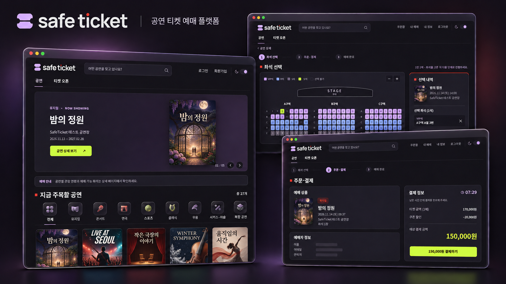</p>

> 인기 공연 오픈 순간의 트래픽을 대기열로 줄이고, 좌석이 두 번 팔리지 않게 막고, 결제 결과를 모를 때도 예매를 끝까지 정리하는 공연 티켓 예매 서비스입니다.
>
> 공연 검색·회차 조회와 좌석 배치도, 선착순 쿠폰 발급과 할인 적용, 판매자 공연 등록과 정산, PG 정산 대사·환불·지급을 다루는 관리자 운영까지 공연 예매의 전 과정을 제공합니다.

## 목차

1. [프로젝트 소개](#프로젝트-소개)
2. [기술 스택](#기술-스택)
3. [아키텍처](#아키텍처)
4. [예매 흐름](#예매-흐름)
5. [기술적 고민과 해결](#기술적-고민과-해결)
6. [주요 기능](#주요-기능)
7. [화면](#화면)
8. [팀원](#팀원)
9. [문서](#문서)
10. [개발 안내](#개발-안내)

## 프로젝트 소개

- **기간**: 2026.10.23 \~ 2026.11.18 (약 4주)
- **인원**: 6명
- **목표**
  - 공연 오픈 순간 몰리는 요청을 대기열로 나눠 받아 예매 서버를 보호합니다.
  - 같은 좌석을 두 사람이 동시에 잡지 못하게 하고, 결제하지 않은 좌석은 제때 풀어 줍니다.
  - 결제 승인 결과가 늦거나 유실되어도 예매·좌석·쿠폰 상태가 어긋나지 않게 맞춥니다.
  - 부하 측정으로 병목을 찾고, 숫자로 개선을 확인합니다.

## 기술 스택

| 분류 | 기술 |
|---|---|
| Backend | Java 17, Spring Boot 3.5, Spring Cloud 2025.0 (Gateway, Eureka, Config, OpenFeign), Spring Data JPA, QueryDSL, Spring Batch, Spring Kafka, Resilience4j |
| Data | PostgreSQL 16, Redis 7.4, Kafka |
| Frontend | React 18, TypeScript, Vite, TanStack Query |
| Infra | AWS EC2·ECR·S3·SSM, Docker Compose, Caddy, GitHub Actions |
| 모니터링·측정 | Prometheus, Grafana, Alertmanager, k6 |
| 테스트·품질 | JUnit 5, Testcontainers, ArchUnit, Spotless, Checkstyle |

## 아키텍처

### 인프라 설계도

<p align="center">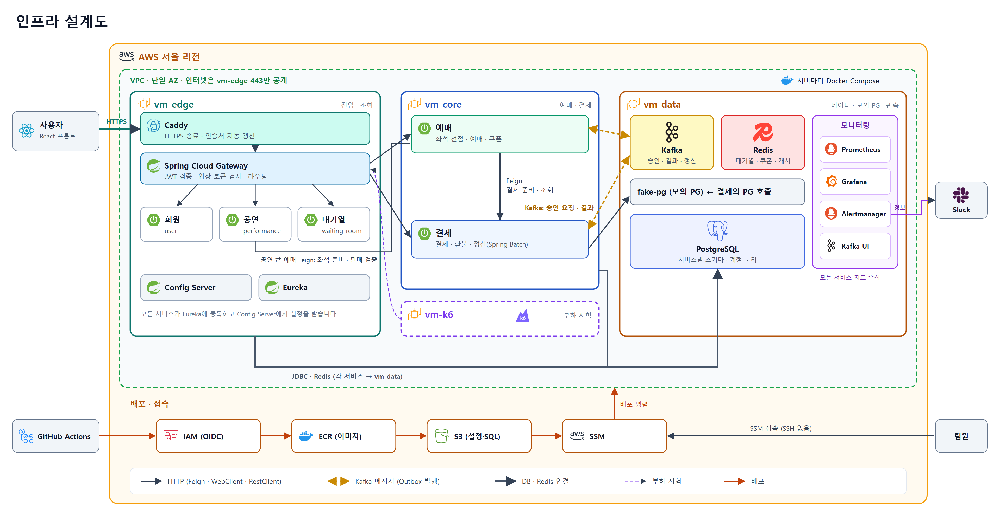</p>

### 시스템 구조도

<p align="center">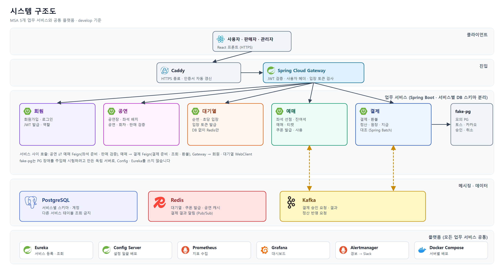</p>

### 서비스 통신 구조도

<p align="center">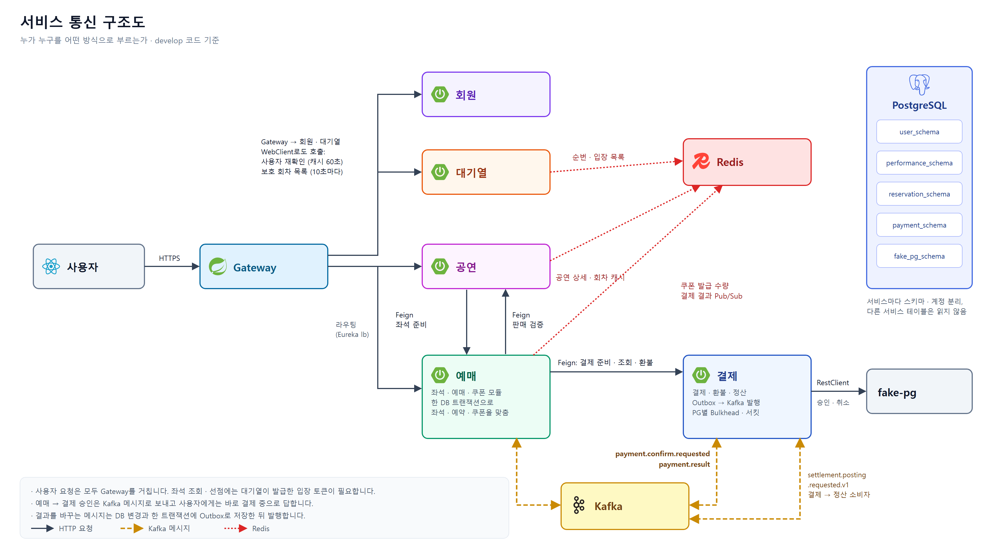</p>

### 서비스 역할

| 서비스 | 역할 |
|---|---|
| gateway-service | 외부 진입점. JWT 검증, 검증된 사용자 헤더 전달, 좌석 조회·선점의 입장 토큰 검사, 내부 API 차단 |
| user-service | 회원·인증·역할 |
| performance-service | 공연장·좌석 등급과 배치·가격·회차·판매 검증, 공개 조회 캐시(Redis) |
| waiting-room-service | 대기열·순번·입장 토큰 (Redis만 사용, 예매 서버와 자원 분리) |
| reservation-service | 좌석 선점·좌석 상태 조회(seat), 예매·티켓·결제 조정(booking), 쿠폰(coupon) |
| payment-service | 결제·환불·PG 호출·결과 확인·정산 |
| fake-pg | 토스페이먼츠 API를 흉내 낸 테스트 PG. 지연·실패·응답 유실 같은 장애를 주입 |
| config-server · eureka-server | 설정 배포, 서비스 등록·조회 |

- 서비스마다 DB 계정과 스키마를 나누고, 다른 서비스 데이터는 API로만 받습니다.
- 좌석·예매·쿠폰은 같은 서비스 안에서 한 트랜잭션으로 맞춥니다.

## 예매 흐름

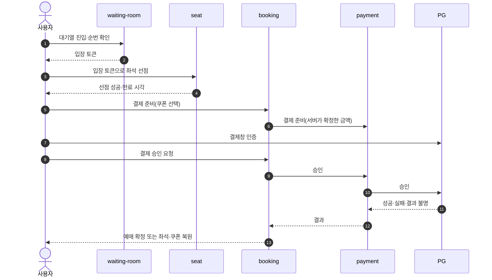

## 기술적 고민과 해결

> 측정값은 모두 로컬 Docker 환경에서 같은 조건끼리 비교한 값이며, 운영 수치가 아닙니다.

### 🎭 공연

**기술적 의사결정**

- **조건이 고정인 조회는 JPQL, 조건이 바뀌는 목록은 QueryDSL**: 공연 ID만 바뀌는 상세 조회도 QueryDSL은 요청마다 조회식을 새로 조립했습니다. 상세·회차·판매 검증의 고정 조회를 JPQL로 옮겨 상세 조회의 호출당 객체 할당이 약 72% 줄었습니다(SQL 3개 → 2개 통합 포함).
- **SQL 재작성 대신 부분 인덱스와 플래너 설정**: 기본 목록 대상은 수백 개인데 DB가 공연 약 7만 개를 전부 읽었습니다. 공개 공연·활성 회차 부분 인덱스를 추가하고 공연 서비스 연결에만 `random_page_cost=1.1`을 적용했습니다. 재작성 SQL은 효과가 없어 되돌렸고, 기본 최신순의 요청당 SQL 시간이 43.5ms에서 1.35ms로 줄었습니다.
- **Elasticsearch 대신 검색용 텍스트 컬럼과 trigram 인덱스**: 제목·출연진·공연장명을 정규화해 한 컬럼에 모으고 DB 트리거로 채워, SQL 시드·이행 경로에서도 값이 어긋나지 않게 했습니다. 판매종료 포함 3글자 검색의 요청당 SQL 시간이 165.6ms에서 10.1ms로 줄었습니다.
- **캐시 스탬피드는 서버 안 조회 공유로 막고 분산 잠금은 도입하지 않음**: 캐시가 빈 순간 같은 공연 요청이 몰리면 첫 요청만 DB를 읽고 나머지는 그 결과(`CompletableFuture`)를 기다립니다. 한 공연에 3,000 RPS를 보내며 Redis를 비워도 DB 조회는 1번, 오류는 0%였습니다.
- **좌석 준비는 Kafka 대신 제한된 비동기 실행기와 DB 재시도**: 회차 등록이 좌석 준비 응답을 기다려, 좌석이 2초 늦으면 회차 50개 가격 설정이 약 53.6초 걸렸습니다. 회차를 PENDING으로 커밋하고 바로 응답한 뒤 실행기(스레드 1개, 큐 200건)가 좌석을 호출하고, 큐가 차거나 실패하면 DB에 남은 PENDING을 스케줄러가 다시 처리합니다. 실제 좌석 서비스와 연동한 1,000석 회차 등록 응답은 29\~79ms였습니다.

**트러블슈팅**

| 문제 | 해결 | 결과 |
|---|---|---|
| DB 연결 대기가 쌓여 DB 병목으로 보였지만, 원인은 다른 서비스와 나눠 쓰던 CPU | 코드·연결 풀은 그대로 두고 공연 서비스에 전용 CPU 2개를 배정해 대조 | 연결 대기 최대 125 → 0, 공연 API p99 약 1.3\~1.5초 → 0.1초 |
| 상세 SQL을 3개 → 2개로 줄였는데 객체 할당이 오히려 약 54% 증가 | 조회 도구 변경과 SQL 통합의 효과를 나눠 비교한 뒤 고정 JPQL로 전환 | 호출당 할당 SQL 3개 유지 시 -65%, 2개 통합 시 -72% |
| trigram 인덱스 적용 뒤 반복 검색에서 generic 실행 계획으로 바뀌어 기본 상태 검색이 느려짐 | 키워드 검색 트랜잭션에만 custom 실행 계획 강제 | 판매종료 포함 검색 165.6ms → 10.1ms, 기본 상태 검색은 2.83ms → 4.90ms 회귀를 알고 수용 |
| 좌석은 저장됐는데 응답 지연·프로세스 종료로 공연 회차가 FAILED로 남음 | 결과 불명(`RESULT_UNKNOWN`)을 따로 저장하고 같은 요청 ID로 결과 확인(자동 3회, 이후 운영자 명령) | 이미 만들어진 좌석을 확인해 READY로 복구, 성공을 추측해 바꾸지 않음 |
| 공연장명 변경과 새 공연 등록이 겹치면 검색용 값에 옛 공연장명이 남음 | 공연 등록·공연장 이동 때 공연장 행을 `FOR SHARE`로 읽어 이름 변경 커밋을 기다림 | `pg_blocking_pids`로 실제 대기를 확인한 동시성 시험 통과 |

---

### ⏳ 대기열

**기술적 의사결정**

- **대기열 서비스를 예매 서버에서 분리**: 분리 전에는 2만 명이 진입한 10초 동안 대기열과 무관한 예매 API p95가 5ms에서 약 1.4초로 느려졌습니다. 스레드를 늘려도 CPU가 이미 한계라 효과가 없어, 대기열을 `waiting-room-service`로 분리했습니다.
- **Redis Sorted Set + Lua로 대기 줄과 입장 처리**: `INCR` 번호를 score로 써서 순번이 겹치지 않게 했습니다. 진입과 입장을 Lua 한 번으로 처리해, 같은 사용자의 동시 요청이나 서버 여러 대에서도 순서와 입장 속도가 흐트러지지 않습니다.
- **대기열을 독립 도메인(room)으로, Gateway는 토큰만으로 검사**: room이 보호할 회차 목록(scope)을 직접 갖고 입장 토큰에 서명해 넣었습니다. Gateway는 요청마다 공연 서비스를 조회하지 않아도 됩니다.
- **Redis 장애 시 fail-closed**: 대기열을 건너뛰면 막으려던 폭주가 예매 서버로 그대로 들어가므로 503으로 막습니다.

**트러블슈팅**

| 문제 | 해결 | 결과 |
|---|---|---|
| 처리 스레드 200개 중 약 160개가 Lua 스크립트 잠금(`getSha1`) 대기 | 기동할 때 스크립트를 한 번만 읽어 고정 | 진입 p95 1,623ms → 1,078ms, 처리 속도 +52% |
| JIT 역최적화로 회차 간 p95 차이가 365ms까지 벌어짐 | 측정 전 같은 크기의 몰림으로 워밍업 | 회차 간 p95 차이 365ms → 141ms |
| Spring 응답 쓰기가 CPU의 14% 사용 | 진입 API만 고정 타입 `ObjectWriter`로 직접 응답 | 진입 p95 1,034ms → 825ms, 합격선 통과 0/4 → 4/4 |

---

### 💺 좌석

**기술적 의사결정**

- **좌석 조회를 배치(layout)와 상태(status 비트맵)로 분리**: 배치 응답과 gzip 압축본은 (회차, 구성 버전)마다 한 번만 만들어 약한 ETag로 재사용합니다. 상태 조회 p99가 4\~8ms에서 1ms로 줄었고, 20,000석 기준 서버 CPU가 0.51코어에서 0.19코어로 줄었습니다.
- **선점 잠금은 기다리는 비관적 락 유지**: NOWAIT, Redis 앞단 필터와 3회씩 비교했습니다. 느려진 원인은 같은 좌석 경합이 아니라 동시에 도착한 요청 양이어서, 잠금 방식을 바꿔도 효과가 없었습니다.
- **오픈 직후는 대기열 입장 속도로 조절하고, 선점의 DB 점유 판정은 Redis로 옮김**: 선점 쓰기만 Redis로 옮긴 첫 구현은 측정 전에 정한 기준을 넘지 못해, 회차당 초당 400명 입장으로 2분 안 매진(99% 판매 110초)을 먼저 맞췄습니다. 이후 선점 앞 DB 읽기까지 없애(좌석 고정 정보는 서버 메모리, DB 점유는 Redis, 최종 판정은 결제하기 때 DB 좌석 잠금) 예매 서비스 단독 측정에서 멈춘 초가 7\~46초에서 0\~2초로, DB CPU가 약 25% 줄었습니다. 기능 스위치(기본 DB)로 두고 Gateway·대기열을 포함한 통합 검증 뒤 전환합니다.

**트러블슈팅**

| 문제 | 해결 | 결과 |
|---|---|---|
| 만료된 예약의 좌석 일부만 가져가면 나머지 좌석이 영원히 선점 불가 | 옛 예약의 좌석까지 ID 오름차순으로 한 번에 잠그고, 예약 단위로 모두 반환 | 어긋난 행 없음, 같은 회원 연타 409 → 200 |
| 응답 압축을 켰는데 강한 ETag 때문에 좌석 배치만 압축 안 됨 | 앱이 버전마다 압축본을 한 번 만들고 약한 ETag로 묶음 | 3,000석 배치 448,980B → 25,740B(-94.3%) |
| Redis 선점을 넣었는데 오픈 직후 멈춤이 줄지 않음(선점 앞 좌석 읽기가 DB 연결 대기를 그대로 만듦) | 좌석 고정 정보는 서버 메모리, DB 점유는 Redis로 판정해 선점이 DB 연결을 쓰지 않게 함 | 멈춘 초 7\~46초 → 0\~2초, DB 연결 대기자 p95 172\~178 → 9\~16 |

---

### 🎫 예매

**기술적 의사결정**

- **결제는 됐는데 확정할 수 없으면 같은 주문번호로 자동 환불**: '환불 필요' 표시를 조건부 UPDATE로 한 번만 남기고, 스케줄러가 트랜잭션 밖에서 환불합니다. 장애 5종을 주입한 뒤 10개 기준으로 대조해 불일치 0건이었습니다.
- **Bulkhead로 결제 대기 수 제한**: PG가 8초 늦어질 때 결제와 무관한 좌석 조회 p99가 7,866ms에서 20ms로 줄었습니다.
- **결제 승인을 동기 HTTP에서 Outbox + Kafka로 전환**: 예약 서버 사용 스레드(최대)가 200에서 3\~5로 줄고, 승인 거절(503)이 없어졌습니다.
- **결제 결과 반영에만 전용 DB 커넥션 풀**: 새 요청이 결과 반영 작업을 굶기던 문제를 라우팅 DataSource로 풀었습니다. 결과 반영이 초당 8\~19건에서 130건으로 늘었습니다.
- **Kafka가 멈추면 새 승인은 HTTP로 자동 전환**: Outbox 맨 앞 요청이 5초 넘게 나가지 못하면 전환합니다. 정지 중 확정까지 걸린 시간(중앙값)이 28.4초에서 0.0초로 줄었습니다.
- **좌석과 예약은 서비스로 나누지 않고 facade 경계만 둠**: 같은 CPU에서 나누면 초당 확정이 오히려 줄었고, 결제 확정이 Saga가 되어 보상 경로 7개가 생기기 때문입니다.

**트러블슈팅**

| 문제 | 해결 | 결과 |
|---|---|---|
| 승인 응답을 놓친 결제의 결과를 늦게 알아 사용자가 평균 3분 대기 | 결제 결과 메시지 소비자 추가 | 사용자 대기 평균 183초 → 21초 |
| 결제 중 예약 수를 30초마다 세서 결과 조회가 초당 3,224건까지 치솟음 | 집계를 1초마다 따로 갱신 | 결과 조회 초당 1,953건 → 963건 |
| 초당 300건에서 메시지 승인 확정이 3\~14건으로 무너짐 | 결제를 끝내는 작업만 전용 커넥션 풀로 분리 | 30초 안 확정 초당 4\~14건 → 165건 |
| 거절당한 사용자가 5초마다 다시 와서 거절 응답만으로 서버가 참 | 재시도 간격을 대기 인원 ÷ 처리량으로 계산(5\~30초) | Tomcat 사용 스레드 200 → 13 |
| 초당 350건에서 승인 요청 발행이 밀려 확정 p95가 24초 | 커밋 직후 발행기를 깨워 바로 발행 | 확정 p95 24초 → 2.7초 |

---

### 💳 결제·정산

**기술적 의사결정**

- **Spring Batch와 스케줄러를 작업 성격에 따라 나눠 씀**: 재시작 지점과 실행 이력이 필요한 PG 대사와 정산 대조만 Batch로 옮겼습니다. 서버 2대에서 정산 대조가 2회 돌던 결함이 1회로 줄었습니다.
- **정산 기록과 판매자 예상 정산 집계를 Kafka로 전환**: Consumer Group 단위로 따로 멈추고 다시 처리할 수 있게 했습니다. 7,000건 모두 반영됐고 금액·차대 오류는 0이었습니다.
- **PG 장애 격리에 서킷 브레이커와 PG별 Bulkhead를 함께 사용**: 토스가 응답하지 않아도 카카오 승인 p99가 30초에서 407ms로 유지됐습니다.
- **결과를 모르는 결제는 다시 요청하지 않고 PG 조회로 확정**: 결제 3,000건 처리 중 강제 종료, 브로커 정지, 리밸런스를 일으켜도 모두 확정됐고 중복 승인 호출은 0이었습니다.

**트러블슈팅**

| 문제 | 해결 | 결과 |
|---|---|---|
| 결제가 몰릴 때 커넥션 풀·스레드 풀 고갈 | 트랜잭션 경계 통합, 풀 10 → 30, 운영 지표 조회 수정, Tomcat 300 | 300건/s 결제 p99 7,189ms → 534ms, 최대 694건/s |
| 결제사 한 곳이 느려지자 다른 결제사 결제까지 멈춤(Kafka head-of-line blocking) | 처리 권한 확보 직후 완료 처리, 결제사별 재시도 Topic | 토스 무응답 때 카카오 승인 p50 298초 → 0.32초 |
| 결제 결과 발행기가 승인 속도를 못 따라감 | 묶음 송신과 일괄 완료 기록, 가득 차면 바로 다음 묶음 | 적체 비우기 65.8건/s → 3,326건/s |
| 응답 금액 변조 때 돈만 빠지고 결제는 실패한 채 환불이 멈춤 | 자동 환불 금액을 PG 조회로 정하고 새 취소 키로 재시도 | 장애 주입 시나리오 59개 모두 통과 |
| 새벽 정산 대조가 끝나지 않고 서버마다 중복 실행 | 집계 후 결합, 검사별 SAVEPOINT, 커밋 가시성 기준 증분 대조 | 11번 검사 600초 초과 → 3.2초 |
| PG 정산 명세 대사 업무가 비어 있음 | 독립 기대값 계산, 판정과 회계 배정 분리, 가계정 | 50만 건 대사 후 `PG_CLEARING` 0, 장부 현금 일치 |
| 정산 원장 쓰기 장애가 결제 확정까지 멈춤(원장을 결제 확정과 같은 트랜잭션에서 기록) | 결제 확정에는 정산 작업 한 줄만 등록하고 실제 기록은 별도 워커로 분리 | 원장 장애 중 결제 확정률 0.2% → 100%, 승인 후 FAILED 192건 → 0건 |

---

### 🏷️ 쿠폰

**기술적 의사결정**

- **DB 쿼리 구조 안의 개선 시도**: 잠금 구간을 줄여 봤지만 쿠폰 행 하나를 순서대로 잡는 구조는 그대로여서 효과가 미미했습니다.
- **Redis Lua + 받은 회원 집합(Set)으로 발급 판단**: 발급 경로에서 쿠폰 행 UPDATE를 없앴습니다. 순간 8,000명 / 7,999장에서 평균 응답이 15.49초에서 5.13초로 줄었습니다.

**트러블슈팅**

| 문제 | 해결 | 결과 |
|---|---|---|
| DB 쿼리 방식에서 쿠폰 하나에 요청이 몰리면 처리량 저하 | Redis Lua 판단으로 전환, 원본은 DB 유지 | 지속 처리 한계 초당 약 200\~250건 → 800건 이상 |
| Redis 전환 뒤에도 순간 몰림 상한이 VU 약 8,300에서 그대로 | Tomcat 연결 한도와 JVM 힙 조정(테스트 설정) | 실패 없이 통과한 최대 VU 8,000 → 20,000 |

## 주요 기능

### 회원

| 분류 | 기능 |
|---|---|
| 계정 | 회원가입, 판매자 회원가입, 로그인(JWT), 내 정보 조회·수정 |
| 공연 조회 | 공연 목록(장르·지역·기간·판매 상태·키워드 검색, 정렬, 페이지), 공연 상세, 회차 목록·상세, 좌석 배치도 |
| 대기열 | 회차 대기열 조회, 대기열 진입, 내 순번 확인, 대기 취소, 차례가 되면 입장 토큰 발급 |
| 좌석 | 구역 목록, 구역별 좌석 배치와 선택 가능 여부(비트맵·ETag 캐시), 등급별 잔여석, 좌석 선점, 선점 해제, 선점 시간이 지나면 자동 해제, Redis 선점 모드(선점 조회·좌석 선택 완료, 기능 스위치·기본 꺼짐) |
| 쿠폰 | 발급 중인 쿠폰 목록·상세, 선착순 쿠폰 발급, 내 쿠폰함 |
| 예매·결제 | 결제 준비(쿠폰 적용, 서버가 금액 확정), 결제 승인(토스·카카오페이 형식), 예매 상태 조회, 내 예매 목록·상세, 예매 취소·환불 |

### 판매자

| 분류 | 기능 |
|---|---|
| 공연 | 공연 등록, 등급별 가격 설정, 판매 공개, 회차 등록·조회 |
| 정산 | 지급 계좌 등록·조회, 정산서 목록·상세, 미수금 조회, 예상 정산 조회 |

### 관리자(MASTER)

| 분류 | 기능 |
|---|---|
| 공연장 | 공연장 등록, 좌석 등급 등록, 좌석 배치 등록 |
| 판매 | 회차 판매 중지·재개, 회차 대기열(room) 생성 |
| 쿠폰 | 쿠폰 정책 생성·수정·발급 종료·삭제 |
| 결제 운영 | 환불 목록·상세, 실패한 환불 재시도·재개 |
| 정산 운영 | 지급 목록·상세·재시도, 판매자 미수금, 예상 정산 다시 만들기, 내부 정산 대조, PG 정산 대사(차이 확인·해소, 잔액 조회), 정산 메시지 처리 실패 재처리·해결 |

### 운영·테스트 도구

| 분류 | 기능 |
|---|---|
| fake PG | 토스·카카오페이 호환 승인·조회·취소, 장애 주입(지연·서버 오류·승인 거절·응답 유실·지연 승인·처리량 제한), 정산 명세 조회 |
| 모니터링 | Prometheus 지표 수집(Eureka 목록에서 자동 탐색), Grafana 대시보드, Alertmanager 알림 |
| 부하 측정 | 좌석 선점·쿠폰 발급·결제 부하 스크립트(k6) |
| 시드 데이터 | 테스트 회원·판매자 계정 생성, KOPIS 공연 데이터 |

## 화면

| 공연 목록·카테고리 | 공연 상세·회차 선택 | 대기열 |
|:---:|:---:|:---:|
| 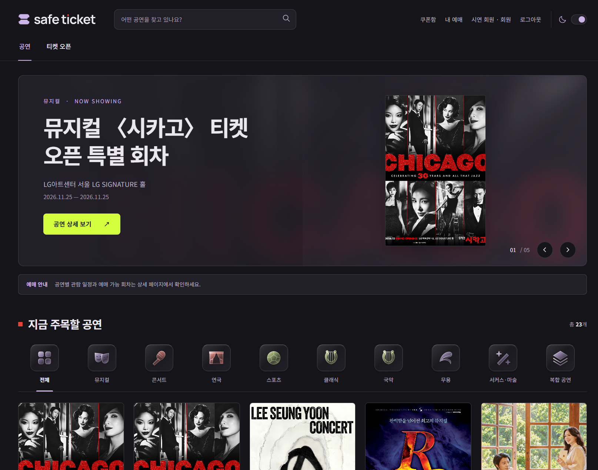 | 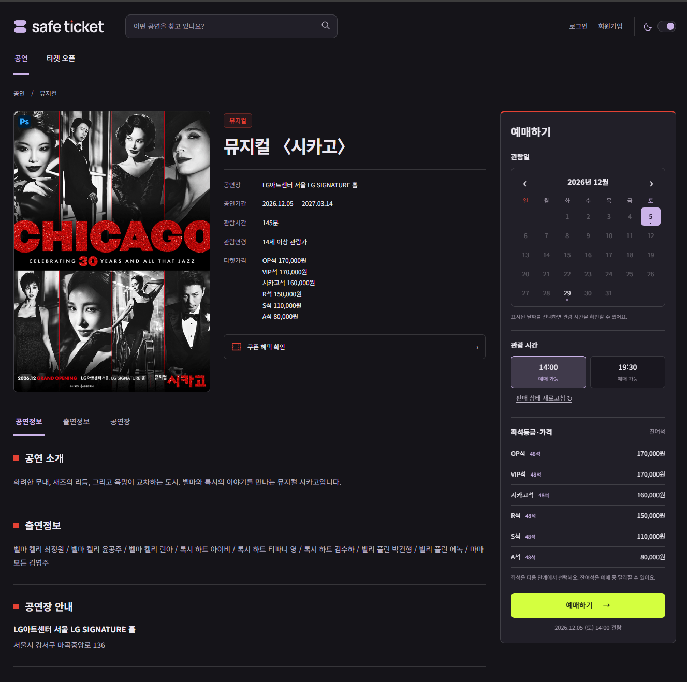 | 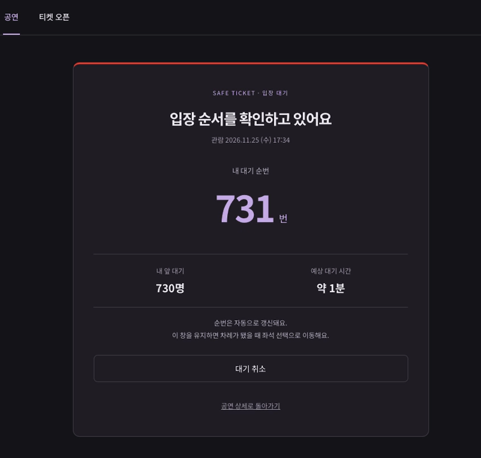 |
| **좌석 조회/선택·1인 매수 제한** | **결제·쿠폰 적용** | **예매 내역** |
| 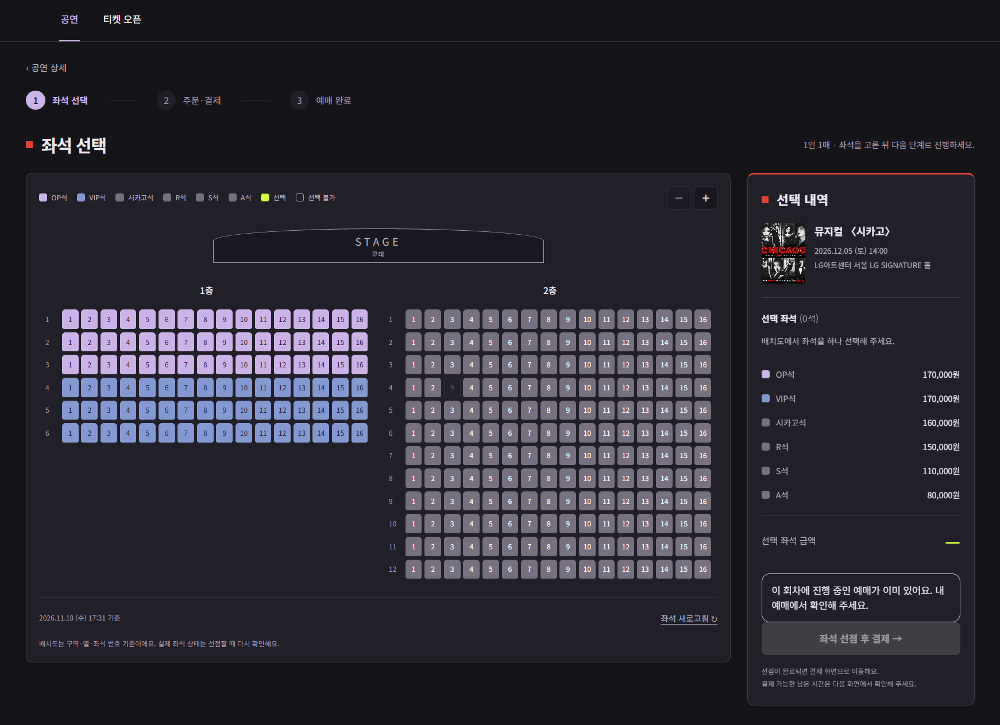 | 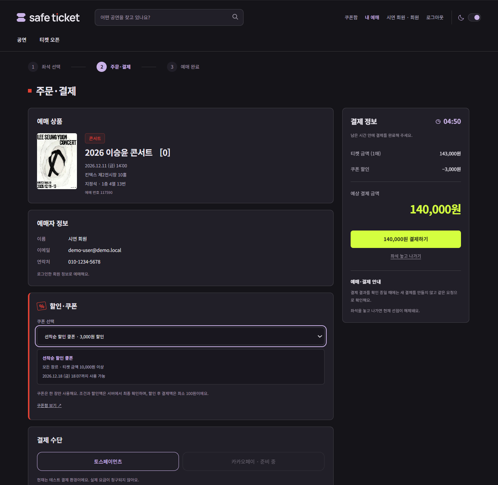 | 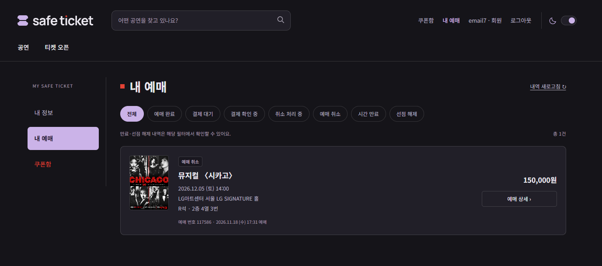 |
| **쿠폰 조회·발급** | **관리자 쿠폰 생성** | **관리자 쿠폰 관리** |
| 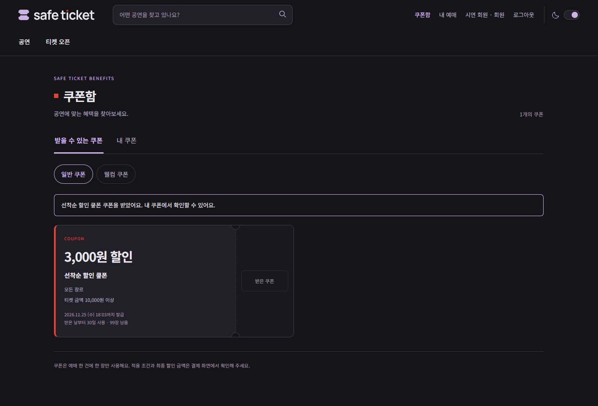 | 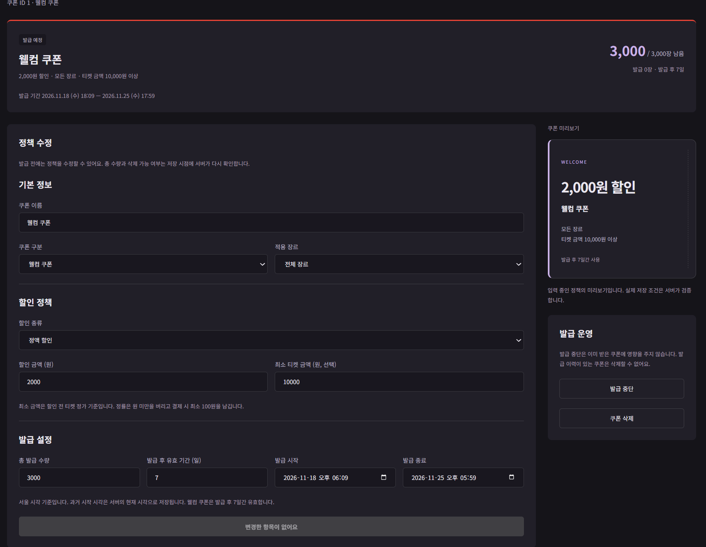 | 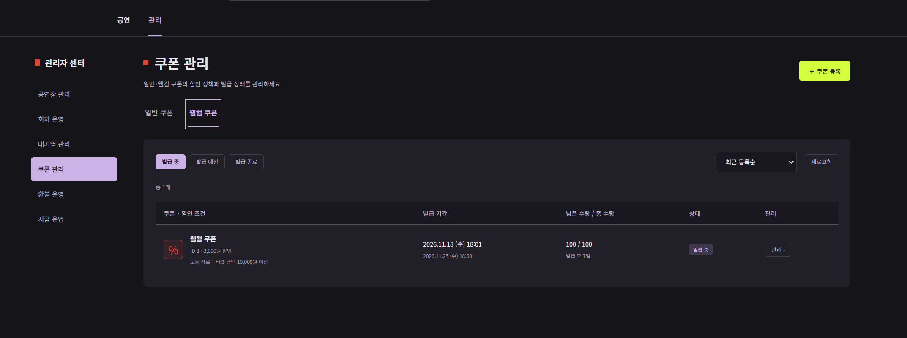 |
| **판매자 정산 조회** | **Grafana 대시보드** |  |
| 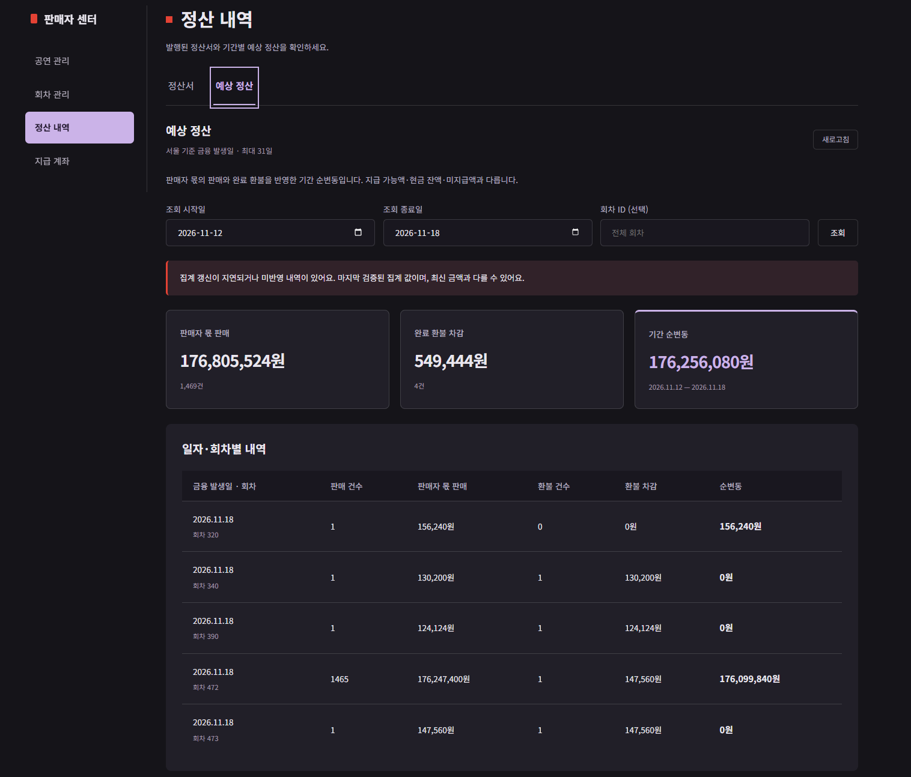 | 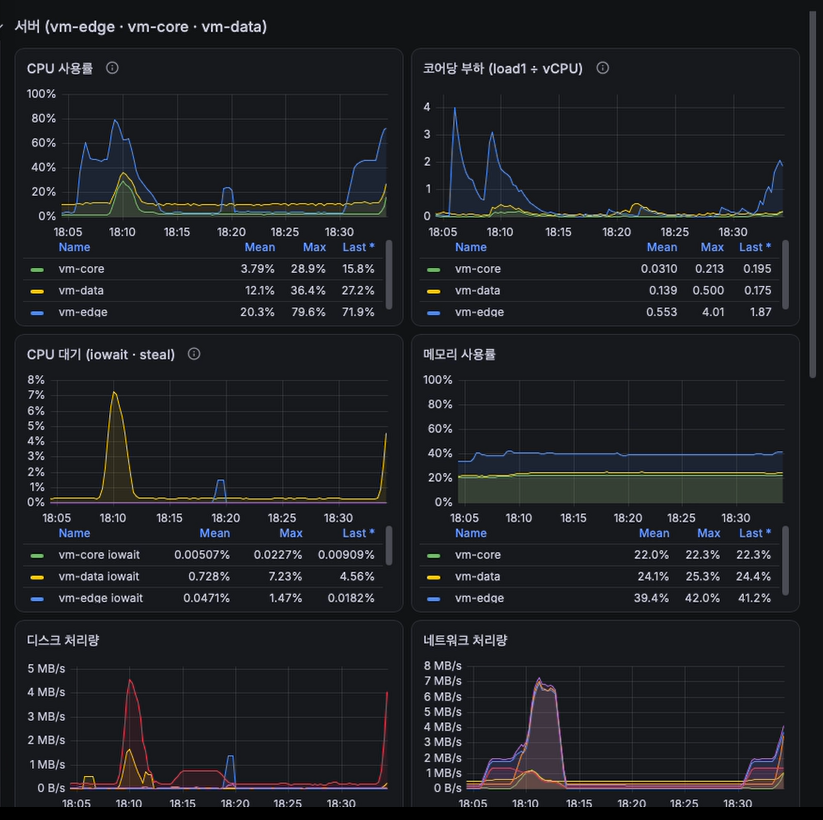 |  |

## 팀원

| 이름 | 담당 | GitHub |
|---|---|---|
| 김태현 | 회원·인증, Gateway, 대기열 | [@nuyheat](https://github.com/nuyheat) |
| 박의연 | 공연·회차·좌석 배치 | [@kiteof-park](https://github.com/kiteof-park) |
| 변정민 | 좌석 조회·선점·잔여석 | [@wjdals717](https://github.com/wjdals717) |
| 지한얼 | 예매·티켓 | [@jihaneol](https://github.com/jihaneol) |
| 성윤범 | 쿠폰 | [@sybeom](https://github.com/sybeom) |
| 강현민 | 결제·정산·fake PG | [@rkddk7165](https://github.com/rkddk7165) |

## 문서

| 문서 | 내용 |
|---|---|
| [docs/architecture.md](docs/architecture.md) | 서비스 책임, 서비스 간 통신, 예매 상태, 실패와 보상 |
| [docs/api.md](docs/api.md) | API·내부 API·메시지 계약 |
| [docs/tables.md](docs/tables.md) | 테이블·제약 |
| [docs/infra.md](docs/infra.md) | 포트, 관측·측정 환경 |
| [docs/conventions.md](docs/conventions.md) | 공통 규칙·코드 컨벤션·협업 |
| [Notion 시스템 구성도](https://app.notion.com/p/404b3ff41d3980e89bb9e17ce9f7106f) | 초기 설계 |
| [Notion 테이블 명세서](https://app.notion.com/p/404b3ff41d3980b88ce0cb1df7defd1e) | 테이블 상세 |
| [Notion API 명세서](https://app.notion.com/p/404b3ff41d398040a969f8eaa2e007a8) | 도메인별 API |

## 개발 안내

<details>
<summary>팀원용 실행·빌드·구조 규칙 (펼치기)</summary>

### 폴더 구조

```
ticket/
├── backend/            # Gradle 루트: 모듈, gradlew, Dockerfile, config-repo, sql(서비스별 DDL)
├── frontend/           # React 프런트 (자세한 내용은 frontend/README.md)
├── docs/               # api·tables·conventions·architecture·infra 공통 문서 5개
├── infra/              # Compose가 쓰는 실행 환경(PostgreSQL 초기화, Prometheus, Grafana, Alertmanager)
├── script/             # 로컬 기동(run.sh), 테스트 계정, 부하 측정 스크립트
├── docker-compose.yml  # 전체 시스템 정의(빌드 컨텍스트는 backend/)
└── .env.example
```

### 모듈과 포트

모두 `backend/` 아래에 있다.

| 모듈 | 포트 | 역할 |
|---|---|---|
| `config-server` | 8888 | `backend/config-repo/`의 설정을 서비스에 내려준다 |
| `eureka-server` | 8761 | 서비스 등록·조회 |
| `gateway-service` | 8080 | 외부 진입점. JWT 검증, 라우팅, Swagger UI 통합 |
| `user-service` | 8081 | 회원가입·로그인(JWT 발급), 내 정보 |
| `performance-service` | 8082 | 공연·회차·좌석 배치 |
| `reservation-service` | 8083 | 좌석 선점·예매·쿠폰 (Redis 사용) |
| `payment-service` | 8084 | 결제·환불·정산 |
| `waiting-room-service` | 8085 | 대기열(room)·순번·입장 토큰 (Redis만 사용) |
| `fake-pg` | 8090 | 테스트용 PG. 토스 호환 API와 장애 주입 관리 API (아래 "fake PG") |
| `common-core` | - | 웹 스택 무관 공통 계약: 에러 코드·응답 형식, 사용자 헤더 이름 |
| `common` | - | MVC 서비스 공통: 예외 처리, `@CurrentUser`, `@RequireRole`, BaseEntity(Audit), Feign 헤더 전달·에러 변환, 페이징 |

### 구조 규칙

- 패키지: `com.sparta.ticket.{서비스}`, 내부는 `presentation / application / domain / infrastructure`
- 설정: 서비스 설정은 `backend/config-repo/{서비스}.yml`, 공통은 `backend/config-repo/application.yml`에 둔다. 모듈의 `application.yml`에는 이름과 `spring.config.import`만 둔다.
- DB: 서비스마다 계정과 스키마가 따로 있다(`infra/postgres/init.sh`). 다른 서비스 테이블을 직접 조회하지 않고 API(Feign)로 받는다.
- 스키마: 서비스별 DDL은 `backend/sql/{서비스}/schema.sql`에 둔다. 프로필별 처리는 아래 "스키마 관리"를 본다.
- 서비스 간 API: `/internal/**` 경로에 두고 응답을 `ApiResponse`로 감싸지 않는다. Gateway가 외부 접근을 404로 막는다.
- 응답: 성공은 `ApiResponse`(`status`, `message`, `data`), 실패는 `ErrorResponse`(`status`, `code`, `message`, `path`, `timestamp`, `errors`).
- 서비스 에러 코드는 `ErrorCode`를 구현한 enum으로 둔다(예: `UserErrorCode`). 공통 코드는 `CommonErrorCode`.

### 스키마 관리

| 프로필 | `ddl-auto` | 테이블을 만드는 것 |
|---|---|---|
| `local`(기본) | `create` | Hibernate가 기동할 때마다 Entity 기준으로 지우고 다시 만든다. 재시작하면 데이터가 사라진다 |
| 그 밖(dev 등) | `validate` | `backend/sql/{서비스}/schema.sql`을 서비스 계정으로 DB에 직접 적용한다. Hibernate는 검증만 한다 |
| 통합 테스트 | `validate` | `PostgresIntegrationTest`가 `schema.sql`을 실행한 뒤 Entity와 대조한다 |

- 프로필을 지정하지 않으면 `local`로 뜬다(각 모듈 `application.yml`의 `spring.profiles.default`). 바꾸려면 `SPRING_PROFILES_ACTIVE`를 준다.
- `local` 전용 값은 `backend/config-repo/application-local.yml`에 있다.
- Entity를 바꾸면 `schema.sql`도 같이 고친다. 어긋나면 통합 테스트가 실패한다.
- `schema.sql`은 현재 스키마 전체를 담는다. 이미 테이블이 있는 dev DB에는 바뀐 부분만 `ALTER`로 직접 적용한다.

### 인증 흐름

1. `POST /api/auth/login` → user-service가 JWT 발급(`sub`=userId, `role`)
2. Gateway가 서명·만료·필수 claim 검증
3. Gateway가 user-service 내부 API(`/internal/users/{id}`, 60초 캐시)로 저장된 role·탈퇴 여부를 다시 확인
4. 클라이언트가 보낸 `X-User-*` 헤더를 지우고 검증된 값(`X-User-Id`, `X-Username`, `X-User-Role`)을 넣어 전달
5. 서비스는 컨트롤러 파라미터 `@CurrentUser UserContext user`로 받고, 역할 제한은 `@RequireRole(Role.MASTER)`로 건다

### 실행

```bash
cp .env.example .env          # script/run.sh는 .env가 없으면 만든다
script/run.sh                 # 전체 빌드·기동
script/run.sh user-service    # 지정한 서비스와 의존 서비스만
script/run.sh --reset         # DB 볼륨까지 지우고 새로 시작
script/run.sh --no-seed       # 테스트 계정을 만들지 않고 바로 끝낸다
script/seed-accounts.sh       # 테스트 계정만 다시 만든다(user-service만 다시 띄운 뒤)
```

프런트는 `frontend/`에서 `npm install && npm run dev`로 띄우고 http://localhost:5173 에서 연다. 자세한 내용은 [frontend/README.md](frontend/README.md)를 본다.

- Swagger: http://localhost:8080/swagger-ui.html
- Eureka: http://localhost:8761
- Kafka UI: http://localhost:8989 (토픽·메시지·컨슈머 그룹·Lag)
- Prometheus: http://localhost:9090/targets (수집 대상은 Eureka 등록 목록에서 자동으로 찾는다)
- Grafana: http://localhost:3000 (`admin` / `.env`의 `GRAFANA_ADMIN_PASSWORD`, Prometheus 데이터 소스 자동 등록)
- Kafka: 컨테이너 안의 앱은 `kafka:29092`, IDE로 띄운 앱은 `localhost:9092` (`spring.kafka.bootstrap-servers`는 `config-repo/application.yml`에 있다)
- 초기 MASTER 계정: `.env`의 `MASTER_EMAIL` / `MASTER_PASSWORD`
- 테스트 USER·SELLER 계정: `.env`의 `SEED_USER_*` / `SEED_SELLER_*`. `script/run.sh`가 기동 끝에 user-service가 요청을 받을 때까지 기다렸다가 가입 API로 만든다. local 프로필은 user-service를 다시 띄울 때마다 테이블을 새로 만들어 계정이 사라지므로, user-service만 다시 띄웠다면 `script/seed-accounts.sh`를 실행한다.
- logistics-management와 함께 띄우면 호스트 포트가 겹친다. `.env`에서 포트와 `COMPOSE_PROJECT_NAME`을 바꾼다. Docker 네트워크 대역(10.220.10.0/24)은 logistics(10.210.10.0/24)와 겹치지 않게 잡았다.
- 대기열: 회차마다 대기열(room)을 만들면 그 회차만 보호된다. gateway-service가 waiting-room-service에서 보호 목록을 받아 좌석 조회·선점의 입장 토큰을 검사한다. 두 서비스는 `.env`의 같은 `QUEUE_TOKEN_SECRET`을 쓴다. 프런트는 회차의 room을 조회해 없으면 바로 좌석 화면으로 간다.
- fake PG: http://localhost:8090/fake/admin/faults (장애 설정), http://localhost:8090/fake/admin/transactions (PG 쪽 거래 기록)

IDE로 서비스 하나만 띄울 때는 `docker compose up -d postgres redis kafka config-server eureka-server`로 기반만 올리고, 실행 설정에 `JWT_SECRET`(user-service), `QUEUE_TOKEN_SECRET`(waiting-room-service, gateway-service)을 넣는다. 서비스보다 config-server를 먼저 띄운다.

### fake PG

결제 테스트·부하 실험용으로 토스페이먼츠 API를 흉내 내는 서버다(`backend/fake-pg`). 실제 PG처럼 Eureka 없이 주소로 찾아가고, Gateway에는 노출하지 않는다. API는 `docs/api.md`, 설계·검증은 `docs/architecture.md`를 따른다.

| 경로 | 하는 일 |
| --- | --- |
| `POST /fake/toss/checkout` | 결제 인증 시뮬레이션. 브라우저 결제창 인증 대신 paymentKey를 발급한다 |
| `POST /v1/payments/confirm`, `GET /v1/payments/orders/{orderId}`, `GET /v1/payments/{paymentKey}`, `POST /v1/payments/{paymentKey}/cancel` | 토스 호환 승인·조회·취소. Basic 인증(`base64("test_sk_fake_toss:")`), `Idempotency-Key` 지원 |
| `PUT /fake/admin/faults/{TOSS}/{CONFIRM\|INQUIRE\|CANCEL}` | 장애 설정: `latencyMs`, `serverErrorRate`, `failRate`, `responseLossRate`, `delayedApprovalRate`·`delayedApprovalMs`, `holdMs`, `rateLimitPerSecond` |
| `DELETE /fake/admin/faults`, `DELETE /fake/admin/transactions` | 장애 해제, 거래·멱등 기록 초기화 |

```bash
# 승인 응답의 10%를 유실(승인은 기록하고 응답만 15초 붙잡았다가 500)
curl -X PUT localhost:8090/fake/admin/faults/TOSS/CONFIRM -H 'Content-Type: application/json' -d '{"responseLossRate":0.1}'
```

fake PG는 DB 계정 `fake_pg_app`과 스키마 `fake_pg_schema`를 쓴다. `infra/postgres/init.sh`는 빈 볼륨에서만 실행되므로, 이전에 만든 DB 볼륨이 있으면 `script/run.sh --reset`으로 다시 만들거나 아래 명령으로 계정만 추가한다.

```bash
docker compose exec -T postgres psql -U postgres -d ticket \
  -c "CREATE USER fake_pg_app WITH PASSWORD 'fake_pg_local_pw'" \
  -c "CREATE SCHEMA IF NOT EXISTS fake_pg_schema AUTHORIZATION fake_pg_app" \
  -c "ALTER ROLE fake_pg_app SET search_path = fake_pg_schema"
```

### 빌드·테스트

```bash
cd backend
./gradlew build                    # 전체 (포맷·Checkstyle·계층 검사·테스트)
./gradlew :user-service:test       # 모듈 하나
./gradlew spotlessApply            # 포맷 자동 정렬
```

- 통합 테스트(`PostgresIntegrationTest`를 상속한 테스트)는 Testcontainers로 PostgreSQL 16을 띄우므로 Docker가 실행 중이어야 한다.
- 포맷은 Spotless(Palantir Java Format)가 맞춘다. 손으로 정렬하지 않고 커밋 전에 `./gradlew spotlessApply`를 돌린다. 어긋나면 `build`의 `spotlessCheck`가 실패한다.
- Checkstyle(`backend/config/checkstyle/checkstyle.xml`)은 이름 규칙, 와일드카드 import, 빈 문장, equals/hashCode 쌍 등을 검사한다.
- 업무 서비스마다 `ArchitectureTest`가 계층 의존 방향을 검사한다. 규칙은 `common` 테스트 모듈의 `LayeredArchitectureRules`에 있다.
- 셸 기본 JDK가 17이 아니어도 Gradle toolchain이 17로 컴파일·실행한다.

### 새 업무 기능을 추가할 때

1. Entity를 만들고 같은 테이블을 `backend/sql/{서비스}/schema.sql`에 DDL로 적는다. Audit 컬럼 6개(`created_at`, `created_by`, `updated_at`, `updated_by`, `deleted_at`, `deleted_by`)를 넣고 Entity는 `BaseEntity`를 상속한다.
2. 외부 API는 `/api/...`로 만들고, Gateway 라우트(`backend/config-repo/gateway-service.yml`)에 경로가 있는지 확인한다.
3. 다른 서비스 호출은 `infrastructure/client`에 `@FeignClient`로 둔다. GET·멱등 API만 `IdempotentRetryConfig`를 붙인다.

</details>
