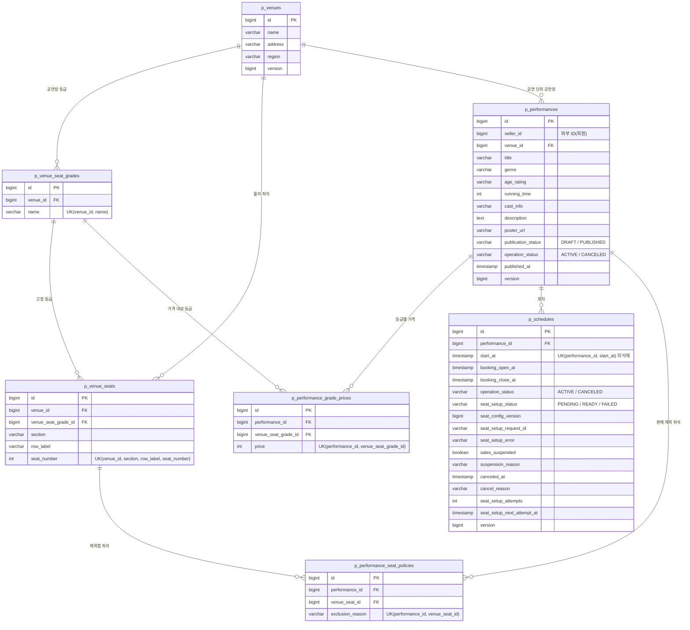

# 공연 테이블 명세

- 상태: 작성 중
- 담당: 박의연
- DDL: `backend/sql/performance-service/schema.sql`
- 출처: Notion [테이블 명세서](https://app.notion.com/p/404b3ff41d3980b88ce0cb1df7defd1e)의 공연 섹션 (2026-10-27 기준). 이후 원본은 이 문서이며, Notion은 담당자가 이 문서를 기준으로 갱신한다.
- 표 제목의 번호(3.2~3.8)는 Notion 원본 번호를 유지한다.

## 1. ERD

Notion ERD 이미지 대신 아래 테이블 명세를 기준으로 그렸다.

- 모든 테이블은 BaseEntity 감사 컬럼 6개(`created_at`, `created_by`, `updated_at`, `updated_by`, `deleted_at`, `deleted_by`)를 가진다. 다이어그램에서는 생략했다.
- UK는 모두 미삭제 행(`deleted_at IS NULL`)만 대상으로 하는 부분 유니크 인덱스다.
- 예매 서비스 소유 `schedule_seat`은 회차 ID를 외부 ID로 참조하며, 공연 DB와 물리 FK가 없다.

## 2. 공통 사항

**현재 설계의 책임 경계:** 예매 서비스가 `schedule_seat`, `reservation`, `ticket`을 소유한다.
선점·예매 확정은 예매 서비스의 로컬 트랜잭션으로 처리한다.
담당자 간 상세 계약·구현 방식은 협의 대상이지만, 현재 문서는 이 소유권을 기준으로 작성한다.
회원과 공연 서비스 데이터는 외부 ID로 참조하며 서비스 간 물리 FK를 만들지 않는다.

- PostgreSQL 기준.
  판매 가격은 원 단위 INT이며 0 초과다.
  통화는 KRW 고정이므로 별도 통화 컬럼을 생략한다.
- 기존 문서에 맞춰 DB 시각은 KST TIMESTAMP(3), API는 +09:00 오프셋을 포함한 ISO 8601로 표현한다.
  DB·서버·드라이버 시간대도 일치시킨다.
  업무 시각 컬럼(`published_at`, `start_at` 등)은 TIMESTAMP(3)을 쓴다. BaseEntity 감사 컬럼(`created_at`, `updated_at`, `deleted_at`)은 팀 공통 엔티티와 다른 서비스 DDL에 맞춰 TIMESTAMP를 쓴다.
- `deleted_at`이 있는 데이터는 기본 조회에서 제외한다.
  **회차 취소와 삭제는 구분한다.**
- 판매자 수정은 performance 행을 기준으로 직렬화하거나 낙관적 잠금으로 보호한다.
  가격·판매 제외 변경은 부모 performance.version을 If-Match로 확인한다. 회차 등록·변경과 공개는 같은 트랜잭션에서 부모 performance 행을 잠가(SELECT ... FOR UPDATE) 공개 상태를 확인한다. 회차 명령의 동시 수정은 schedule.version으로 막는다.
- 아래 NOT NULL 조건은 저장 가능한 최소 초안 기준이다.
  공개 시 설명·포스터·회차·공연장 등급·가격 등 추가 조건을 검증한다.

### 공통 감사 컬럼 — 팀 BaseEntity 상속

모든 공연 테이블은 팀 BaseEntity를 상속해 아래 6개 컬럼을 가진다(2026-10-27 결정).
아래 3.2~3.8 표에는 이 6개 컬럼을 반복하지 않는다.

| 컬럼(영문) | 컬럼(한글) | 타입 | 제약·기본값 | 설명 |
| --- | --- | --- | --- | --- |
| created_at | 생성 시각 | TIMESTAMP | NOT NULL | JPA Auditing이 행 최초 생성 시 기록한다. 이후 변경하지 않는다. |
| created_by | 생성자 | VARCHAR(100) | NOT NULL | 인증 사용자 ID를 문자열로 기록한다. 요청 밖 작업은 SYSTEM. |
| updated_at | 최종 변경 시각 | TIMESTAMP | NOT NULL | 서버가 매 변경 시 갱신한다. |
| updated_by | 최종 변경자 | VARCHAR(100) | NOT NULL | 마지막으로 바꾼 주체. 요청 밖 작업은 SYSTEM. |
| deleted_at | 삭제 시각 | TIMESTAMP | NULL | NULL이면 미삭제, 값이 있으면 소프트 삭제된 행이다. |
| deleted_by | 삭제자 | VARCHAR(100) | NULL | 삭제한 주체. |

version이 있는 테이블은 version으로 수정 충돌을 확인한다.
schedule_seat 선점은 MVP에서 비관적 락(SELECT ... FOR UPDATE) 후 상태·소유 예매·만료 시각을 검증한다. 예약 상태 전환의 조건부 UPDATE와 구분한다.

모든 삭제는 deleted_at을 기록하는 소프트 삭제이며 기본 조회에서 제외한다.
p_venue_seat_grades와 p_venue_seats는 사용 중 삭제하지 않는다.
가격·공연별 판매 제외 행은 DRAFT의 집합 변경 API로만 관리하며, 교체 시 기존 행을 소프트 삭제하고 새 행을 만든다.
아래 UK는 모두 미삭제 행(deleted_at IS NULL)만 대상으로 하는 부분 유니크 인덱스로 적용한다.
부모 삭제 시 참조 이력은 유지하고 부모의 삭제 여부로 조회를 차단한다.

## 3. 테이블

### 3.2 p_venues (venue) — 공연장

| 컬럼(영문) | 컬럼(한글) | 타입 | 제약·기본값 | 설명 |
| --- | --- | --- | --- | --- |
| id | 식별자 | BIGINT | PK, NOT NULL, GENERATED ALWAYS AS IDENTITY (구현 제안) | 공연장 ID |
| name | 이름 | VARCHAR(100) | NOT NULL | 이름 |
| address | 주소 | VARCHAR(255) | NOT NULL | 주소 |
| region | 지역 | VARCHAR(20) | NOT NULL | 지역 필터 |
| version | 낙관적 잠금 버전 | BIGINT | NOT NULL DEFAULT 0 | 동시 수정 방지 |

### 3.3 p_venue_seat_grades (venue_seat_grade) — 공연장별 좌석 등급

등급명과 좌석 배정은 공연장이 소유한다.
가격은 이 테이블에 저장하지 않는다.

| 컬럼(영문) | 컬럼(한글) | 타입 | 제약·기본값 | 설명 |
| --- | --- | --- | --- | --- |
| id | 공연장 좌석 등급 식별자 | BIGINT | PK, NOT NULL, GENERATED ALWAYS AS IDENTITY | 공연장 내 등급 ID. 공연별 가격과 물리 좌석에서 참조한다. |
| venue_id | 공연장 식별자 | BIGINT | FK → p_venues.id, NOT NULL | 등급이 속한 공연장. |
| name | 좌석 등급명 | VARCHAR(20) | NOT NULL, 공백 문자열 불가 | VIP, R, S 등. 공연장이 다르면 같은 이름 사용 가능. |

UK(venue_id, name), 미삭제 행 대상.
공연이 하나라도 해당 공연장을 참조한 이후 등급 추가·이름 변경·삭제를 차단하는 초기 구현안이다.
기존 공연을 바꾸지 않으려면 별도 배치 버전 도입이 필요하다.

### 3.4 p_venue_seats (venue_seat) — 공연장 물리 좌석

| 컬럼(영문) | 컬럼(한글) | 타입 | 제약·기본값 | 설명 |
| --- | --- | --- | --- | --- |
| id | 물리 좌석 식별자 | BIGINT | PK, NOT NULL, GENERATED ALWAYS AS IDENTITY | 공연장 좌석 ID. |
| venue_id | 공연장 식별자 | BIGINT | FK → p_venues.id, NOT NULL | 좌석 소속 공연장. |
| venue_seat_grade_id | 고정 좌석 등급 식별자 | BIGINT | FK → p_venue_seat_grades.id, NOT NULL | 공연장에 고정된 등급. 공연·회차에서 덮어쓸 수 없다. |
| section | 좌석 구역 | VARCHAR(20) | NOT NULL, 빈 문자열 불가 | 예: A, 1층. |
| row_label | 좌석 열 | VARCHAR(10) | NOT NULL, 빈 문자열 불가 | 예: 1, 가. |
| seat_number | 좌석 번호 | INT | NOT NULL, 0 초과 | 구역·열 안에서의 좌석 번호. |

UK(venue_id, section, row_label, seat_number), 미삭제 행 대상.
INDEX(venue_id, venue_seat_grade_id).
좌석과 등급의 venue_id가 같아야 한다.
공연에 사용된 이후 물리 좌석·등급 배정은 변경하지 않는 초기 정책이다.
**예: A구역 1열 1번이 VIP라면 이 공연장을 쓰는 모든 공연·회차에서 VIP다.**

### 3.5 p_performances (performance) — 공연

| 컬럼(영문) | 컬럼(한글) | 타입 | 제약·기본값 | 설명 |
| --- | --- | --- | --- | --- |
| id | 식별자 | BIGINT | PK, NOT NULL, GENERATED ALWAYS AS IDENTITY (구현 제안) | 공연 ID |
| seller_id | 판매자 식별자 | BIGINT | NOT NULL, 외부 ID | 인증 주체의 BIGINT 회원 ID로 설정. 요청 본문으로 받지 않음 |
| venue_id | 공연장 식별자 | BIGINT | FK NOT NULL | 공연 단위 공연장. 공연이 DRAFT이며 삭제 회차를 포함한 회차 등록 이력이 없을 때만 변경 가능. 변경 시 가격·제외 설정을 같은 트랜잭션에서 초기화한다. |
| title | 공연 제목 | VARCHAR(200) | NOT NULL | 공연명 |
| genre | 공연 장르 | VARCHAR(20) | NOT NULL | CONCERT / MUSICAL / PLAY / SPORTS |
| age_rating | 관람 등급 | VARCHAR(20) | NOT NULL | ALL / 12 / 15 / 19 |
| running_time | 공연 시간(분) | INT | NOT NULL | 분, 0 초과 |
| cast_info | 출연진 정보 | VARCHAR(500) | NULL | 출연진 안내 |
| description | 공연 상세 설명 | TEXT | NULL | 공개 시 필수 제안 |
| poster_url | 포스터 주소 | VARCHAR(500) | NULL | 공개 시 필수 제안 |
| publication_status | 공개 상태 | VARCHAR(20) | NOT NULL DEFAULT `DRAFT` | DRAFT / PUBLISHED |
| operation_status | 운영 상태 | VARCHAR(20) | NOT NULL DEFAULT `ACTIVE` | ACTIVE / CANCELED. 공개 여부와 별개 |
| published_at | 최초 공개 시각 | TIMESTAMP(3) | NULL | 최초 공개 시각. 공개 이력·변경 제한 판단 |
| version | 낙관적 잠금 버전 | BIGINT | NOT NULL DEFAULT `0` | 공연 정보·공연장·등급 가격·판매 제외·공개 상태 변경 시 증가. 회차 변경으로는 증가하지 않는다. 공연 단위 명령의 If-Match 기준이다. |

INDEX(seller_id, deleted_at),
INDEX(publication_status, genre, id).
공연 기간은 삭제·취소되지 않은 회차의 시작 일시 최솟값·최댓값에서 계산하는 구현 제안이다.
기존 start_date/end_date를 유지한다면 회차 변경과 함께 갱신해야 한다.

### 3.6 p_performance_grade_prices (performance_grade_price) — 공연별 등급 가격

기존 공연 소유 seat_grade를 공연장 등급과 공연 가격으로 분리했다.
판매자는 등급을 만들거나 좌석에 배정하지 않고, 공연장의 기존 등급에 가격만 설정한다.

| 컬럼(영문) | 컬럼(한글) | 타입 | 제약·기본값 | 설명 |
| --- | --- | --- | --- | --- |
| id | 공연별 등급 가격 식별자 | BIGINT | PK, NOT NULL, GENERATED ALWAYS AS IDENTITY | 가격 행 ID. 등급 자체의 ID와 다르다. |
| performance_id | 공연 식별자 | BIGINT | FK → p_performances.id, NOT NULL | 가격이 적용되는 공연. |
| venue_seat_grade_id | 공연장 좌석 등급 식별자 | BIGINT | FK → p_venue_seat_grades.id, NOT NULL | 해당 공연장의 고정 등급. |
| price | 기본 가격(원) | INT | NOT NULL, 0 초과 | 할인 전 원화 금액. 동일 공연의 모든 회차에 공통 적용. |

UK(performance_id, venue_seat_grade_id), 미삭제 행 대상.
공연의 venue_id와 등급의 venue_id가 일치해야 한다.
가격 누락은 행이 없는 것으로 판단하며 0원 가격은 저장하지 않는다.
공개 시 판매 대상 좌석에 사용되는 모든 등급의 가격이 필요하다.
`DRAFT`에서만 가격 집합 변경 가능하며, 공개 후 변경·삭제는 금지한다.
`DRAFT` 전체 교체 시 기존 가격 행을 소프트 삭제하고 새 행을 만든다.
공연이 삭제되면 부모 삭제 여부로 가격 조회도 차단한다.

### 3.7 p_schedules (schedule) — 공연 회차 (공연 서비스 소유)

회차는 공연장 등급과 공연별 가격을 새로 정의하지 않는다.
performance_id로 공연을 참조하고 공연장의 고정 좌석·등급 및 공연별 가격을 공통으로 사용한다.
회차별로 달라지는 것은 공연·판매 시각과 운영·판매 준비 상태이며, 좌석별 선점·판매 상태는 예매 서비스 schedule_seat이 관리한다.

| 컬럼(영문) | 컬럼(한글) | 타입 | 제약·기본값 | 설명 |
| --- | --- | --- | --- | --- |
| id | 식별자 | BIGINT | PK, NOT NULL, GENERATED ALWAYS AS IDENTITY (구현 제안) | 회차 ID |
| performance_id | 공연 식별자 | BIGINT | FK NOT NULL | 공연 |
| start_at | 공연 시작 시각 | TIMESTAMP(3) | NOT NULL | 공연 시작 |
| booking_open_at | 예매 오픈 시각 | TIMESTAMP(3) | NOT NULL | 회차별 예매 오픈 |
| booking_close_at | 예매 마감 시각 | TIMESTAMP(3) | NOT NULL | 회차별 예매 마감 |
| operation_status | 운영 상태 | VARCHAR(20) | NOT NULL DEFAULT `ACTIVE` | ACTIVE / CANCELED |
| seat_setup_status | 좌석 준비 상태 | VARCHAR(20) | NOT NULL DEFAULT `PENDING` | PENDING / READY / FAILED |
| seat_config_version | 좌석 구성 버전 | BIGINT | NOT NULL DEFAULT `1` | 좌석 구성 변경 시 증가 |
| seat_setup_request_id | 좌석 생성 요청 식별자 | VARCHAR(36) | NOT NULL | 현재 생성 요청 UUID. 스케줄러 자동 재시도를 포함한 재전송은 유지하고, 구성 변경으로 configVersion이 올라갈 때만 교체한다. |
| seat_setup_error | 좌석 생성 실패 사유 | VARCHAR(500) | NULL | 실패 요약. 판매자에게 민감한 내부 정보 노출 금지 |
| sales_suspended | 판매 일시 중지 여부 | BOOLEAN | NOT NULL DEFAULT `false` | 신규 선점 차단 여부. 기존 유효 선점은 원래 만료 시각까지 결제 가능 |
| suspension_reason | 판매 중지 사유 | VARCHAR(500) | NULL | 중지 시 trim 후 1~500자 필수. 재개 시 NULL로 비운다. |
| canceled_at | 회차 취소 시각 | TIMESTAMP(3) | NULL | 취소 시각 |
| cancel_reason | 회차 취소 사유 | VARCHAR(500) | NULL | 취소 사유 |
| seat_setup_attempts | 좌석 준비 시도 횟수 | INT | NOT NULL DEFAULT `0` | 현재 requestId로 좌석 준비를 호출한 횟수. 새 requestId를 발급하면 0으로 초기화한다. 최대 횟수를 넘기면 FAILED로 바꾼다. 최대 횟수는 구현 시 결정한다. |
| seat_setup_next_attempt_at | 다음 좌석 준비 시도 시각 | TIMESTAMP(3) | NULL | PENDING 회차를 스케줄러가 같은 requestId로 다시 보낼 시각. READY·FAILED이면 NULL. 재시도 간격은 구현 시 결정한다. |
| version | 낙관적 잠금 버전 | BIGINT | NOT NULL DEFAULT `0` | 회차 수정·삭제·취소·판매 중지 시 증가. 회차 명령의 If-Match 기준이며 부모 performance.version과 별개다. |

미삭제 회차에만 UNIQUE(performance_id, start_at)를 적용한다.
삭제 행은 중복 검사에서 제외하며 동일 시각 재등록은 새 회차 ID를 발급한다.
INDEX(performance_id, booking_open_at)은 유지한다.
적용 SQL: CREATE UNIQUE INDEX uq_schedule_active_start ON p_schedules(performance_id,start_at) WHERE deleted_at IS NULL.

booking_open_at < booking_close_at <= start_at.
공연 당일 시작 후 판매는 지원하지 않는 초기 제안이다.
취소는 되돌리지 않는다.
회차별 공연장은 두지 않는다.

### 3.8 p_performance_seat_policies (performance_seat_policy) — 공연 공통 판매 제외 좌석

회차별 등급 배정 테이블 schedule_seat_assignment는 제거한다.
등급은 venue_seat에서 결정하므로 별도 배정 테이블이 필요 없다.
기존 판매 제외 기능은 공연 공통 예외만 저장하는 아래 테이블로 분리하는 구현 제안이다.
이 테이블은 등급이나 가격을 변경할 수 없다.

| 컬럼(영문) | 컬럼(한글) | 타입 | 제약·기본값 | 설명 |
| --- | --- | --- | --- | --- |
| id | 판매 제외 정책 식별자 | BIGINT | PK, NOT NULL, GENERATED ALWAYS AS IDENTITY | 공연별 제외 좌석 행 ID. |
| performance_id | 공연 식별자 | BIGINT | FK → p_performances.id, NOT NULL | 제외 정책이 적용될 공연. |
| venue_seat_id | 제외할 물리 좌석 식별자 | BIGINT | FK → p_venue_seats.id, NOT NULL | 반드시 해당 공연장의 좌석이어야 한다. |
| exclusion_reason | 판매 제외 사유 | VARCHAR(255) | NOT NULL, 빈 문자열 불가 | 예: 운영석, 시야 제한석. 관리용이며 공개 응답에 내부 사유를 노출하지 않는다. |

UK(performance_id, venue_seat_id), 미삭제 행 대상.
행이 없으면 판매 대상, 행이 있으면 판매 제외다.
모든 회차가 동일한 제외 정책을 사용한다.
DRAFT에서만 변경하며 공개 후 고정한다.
독립적인 회차별 등급·제외 배정 API는 제공하지 않는다.
선점·판매 완료 상태는 예매 서비스의 회차별 schedule_seat에서 별도로 관리한다.

## 4. 보고서 확정 정책

공개 후에도 취소되지 않은 공연에 신규 회차를 추가할 수 있다.
기존 회차의 좌석·예매는 변경하지 않는다.
새 회차는 PENDING에서 시작하며 READY 및 판매 기간 조건을 충족해야 신규 선점 가능하다.

salesStatus는 저장 컬럼이 아니다.
CANCELED → CLOSED → BEFORE_OPEN → UNAVAILABLE → ON_SALE 우선순위로 기존 컬럼과 현재 시각에서 계산한다.
좌석 매진·여유·임박과 구분한다.

공연 전체 취소 전용 API 없이 회차별 취소를 사용한다.
시간만 바꿀 때 좌석 재생성은 하지 않는다.
공연 기간의 계산·저장 정책은 보고서에 올바른 결정이 없어 기존 제안을 유지한다.
