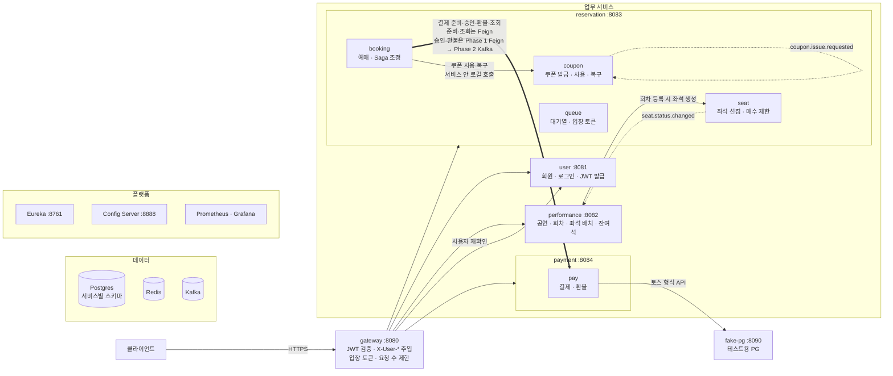
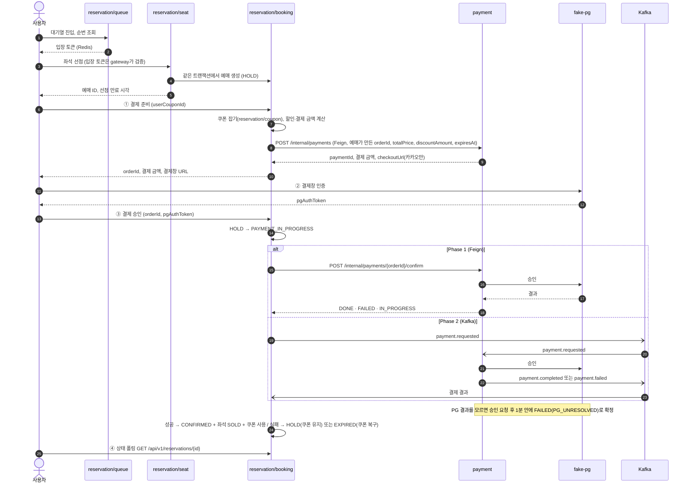
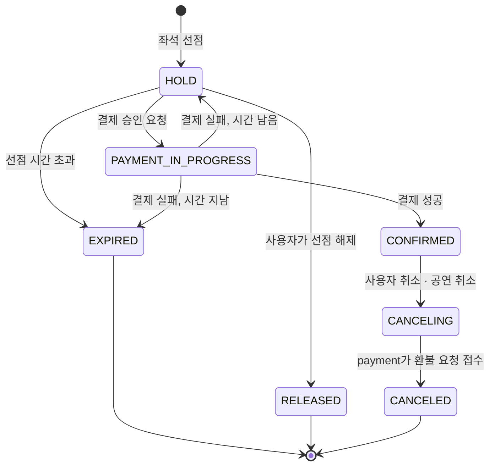

# 시스템 구성도

서비스가 각각 무엇을 맡고, 서로 어떻게 대화하는지(동기 호출·Kafka 이벤트), 예매 한 건이 어떤 길로 흐르는지 보여 준다. 서버 배치·배포·접속은 [infra.md](infra.md)에 있다.

- 상태: 작성 중
- 출처: Notion [시스템 구성도](https://app.notion.com/p/404b3ff41d3980e89bb9e17ce9f7106f) (2026-10-26 기준)
- **(제안)**, **(가안)** 표시는 담당자끼리 아직 합의하지 않은 내용이다.
- 서비스 이름은 설계서를 따라 performance로 쓴다. 저장소 이름도 `performance-service`다 (D10).

> 이 문서는 전체 그림이다. 경로·필드·상태 값이 계약이나 도메인 문서와 다르면 [shared/](../shared/README.md) 계약과 도메인 폴더 문서가 기준이다. 지금 알려진 차이는 [9장](#9-아직-정하지-않은-것)에 모았다.

## 1. 전체 구성도

| 선 | 뜻 |
|---|---|
| 실선 → | 동기 호출 (gateway 라우팅, Feign, WebClient, 서비스 안 모듈 호출) |
| 굵은 선 ⇒ | 예매 ↔ 결제 Saga. Phase 1은 Feign, Phase 2는 Kafka (측정 비교 대상) |
| 점선 ⇢ | Kafka 이벤트 |

- 모든 업무 서비스는 Eureka에 등록하고, Config Server에서 설정을 받고, Prometheus가 지표를 수집한다. 그래서 플랫폼으로 가는 선은 생략했다.
- fake-pg는 바깥 PG를 흉내 내므로 Eureka·Config Server를 쓰지 않고 주소로 호출된다. gateway 라우트에도 없다.

## 2. 서비스와 책임

| 서비스 (저장소 이름) | 포트 | 내부 모듈 | 책임 | 소유 데이터 | 담당 |
|---|---|---|---|---|---|
| gateway (`gateway-service`) | 8080 | — | 라우팅, JWT 검증, 외부 `X-User-*` 제거 후 검증된 값 주입, `/internal/**` 차단, 입장 토큰 검증(좌석 조회·선점 API만), 요청 수 제한 | 없음 (Redis 조회) | 김태현, 성윤범(매크로 차단) |
| user (`user-service`) | 8081 | — | 회원가입, 로그인, JWT 발급, 역할 | 회원 (`user_schema`) | 김태현 |
| performance (`performance-service`) | 8082 | — | 공연장·좌석 배치, 공연·등급·회차·가격, 공연 조회, 잔여석 미리보기 | 공연·회차·좌석 배치, 잔여석 카운터 (`performance_schema`) | 박의연 |
| reservation (`reservation-service`) | 8083 | `queue` | 대기열 순번, 입장 토큰 | Redis | 김태현 |
| | | `seat` | 좌석 선점(비관적 락), 좌석 상태, 1인 매수 제한 | 회차 좌석 상태 (`reservation_schema`) | 변정민 |
| | | `booking` | 선점 만료, 쿠폰 적용·할인 금액 계산, 결제 준비·승인 요청, 예매 확정·취소, Saga 조정·보상 | 예매·티켓 (`reservation_schema`) | 지한얼 |
| | | `coupon` | 쿠폰 정책, 선착순 발급(Kafka 비동기 접수), 사용·복구 | 쿠폰 정책·쿠폰 (`reservation_schema`) | 성윤범 |
| payment (`payment-service`) | 8084 | `pay` | 결제 준비·승인, 환불, 결과 조회, fake-pg 호출 | 결제·환불 (`payment_schema`) | 강현민 |
| fake-pg (`fake-pg`) | 8090 | — | 토스 형식 결제 API 흉내, 실패율·지연·응답 유실 주입(`/fake/admin/**`) | 거래 기록 (`fake_pg_schema`) | 강현민 |

왜 이렇게 나눴나

- **서비스 4개 + gateway**: 발제 가이드(2~3개로 시작, 5개 이상은 재검토)를 지키고, 더 나눌지는 측정으로 정한다.
- **queue·seat·booking을 reservation 한 서비스에**: 좌석 상태와 예매 상태는 한 트랜잭션에서 함께 바뀌어야 한다. 서비스를 나누면 이 부분까지 Saga가 된다. 대신 모듈끼리 Facade로만 부르게 해서 나중에 떼어낼 수 있게 한다. 대기열 분리는 측정 결과로 정한다.
- **coupon을 reservation 안에 (제안, #27)**: 쿠폰은 결제 수단이 아니라 주문 금액을 정하는 규칙이라 주문(예매) 쪽에 둔다(튜터 피드백). 예매가 할인 전 금액부터 할인 후 결제 금액까지 정하고, 쿠폰 사용·복구가 예매 상태 전이와 같은 로컬 트랜잭션이 된다. 서비스를 넘는 보상은 그대로 예매 ↔ 결제 하나다. 결제는 정해진 금액만 받아 PG와 처리한다. 이전에는 payment 안에 두었다.

## 3. 서비스 간 통신

경로·요청·응답의 기준은 각 계약 문서다. 계약 목록은 [shared/README.md](../shared/README.md#계약-목록)에 있다.

| 흐름 | 방식 | 이유 | 상태 |
|---|---|---|---|
| 클라이언트 → 서비스 | gateway → `lb://{서비스}` (Eureka) | 인증을 한곳에서 하고, 인스턴스를 늘려도 설정이 그대로다 | 구현 |
| gateway → user | WebClient `GET /internal/users/{userId}` (60초 캐시) | 토큰이 유효해도 탈퇴·권한 변경을 반영한다 | 구현 |
| 서비스 → 서비스 Feign | `X-User-*` 헤더를 그대로 전달 | 호출받는 서비스도 같은 사용자로 처리한다 | 구현 |
| performance → reservation | Feign, 회차 등록 시 좌석 생성 ([좌석 내부 API](../shared/internal-api/seat.md)) | 관리자 작업이라 즉시 결과가 필요하다. 가격은 이때 스냅샷으로 복사 | 설계 |
| reservation → payment: 결제 준비 | Feign `POST /internal/payments`. `orderId`는 예매가 준비 시도마다 만든다 | 사용자가 결제창으로 가려면 즉시 응답이 필요하다. Phase 2에서도 Feign | 합의 |
| reservation → payment: 결제 승인 | Phase 1 Feign `POST /internal/payments/{orderId}/confirm` → Phase 2 Kafka | 동기 호출의 장애 전파를 측정한 뒤 전환한다 (비교 실험) | Phase 1 합의, Phase 2 가안 (P4) |
| reservation → payment: 환불 | Phase 1 Feign `POST /internal/payments/{orderId}/refund` → Phase 2 Kafka | 예매는 payment가 요청을 접수했는지만 확인한다. 환불 완료까지는 payment가 책임진다 | Phase 1 합의, Phase 2 가안 (P3) |
| reservation → payment: 결과 조회 | Feign `GET /internal/payments/{orderId}` | 결과를 모를 때 예매 스케줄러가 조회한다. payment는 결과를 먼저 알려 주지 않는다 | 합의 |
| reservation → payment: 공연 취소 환불 | Feign `POST /internal/payments/{orderId}/refund`, 예매마다 `reason=SCHEDULE_CANCELED` | 취소 기한·수수료와 상관없이 전액 환불한다 | 합의 |
| payment → fake-pg | HTTP (주소로 호출) | 실제 PG처럼 서비스 밖에 있다 | 브랜치 (`feat/payment/13-fake-pg`, PR #19) |
| reservation → performance: 잔여석 | Kafka `seat.status.changed` | 조금 늦게 반영돼도 된다 | 설계 |
| 쿠폰 선착순 발급 | Kafka 비동기 접수 (202 응답 → reservation 소비자가 저장) | 발제 필수 비동기 API. 몰리는 요청을 줄 세운다. 좌석 오픈과 겹치면 같은 서비스에 부하가 몰리므로 측정 때 함께 본다 | 설계 |

결제 흐름은 [결제 내부 API](../shared/internal-api/payment.md) 계약과 2026-10-26 결제·예매 팀 결정(이슈 #7 등)을 함께 따른다.

- `/internal/**`은 서비스 간 전용이다. gateway가 외부 요청을 404로 막고, API 문서에도 싣지 않는다.
- 서비스는 `X-User-*` 헤더를 검증 없이 믿는다. 서비스 포트를 외부에 열지 않는 이유다 ([infra.md](infra.md) 2-1).
- 대기열 입장 토큰은 좌석 조회·선점에만 쓰는 입장권이다. 결제·예매 API는 이 토큰을 검사하지 않는다.

## 4. 예매 흐름

상세 Saga는 [reservation/orchestration.md](../reservation/orchestration.md)에 있다.

- 사용자 요청은 모두 gateway(`/api/v1/**`)를 거친다. 그림에서는 생략했다.
- 할인 전 금액(`totalPrice`)은 선점 때 복사한 좌석 가격으로, 쿠폰 할인액(`discountAmount`)도 reservation이 계산한다. payment는 `totalPrice - discountAmount`로 결제 금액을 정하고 100원 이상인지만 검증한다(#22). 클라이언트가 보낸 금액은 쓰지 않는다.
- fake-pg는 실제 결제창 대신 인증을 흉내 내는 API를 준다. 부하 테스트에서는 k6가 VPC 안에서 직접 부른다. 서버 환경에서 사용자 브라우저가 fake-pg에 닿는 경로는 아직 정하지 않았다 (9장).
- Phase 1과 Phase 2는 **전송 방식만** 다르고 상태 전이 코드는 같다. 그래서 측정 차이를 통신 방식 때문이라고 말할 수 있다.

## 5. 예매 상태

> 상세 전이와 컬럼은 [reservation/orchestration.md](../reservation/orchestration.md) 4장과 [reservation/tables.md](../reservation/tables.md)에 있다. `CANCELING`은 취소를 구현할 때 코드에 더한다.

| 상태 | 뜻 |
|---|---|
| HOLD | 좌석 선점, 결제 승인 전. 결제 실패로 돌아오면 좌석·쿠폰을 유지한다 |
| PAYMENT_IN_PROGRESS | 결제 결과 대기. 이 동안은 만료되지 않는다. payment가 승인 요청 후 1분 안에 결과를 확정하므로 오래 머물지 않는다 |
| CONFIRMED | 예매 확정, 좌석 SOLD, 쿠폰 사용 |
| EXPIRED | 선점 시간 안에 결제를 못 마침 (만료 스케줄러 10초 주기). 좌석 반환, 쿠폰 해제 |
| RELEASED | 사용자가 선점을 직접 해제. 좌석 반환, 쿠폰 해제 |
| CANCELING | 외부 환불 호출 전에 커밋하는 취소 의도. 티켓은 쓸 수 없고 좌석은 그대로다. 환불 요청 응답이 사라지면 스케줄러가 이 상태에서 같은 orderId로 다시 요청한다 |
| CANCELED | payment가 환불 요청을 접수함. 좌석 반환, 쿠폰 복원(같은 로컬 트랜잭션). 환불이 거절되거나 늦어져도 되돌리지 않고, 환불 완료까지는 payment가 책임진다 |

취소 상태 이름은 `CANCELING`·`CANCELED`로 확정했다 (T3). `CANCELLED`, `CANCEL_PENDING`, `CANCEL_REQUESTED`는 쓰지 않는다.

모든 상태 전이는 조건부 UPDATE(`WHERE id = ? AND status = ?`)로 한다. 재시도나 중복 이벤트가 와도 한 번만 반영된다.

## 6. Kafka 토픽

메시지 스키마는 Phase 2에서 `shared/events/`에 계약으로 둔다. 그 전까지 아래는 설계안이다.

| 토픽 | 발행 | 소비 | 내용 | 도입 |
|---|---|---|---|---|
| `coupon.issue.requested` | reservation/coupon API | reservation/coupon 소비자 | policyId, userId | MVP 1주차 |
| `seat.status.changed` | reservation/seat | performance | scheduleId, grade, delta | MVP |
| `payment.requested` | reservation/booking | payment | orderId, reservationId, pgAuthToken, amount (승인 요청) | Phase 2 (MVP 2주차) |
| `payment.completed` | payment | reservation/booking | orderId, reservationId, paymentId, amount | Phase 2 |
| `payment.failed` | payment | reservation/booking | orderId, reservationId, failureType, failureCode | Phase 2 |
| `payment.refund.requested` | reservation/booking | payment | orderId, reservationId, reason (`USER_CANCEL`, `SCHEDULE_CANCELED`, `CONFIRM_FAILED`) | Phase 2 |
| `payment.refunded` | payment | reservation/booking | orderId, reservationId, refundAmount | Phase 2 |

- 공통 Envelope: `eventId`(UUID), `eventType`, `occurredAt`, `traceId`, `payload`
- 파티션 키 `reservationId` — 같은 예매의 이벤트 순서를 지킨다.
- 실패가 반복되면 `{topic}.DLT`로 보낸다 (트러블슈팅 기간).
- 승인 토픽 이름(`payment.confirm.requested`로 바꿀지), 환불 접수 이벤트, `pgAuthToken` 보관 기간은 P3·P4에서 정한다.
- 필드 이름은 Feign 응답([결제 내부 API](../shared/internal-api/payment.md))과 같게 둔다. Phase 1과 Phase 2가 같은 상태 전이 코드를 쓰기 때문이다.

## 7. 실패와 보상

| 상황 | 처리 | 시기 |
|---|---|---|
| 사용자가 결제하지 않음 | 만료 스케줄러: HOLD → EXPIRED, 좌석 AVAILABLE, 쿠폰 복구 | MVP |
| PG 승인 실패 | payment가 실패 응답·이벤트 → 시간 남으면 HOLD(쿠폰 유지), 지났으면 EXPIRED(쿠폰 복구) | MVP |
| 결과를 모름 (타임아웃) | payment가 PG 승인 요청 후 1분 안에 결과를 모르면 FAILED(`PG_UNRESOLVED`)로 확정한다. 예매는 PAYMENT_IN_PROGRESS로 두고 결과 확인 스케줄러(30초)가 `GET /internal/payments/{orderId}`로 조회한다. `IN_PROGRESS`면 기다리고, `READY`이면서 `confirmRequestedAt`이 없거나 1분 넘게 지났을 때만 같은 orderId·pgAuthToken으로 승인을 다시 보낸다 | MVP |
| 결과 불명으로 실패 처리한 뒤 PG 승인이 발견됨 | payment 대사(실패 확정 후 11분·1,440분)가 자동 환불한다. 예매를 다시 확정하지 않고 쿠폰도 다시 바꾸지 않는다(쿠폰은 예매가 끝날 때 이미 돌려줬다) | 트러블슈팅 |
| 이벤트 발행 유실 | 커밋 후 발행 + 결과 확인 스케줄러 → 이후 Transactional Outbox | MVP → 트러블슈팅 |
| 같은 이벤트 중복 수신 | 조건부 UPDATE가 두 번째를 무시 → 이후 `processed_event` 테이블 | MVP → 트러블슈팅 |
| 결제는 됐는데 예매를 확정할 수 없음 (이미 만료 등) | 예매가 CANCELING 커밋 후 `reason=CONFIRM_FAILED`로 환불 요청 → payment가 자동 환불. MVP에서는 감지해 알림만 남긴다 | 트러블슈팅 |
| 취소 중 환불 요청 응답 유실 | CANCELING을 먼저 커밋했으므로 스케줄러가 같은 orderId로 환불을 다시 요청한다 (orderId 기준 멱등) | 취소 구현 때 |
| 공연 취소 | 예매마다 CANCELING 커밋 후 `reason=SCHEDULE_CANCELED`로 환불 요청. 취소 기한·수수료 없이 전액 환불 | 취소 구현 때 |
| 취소 확정 (사용자·공연) | payment가 환불 요청을 접수하면 CANCELED와 같은 로컬 트랜잭션에서 쿠폰 복원. 그 뒤 환불이 실패해도 쿠폰은 되돌리지 않는다 | 취소 구현 때 |
| 소비자가 계속 실패 | 재시도 후 DLT, 대시보드 알림 | 트러블슈팅 |

원칙: "결제는 됐는데 표가 없는 상태"는 반드시 자동 환불로 끝낸다.

## 8. 플랫폼 구성 요소

| 구성 요소 | 하는 일 |
|---|---|
| Eureka (8761) | 서비스 등록·찾기. gateway의 `lb://`와 Feign이 이름으로 인스턴스를 찾는다 |
| Config Server (8888) | `backend/config-repo`의 설정을 서비스에 내려준다. 프로필: 로컬 `local`, 서버 `dev` |
| Postgres | DB 하나에 서비스별 스키마와 계정. 계정은 자기 스키마에만 권한이 있어 다른 서비스 데이터를 직접 읽을 수 없다 |
| Redis | 대기열 순번·입장 토큰, 요청 수 제한, (트러블슈팅) 쿠폰 발급 선검증 |
| Kafka | 6장의 토픽. 브로커 1대(KRaft) |
| Prometheus · Grafana | 서비스별 요청 수·에러율·p95, JVM, HikariCP, Kafka lag, k6 결과 |

## 9. 아직 정하지 않은 것

| 항목 | 관련 |
|---|---|
| 응답 형식 통일: 예매(`/api`, `data` 래퍼, 숫자 ID, 오프셋 없는 시각)와 공연 공통 계약(`/api`, 래퍼 없음, 문자열 ID, `+09:00`)이 다름 | 팀 전체 |
| 승인·환불 토픽 이름(`payment.confirm.requested`로 바꿀지), `pgAuthToken` 보관 기간. Feign 경로와 필드는 합의됐다 | P3·P4 |
| 공유 계약 반영: [결제 내부 API](../shared/internal-api/payment.md)에 아직 UUID 회원 ID, 관리자 `resolve`가 남아 있다. Long ID, `PG_UNRESOLVED` 추가, `resolve`·`MANUAL` 제거로 고친다. 쿠폰 필드는 `discountAmount`로 바꾸는 변경이 검토 대기다 | 결제 계약 PR, #22 |
| 쿠폰 모듈 이동 뒤 CouponUsage: 쿠폰을 예매 단위(`reservationId`)로 잡는 연결 키와 메서드 인자. 결제 실패 후 쿠폰 유지·취소 확정 시 복원은 결제·예매 담당이 동의했고 쿠폰 담당 검토가 남았다 | #27 |
| `PG_UNRESOLVED` 실패 뒤 예매 처리: 계약표는 FAILED면 HOLD 복귀(시간 지났으면 만료), 팀 결정 문구는 "좌석을 푼다"다. 어느 쪽인지 확정 | 예매·결제 |
| Phase 2 결과 전달: 팀 결정은 "예매가 조회하고 payment는 먼저 알리지 않는다"인데, Phase 2는 `payment.completed`·`payment.failed` 이벤트로 알린다. 이 결정이 Phase 1에만 해당하는지 확정 | P4 |
| 서버 환경에서 사용자가 fake-pg 결제창에 닿는 경로: fake-pg는 gateway 라우트에 없고 서비스 포트는 외부에 열지 않는다 | [infra.md](infra.md) |
| 선점 만료 에러: 409 `HOLD_EXPIRED` / 410 | 팀 전체 |
| 대기열을 별도 서비스로 분리할지 (측정 후 결정) | 설계서 5장 |

## 변경 이력

| 날짜 | 내용 |
|---|---|
| 2026-10-26 | Notion 시스템 구성도에서 옮겼다 |
| 2026-10-27 | 쿠폰 모듈을 payment에서 reservation으로 옮기는 제안을 반영했다 (#27) |
| 2026-10-27 | 취소 상태 이름을 `CANCELING`·`CANCELED`로 확정했다(T3). 5장 상태도·표, 7장 보상 표를 맞추고 9장의 철자 항목을 지웠다 |
