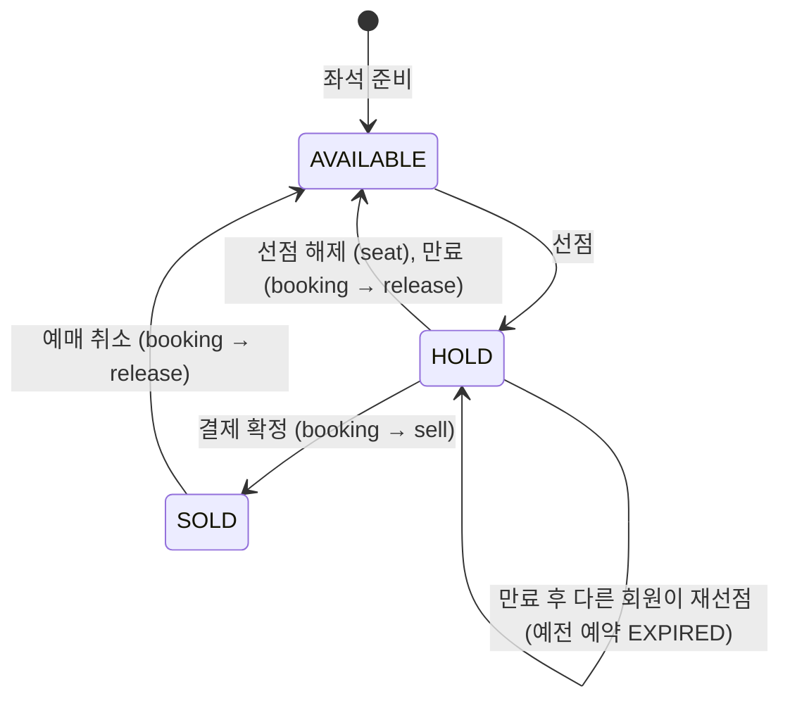

# 좌석 구현 계획

- 상태: 작성 중
- 담당: 변정민

| 문서 | 내용 |
|---|---|
| [api.md](api.md) | 외부 API 4개 |
| [tables.md](tables.md) | ERD와 `p_schedule_seats` 명세 |
| shared 계약 | 제공: [회차 좌석 준비](../shared/internal-api/seat.md) / 사용: [공연 판매 검증](../shared/internal-api/event.md) / booking과의 Facade: [BookingFacade](../shared/modules/booking-facade.md) · [SeatFacade](../shared/modules/seat-facade.md) (합의 #34) |

## 1. 목표와 범위

- 하는 것
  - 회차 좌석 준비: 공연 서비스의 Kafka 이벤트를 소비해 `p_schedule_seats`를 만들고 결과 이벤트를 발행한다.
  - 선택 가능 좌석 조회, 등급별 잔여석 조회
  - 좌석 선점(MVP 비관적 락)과 선점 해제
  - booking이 부르는 `SeatFacade`(잠금, 판매, 반환) 구현
- 하지 않는 것
  - 예약 상태 소유와 변경: booking이 맡는다. seat는 `BookingFacade`로 요청한다.
  - 선점 만료 스케줄러, 결제 준비·승인, 취소: booking이 맡는다.
  - 입장 토큰 발급·검증: queue와 Gateway가 맡는다.
  - 공연·회차·가격 원본 관리: 공연 서비스가 맡는다.

## 2. 구조

```
com.sparta.ticket.reservation
├── seat/                      # 정민
│   ├── presentation/          # 좌석 조회·선점·해제 API
│   ├── application/           # 선점·해제 유스케이스, 판매 검증 포트
│   │   └── facade/            # SeatFacade 인터페이스·타입(SeatLock, SeatState)과 구현
│   ├── domain/                # ScheduleSeat, SeatStatus, 선택 가능 판정
│   └── infrastructure/        # persistence, client(공연 판매 검증 Feign), messaging(좌석 준비 소비)
└── booking/                   # 한얼. booking.application.facade의 BookingFacade
```

- 모듈을 먼저 나누고 그 안을 계층으로 나누는 배치는 [orchestration.md](../reservation/orchestration.md) 3.1(S1) 제안을 따른다.
- seat는 booking의 `application.facade` 패키지만 쓴다. booking의 Entity·Repository·domain 타입을 쓰지 않고, 예약 테이블을 JOIN하지 않는다. ArchUnit 규칙(`SEAT_USES_BOOKING_ONLY_THROUGH_FACADE`, `BOOKING_USES_SEAT_ONLY_THROUGH_FACADE`)이 검사한다([BookingFacade 계약](../shared/modules/booking-facade.md#공통)).
- 같은 프로세스·같은 DataSource라 Facade 호출은 바깥 트랜잭션에 묶인다. 상태를 바꾸는 Facade 메서드는 `Propagation.MANDATORY`로 호출자 트랜잭션에 참여한다.

## 3. 상태



- 결제 중(PAYMENT_IN_PROGRESS) 예약의 좌석은 `hold_expires_at`이 지나도 다시 선점할 수 없다. 좌석 쪽 시각을 늘리지 않고 예약 상태로 판단한다.
- 해제 결과는 예약 상태로 구분한다. 만료 전에 사용자가 놓으면 RELEASED, 만료 후면 EXPIRED다.

## 4. 처리 흐름

### 4.1 선점

```
1. 좌석 조회 (잠금 없음): 회차 소속 확인
2. [트랜잭션 밖] 공연 판매 검증 Feign. 거절이면 reasonCode 그대로 응답, 장애면 503
3. 관람 연령 확인 (계약 미정)
4. [트랜잭션] findActiveHold → 요청 좌석 + 그 예약의 좌석을 id 오름차순 FOR UPDATE
5.   그 예약이 요청 좌석의 유효 HOLD → 기존 예약 200
6.   그 예약이 다른 좌석의 만료 HOLD → expireIfDue, true면 그 좌석 AVAILABLE
7.   판매 대상·config_version·base_price 확인
8.   선택 가능 판정. 만료 HOLD면 findPaymentInProgress → 아니면 expireIfDue로 예전 예약 EXPIRED (false면 409)
9.   countActiveSeats ≥ 1 → 409 PURCHASE_LIMIT_EXCEEDED
10.  holdExpiresAt = Clock now + 10분 (한 번만 계산)
11.  BookingFacade.hold(userId, scheduleId, [SeatLine(seatId, base_price)], holdExpiresAt) → 예약 HOLD + 티켓
12.  좌석 HOLD, reservation_id, hold_expires_at = 10단계 값
13. 커밋, 201
[트랜잭션 밖] uk_p_reservations_active_user_schedule 위반이면 409 PURCHASE_LIMIT_EXCEEDED로 변환
```

원격 호출(판매 검증)은 잠금 전에 트랜잭션 밖에서 한다. 공연 서비스가 늦어도 좌석 행과 DB 커넥션을 잡고 있지 않게 하려는 것이다. 만료 판단과 `holdExpiresAt` 계산의 now는 booking과 함께 쓰는 `Clock` 빈에서 읽는다. `hold()`가 던진 UNIQUE 위반은 트랜잭션을 롤백 전용으로 만들므로, 409 변환은 트랜잭션을 감싼 바깥에서 제약 이름으로만 한다.

### 4.2 선점 해제

```
1. getReservation (잠금 없음): 없음 404 / 회차 다름 404 / 남의 예약 403
[트랜잭션]
2. view.scheduleSeatIds 오름차순 FOR UPDATE
3. BookingFacade.release(userId, reservationId)
     RELEASED · EXPIRED · ALREADY_CLOSED → 좌석 AVAILABLE (reservation_id 일치할 때만)
     NOT_RELEASABLE                      → 좌석 그대로, 409 INVALID_STATUS_TRANSITION
커밋, 204
```

예약 상태 판단은 booking 한 곳에서 한다. 이미 끝난 예약은 좌석이 남아 있지 않을 수 있으므로 회차 확인은 예약(`getReservation`)으로 한다. `NOT_RELEASABLE`에서 좌석을 풀면 결제 중 좌석이 이중 판매되므로 좌석을 바꾸지 않는다.

### 4.3 조회·잔여석

판매 대상 중 AVAILABLE과 "만료됐고 예약이 결제 중이 아닌 HOLD"를 선택 가능으로 센다. 만료 HOLD의 예약 ID를 모아 `findPaymentInProgress`를 한 번 부른다. 잔여석은 Redis에 짧게 캐시한다.

### 4.4 회차 좌석 준비

`ScheduleSeatSetupRequested`를 소비해 한 트랜잭션에서 좌석을 전부 저장하고 `ScheduleSeatSetupCompleted`/`Failed`를 발행한다. 같은 버전은 재발행하고, 오래된 버전은 무시한다. 더 큰 버전은 모든 좌석이 AVAILABLE일 때만 교체한다([tables.md](tables.md) "컬럼이 바뀌는 시점"). 이벤트 형식은 공연 담당과 협의 중이다.

## 5. 다른 도메인과의 계약

| 상대 | 맞출 것 | 계약 문서 | 상태 |
|---|---|---|---|
| 공연 | 판매 검증 (`POST /internal/schedules/{id}/sale-validations`) | [shared/internal-api/event.md](../shared/internal-api/event.md) | 합의 |
| 공연 | 회차 좌석 준비 이벤트 (요청·완료·실패, 토픽 이름, reasonCode) | [shared/internal-api/seat.md](../shared/internal-api/seat.md) | 협의 중 (이벤트 형식 미확정) |
| 예매 (booking) | `BookingFacade`: `hold(userId, scheduleId, List<SeatLine>, holdExpiresAt)`, `getReservation`, `release(userId, reservationId) → ReleaseResult`, `countActiveSeats`, `findActiveHold`, `expireIfDue`, `findPaymentInProgress` / `SeatFacade`: `lockSeats → List<SeatLock>`, `sell(ids, reservationId)`, `release(ids, reservationId)` / 공용 `Clock` | [booking-facade.md](../shared/modules/booking-facade.md), [seat-facade.md](../shared/modules/seat-facade.md) | 합의 (#34). SeatFacade는 좌석 담당 구현 전 |
| 대기열·Gateway | `X-Queue-Token` 검증(공연 단위, TTL 10분), 경로의 scheduleId로 공연 범위 확인 | Notion 전체 API 공통 계약 | 확정 (검증 방식은 대기열 담당과 협의) |
| Gateway | `/api/schedules/{id}/seats·remaining·holds/**` → reservation-service 라우트 | `backend/config-repo/gateway-service.yml` | 미반영. 방식은 7장 1번 제안 (Task 0, @nuyheat 확인 대기) |

## 6. 작업 목록

작업 순서와 완료 조건은 [todo.md](todo.md)에 둔다. Task 하나를 이슈 1개·PR 1개로 올린다.

## 7. 열린 질문

1. **경로·Gateway 라우팅**: 외부 경로 접두사는 `/api/**`(v1 없음)로 정해졌다(2026-10-27). 남은 것은 라우팅이다. 공연 서비스의 `GET /api/schedules/{id}`(회차 상세)와 좌석의 `/api/schedules/{id}/seats·remaining·holds/**`가 같은 접두사를 쓰므로, Gateway에서 하위 경로 단위로 reservation-service에 보내야 한다. 누가 언제 라우트를 고칠지 정한다.
   - **제안** (2026-10-27, 확인 대기: @nuyheat): reservation-service 라우트에 `Path=/api/schedules/*/seats, /api/schedules/*/remaining, /api/schedules/*/holds/**`를 더한다. 공연의 `/api/schedules/**` 라우트가 생기면 그보다 앞에 둔다. Gateway는 라우트를 정의 순서대로 검사하기 때문이다. 좌석 담당이 첫 외부 API PR(Task 4)에서 고치고 Gateway 담당이 리뷰한다. 공연 라우트가 아직 `/api/v1/events/**`인 것은 공연 담당이 정리한다.
2. **감사 작성자 채우는 방식**: `created_by`·`updated_by`를 요청 사용자 ID로 채우는 `AuditorAware` 구현 위치, 요청 밖 작업(좌석 준비 소비)의 `SYSTEM` 기록, 조건부 UPDATE·잠금 후 변경에서 쿼리가 값을 넣는 방법을 booking과 같은 방식으로 맞춘다.
   - **제안** (2026-10-27, 확인 대기: @jihaneol): JPA 감사는 공통 `HeaderAuditorAware`(`X-Username`, 요청 밖은 `SYSTEM`)를 그대로 쓴다. 조건부 UPDATE에는 booking의 `ChangeStamps`와 같은 규칙(공용 `Clock` 시각, `AuditorAware` 사용자, 없으면 `SYSTEM`)으로 seat에 같은 모양의 클래스를 둔다. seat는 `booking.application.facade` 밖의 booking 타입을 쓰지 않으므로(`ArchitectureTest`, B32) `ChangeStamps`를 직접 쓰지 않는다. 좌석 준비 소비처럼 요청 밖 작업에는 `SYSTEM`이 들어간다.
3. **`+09:00` 직렬화**: 좌석 API는 `+09:00` 오프셋을 포함하기로 했다. 예매 API는 오프셋 없는 KST를 쓰고, conventions.md는 아직 "합의가 필요한 차이"로 둔다. Jackson 설정을 서비스 전체로 할지 DTO 타입(`OffsetDateTime`)으로 할지 정한다.
   - **제안** (2026-10-27, 확인 대기: @jihaneol): 서비스 전체 Jackson 설정은 바꾸지 않는다. 좌석 응답 DTO만 `OffsetDateTime`으로 만들어 공용 `Clock`의 `Asia/Seoul` 오프셋으로 내보낸다. 예매 API 형식은 바뀌지 않고, conventions.md의 차이 표는 그대로 둔다.
4. **좌석 준비 이벤트 도입 시기**: 이벤트 형식·토픽 이름은 공연 담당과 협의 중이다. reservation-service에 `spring-kafka`가 들어오는 시점(booking Phase 2와 같이 할지)과, 그 전까지 좌석 데이터를 테스트용으로 넣는 방법을 정한다.

Notion에 남은 미확정 항목(2026-10-27 기준):

5. 관람 연령 검증: 생년월일 확보, 연령 기준, ageRating 전달 계약과 오류 코드 (회원·공연 담당)
6. 선점 API의 Idempotency-Key 적용 범위
7. 잔여석 캐시 TTL 값
8. 조회 API 구현 담당: Notion 기능 분담표는 좌석 배치도·잔여석 미리보기를 4번 담당으로 적었다. 좌석 데이터가 `p_schedule_seats`에 있으므로 좌석 담당이 구현하는 것으로 확정할지 정한다.

Task 0에서 더한 항목:

9. **좌석 DDL 파일 위치**: booking은 자기 테이블 DDL을 `booking.sql`로 나눴고 `schema.sql`은 고치지 않는다(booking-decisions.md B27).
   - **합의** (2026-10-27, @jihaneol, PR #57 리뷰): 좌석도 `backend/sql/reservation-service/seat.sql`에 둔다. `schema.sql`은 고치지 않는다. 쿠폰도 곧 테이블이 생기므로 모듈별 파일로 나눠야 충돌이 적다. 좌석 통합 테스트는 `schema.sql`, `booking.sql`, `seat.sql` 순서로 실행한다. booking 테스트 설정에 `seat.sql`을 더할지는 Task 1에서 예매 담당과 정한다.
