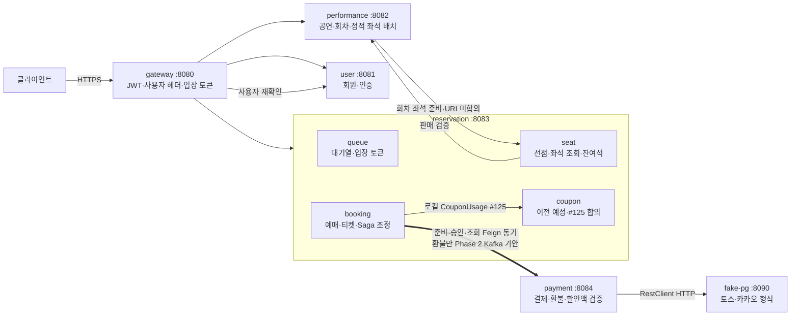
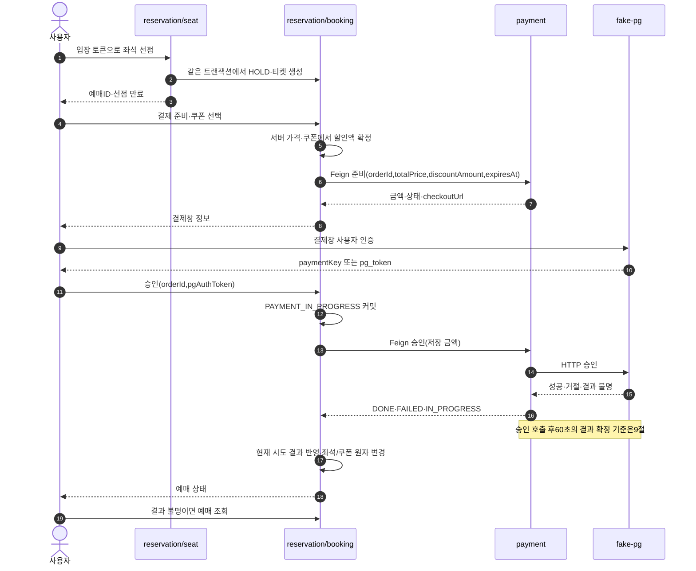
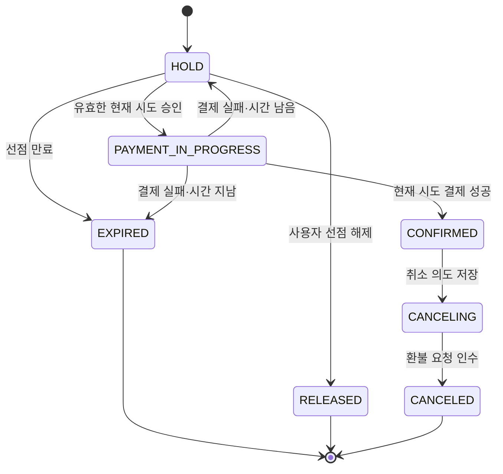

# 시스템 아키텍처

- Notion 시스템 구성도를 옮긴 뒤 저장소의 후속 합의에 맞춰 본문을 정리했다. **이 문서가 현재 설계 기준**이며, Notion 원본은 수정하지 않았다.
- 출처: 팀 Notion [시스템 구성도](https://app.notion.com/p/404b3ff41d3980e89bb9e17ce9f7106f)의 기존 전사본과 develop 7a48c5e(#54 포함). 이번 작업에서 실시간 Notion·실제 배포 상태는 검증하지 않았다.
- 합의된 설계와 구현 완료는 다르다. API별 상태는 [api.md](api.md), 현행 DDL과 계획은 [tables.md](tables.md), 공통 표현은 [conventions.md](conventions.md)를 따른다. 배치는 [infra.md](infra.md)에 있다.
- 결정 번호의 뜻은 13절, 담당 확인·미합의·구현 차이는 14절에 모은다. 한 담당 내부의 상세 구현·실험·작업 계획은 이슈 또는 담당 로컬 문서에 둔다.

## 1. 전체 구성도

- 실선은 동기 HTTP 또는 서비스 안 모듈 호출이다. 굵은 선은 예매가 조정하는 결제·환불 흐름이다.
- 승인은 고도화 후에도 Feign 동기다(D16). 환불 명령과 확정 결과 메시징은 후속 계약이며 그림이 토픽·스키마 합의를 대신하지 않는다.
- 업무 서비스는 Eureka·Config를 사용하고 Prometheus가 지표를 수집한다. fake-pg는 독립 PG 모의 서버이므로 Config·Eureka·공통 업무 모듈을 사용하지 않는다.

## 2. 서비스와 책임

| 서비스·모듈 | 포트 | 책임·데이터 | 담당 |
|---|---|---|---|
| gateway-service | 8080 | 라우팅·JWT·검증된 사용자 헤더, 내부 경로 차단. 입장 토큰·요청 제한은 구현 상태 별도 확인 | 태현·윤범 |
| user-service | 8081 | 회원·인증·역할, user_schema | 태현 |
| performance-service | 8082 | 공연장·고정 좌석 등급/배치·공연 가격·회차·공개·판매 검증, performance_schema | 의연 |
| reservation-service / queue | 8083 | 대기열 순번·입장 토큰, Redis | 태현 |
| reservation-service / seat | 8083 | 회차 좌석 스냅샷·선점·실시간 좌석/잔여석 조회, reservation_schema | 정민 |
| reservation-service / booking | 8083 | 예매·티켓·만료·결제 준비/승인·취소/보상 조정, reservation_schema | 한얼 |
| reservation-service / coupon | 8083 | 쿠폰 정책·동기 발급·점유/사용/복원. reservation_schema로 이전 예정, CouponUsage #125 합의 | 윤범 |
| payment-service | 8084 | 결제·환불·PG 실행·결과 확인, payment_schema. 쿠폰 ID/상태는 처리하지 않음 | 현민 |
| fake-pg | 8090 | 토스·카카오 호환 거래·장애 주입·결과 조회, fake_pg_schema | 현민 |

- 서비스별 계정·스키마를 격리하고 다른 서비스 데이터의 직접 조회·물리 FK를 두지 않는다. common-core는 비웹 계약, common은 MVC 공통이다.
- seat·booking은 같은 로컬 트랜잭션에서 좌석·예매를 맞춘다. 쿠폰 이전의 목적도 같은 원자성 확보이며, 상세 연결은 #125에서 합의했고 구현 전이다. 모듈을 별도 서비스로 나누면 기존 원자성을 자동 보존할 수 없다.
- 판매자 정산·수수료·부분 환불은 현행 확장 범위이며 합의 없이 추가하지 않는다.

## 3. 서비스 간 통신

| 흐름 | 현재 기준 | 상태 |
|---|---|---|
| 클라이언트 → 서비스 | Gateway → Eureka lb 라우팅. 실 라우트 차이는 infra 10절 | 기반 구현됨 |
| gateway → user | WebClient GET /internal/users/{userId}, 일반 요청 캐시60초. 결제 관리자 요청은 캐시 우회·MASTER 검사 | 일반 인증 구현됨. 관리자 예외는 #88 브랜치 구현 |
| 서비스 → 서비스 | Feign이 검증된 사용자 헤더 전달. 서비스 인증은 별도 계약 | 기반 구현됨 |
| performance → seat | 판매자 회차 등록·구성 변경 커밋 후 Feign으로 준비/재준비. URI·응답 미합의(#54) | 공연 방향과 좌석 소비안 조율 필요 |
| seat → performance | POST /internal/schedules/{scheduleId}/sale-validations, 선점 트랜잭션 밖 호출 | 기존 합의·DTO 상세 초안 구분 |
| booking → coupon | 로컬 CouponUsage, reservationId 점유 | #125 합의, 구현 전 |
| booking → payment 준비·승인·조회 | Feign 동기 유지. 승인 응답 DONE/FAILED/IN_PROGRESS | HTTP 계약 합의, D16 적용 |
| booking → payment 환불 | MVP HTTP 동기. 200과 해석 가능한 refundStatus면 인수(#127). Phase 2 Kafka 명령은 P3 가안 | MVP 인수 기준 합의(#127), 토픽 미합의 |
| payment → 예매 확정 결과 | MVP 동기 응답과 예매 폴링. 고도화 결과 이벤트·Outbox | 결과 메시지 미합의 |
| payment → fake-pg | RestClient + JDK HttpClient HTTP/1.1. 연결2초·읽기10초(D17) | PG 어댑터 구현됨 |
| 잔여석 조회 | seat가 GET /api/seats/schedules/{scheduleId}/remaining 제공. 공연 카운터 갱신 이벤트는 보류 | 좌석 API 초안 |
| 쿠폰 발급 | POST /api/coupons/{couponId}/issue 동기201 | 구현됨(동기201). Kafka202 전환 미합의 |

- /internal 경로는 Gateway 외부 접근을 차단한다. 내부 API 명세는 api.md에 유지하되 공개 Swagger 노출 여부는 따로 점검한다.
- 사용자 헤더는 서비스 인증의 대체물이 아니다. 서비스 포트 외부 차단은 [infra.md](infra.md) 2-1절을 따른다.
- 입장 토큰은 좌석 조회·선점만 검사한다. 결제·예매 요청에는 적용하지 않는다.
- 예매의 Feign 읽기15초와 결제의20초 제안은 담당 조율 대기다. Gateway 현행 응답 타임아웃은60초다.

## 4. 예매 흐름

준비 실패 상태를 성공 URL로 매핑하지 않는다. 준비 순서·오래된 요청 역전·HTTP200+FAILED 매핑은 14절에서 조율한다. PG 인증값은 Kafka로 보내지 않는다. 환불 실행·확정 결과 전달만 고도화 비교 대상이며, 두 단계가 전송 방식만 다르다고 가정하지 않는다.

## 5. 예매 상태

- HOLD는 좌석을 선점한 상태다. 준비는 상태를 바꾸지 않으며 실패 후 HOLD 복귀 때 쿠폰은 유지한다.
- PAYMENT_IN_PROGRESS는 선점 만료 정리 대상이 아니다.60초는 결제의 판정 기준이고 잡 지연·서버 중단 중 완료 시한 보장은 아니다(9절).
- CONFIRMED는 좌석 판매·티켓 코드·쿠폰 사용이 함께 확정된 상태다. EXPIRED/RELEASED는 좌석·예약 쿠폰을 반환한다.
- CANCELING은 외부 환불 전 저장하는 의도, CANCELED는 결제의 환불 요청 인수 상태다. PG 취소 완료와 같지 않다.
- facade enum ReservationState와 활성 부분 UNIQUE에는 CANCELING이 있다. domain ReservationStatus·booking.sql CHECK·countActiveSeats 집계에 더하는 것은 #126으로 합의했고 구현 전이다.
- 상태 전이는 조건부 UPDATE로 한 번만 반영한다. CANCELING → CONFIRMED 복귀 경로는 두지 않는다(#127). 영구 확정 실패의 PAYMENT_IN_PROGRESS/EXPIRED → CANCELING 전이는 자동 추가하지 않는다(14절).

## 6. Kafka 메시징 범위

아래는 후속 설계 목록이다. 토픽 이름·Envelope·스키마·버전·파티션 키·DLT 정책은 최종 계약이 아니다. 승인 명령·인증값을 메시지에 싣지 않는다(D16).

| 제안 이름 | 용도·발행 → 소비 | 상태 |
|---|---|---|
| coupon.issue.requested | 쿠폰 비동기 발급. 후보 식별자 couponId·userId | 미합의. 현재 계약은 동기201 |
| seat.status.changed | seat → 공연 잔여석 반영. 후보 식별자 scheduleId·venueSeatGradeId | 보류. 현재 조회 소유자는 seat |
| payment.completed / payment.failed | payment → 예매 확정 결과 | 고도화 초안. paidAmount/amount·reason/failureType 등 필드 미합의 |
| payment.refund.requested | 예매 → 결제 환불/확정 실패 보상 | 고도화 초안. 접수 확인 의미 미합의 |
| payment.refunded | 결제 → 결과 소비자 환불 확정 사실 | 고도화 초안. 실제 계좌 반영 보장 아님 |

eventId로 메시지 중복을, orderId 등 업무 키로 업무 중복을 각각 막는다. 파티션 내 순서만으로 다른 시도의 늦은 결과를 막지 못한다. DB 인계 전 offset 커밋 금지, Outbox와 업무 상태는 함께 저장한다. DLT 이동은 업무 완료가 아니며 수동 재처리 책임을 남긴다.

## 7. 실패와 보상

| 상황 | 처리·경계 |
|---|---|
| 선점 만료·미결제 | HOLD만 EXPIRED로 전이하고 좌석·쿠폰 해제 |
| 승인 실패 | 현재 시도의 결과만 반영. 시간 남으면 HOLD, 지났으면 EXPIRED |
| 승인 응답 유실·조회 장애 | PAYMENT_IN_PROGRESS 유지·폴링.60초 판정 기준은9절, 조회 불가만으로 좌석 반환 금지 |
| PG 호출 전 READY | 승인 접수 여부를 조회하고 같은 orderId·인증값으로 재전송. 세부 재전송 시각·404 분기는14절 |
| FAILED 종료 후 늦은 과금 | 해당 orderId만 AUTO_VOID, 새 예매 시도·쿠폰은 보존. 결제 담당의 단계별 최소 Reconcile로 확인하며 최종 누락 부재의 증명은 아님. 실제 PG 취소와 전체 내역 대사는 별도 |
| 과금됐으나 확정 불가(F6) | 현재 시도 식별·알림. MVP의 보상 의도 영속 저장 여부는 B19/D18 합의 대기 |
| 환불 접수 응답 유실 | CANCELING 유지. 취소 확인 스케줄러가 조회 없이 CANCELING 진입 때 고정한 orderId로 재요청한다. 200과 해석 가능한 refundStatus면 CANCELED. 404는 알림·CANCELING 유지(#127) |
| 환불 PG 거절·장기 불명 | 금융 미완료는 결제가 관리. 인수 후 취소한 티켓을 되살리지 않음. 접수 전 정책상 거절과 구분 |
| 회차 취소 | 공연202 접수와 예매 전달·PG 완료는 구분. 전파·재시도·상태별 정리는14절 계약 대기 |

자동 환불이 목표여도 감지·로그만으로 보상 완료를 보고하지 않는다. 영속 의도·재시도·운영 인수까지 연결해야 하며, 구현 완료 여부를 담당 단독 설계와 혼동하지 않는다.

## 8. 플랫폼 구성 요소

| 구성 | 역할 |
|---|---|
| Eureka·Config Server | 서비스 등록/발견·외부 설정. fake-pg 제외 |
| PostgreSQL | 단일 인스턴스에 전용 스키마/계정. 물리 장애·자원은 공유 |
| Redis | 대기열·입장 토큰·캐시. 키/TTL 세부는 해당 계약 |
| Kafka |6절 고도화 명령·결과. 단일 브로커는 고가용성 아님 |
| Prometheus·Grafana | HTTP·JVM·DB 풀·PG 지연·미완료 거래, 고도화 후 lag/DB 작업 대기 |

포트·서버·배포·측정 환경은 infra에만 정의한다.

## 9. 예매 ↔ 결제 연동 규칙

1~7절에 없는, 예매와 결제가 함께 지켜야 하는 규칙이다. 결제 내부 동작(복구·대사·워커·검증 관문)은 결제 담당 문서에서 관리한다.

- **PG 인증값:** 토스 paymentKey·카카오 pg_token은 미완료 승인을 재전송하는 동안만 예매가 보관하고, 끝나면 지운다. 응답·로그·이벤트·메시지에 남기지 않는다. 결제는 인증값을 저장하지 않는다.
- **현재 시도만 반영:** 결과의 orderId가 예매의 현재 orderId와 같을 때만 반영한다. 다르면 지난 시도의 결과다(실패는 무시, 성공은 F6으로 환불). F6의 MVP 처리 범위는 14절 「취소·보상」에서 정한다.
- **결과 확정 시한:** 결제는 PG 승인 호출 시각부터 60초가 지나도 결과를 모르면 FAILED(`PG_UNRESOLVED`)로 확정한다. 서버 중단·적체 중에도 정확히 60초에 끝난다는 보장은 아니고, 실제 과금이 없었다는 증명도 아니다. 그래서 늦은 승인은 결제가 그 orderId만 자동 환불(`AUTO_VOID`)하고, 새 시도의 예매·쿠폰·티켓은 건드리지 않는다.
- **조회가 안 될 때:** 결제 조회가 실패했다는 이유만으로 예매가 좌석·쿠폰을 풀지 않는다.
- **환불의 세 단계:** 환불 접수, PG 취소 성공, 고객 카드·계좌 반영은 각각 다른 시점에 끝난다. `NOT_REQUIRED`·`SKIPPED`의 의미는 api.md 결제 계약을 따른다.
- **취소 정책:** 사용자는 회차 시작 전에만 정책에 따라 취소할 수 있다. 기한은 CONFIRMED → CANCELING 때 선점 시 저장한 회차 시작 시각으로 판정하고(`now < scheduleStartAt`), 받은 취소는 회차가 시작된 뒤에도 마무리한다(#126·#127). 회차 취소와 확정 실패 보상은 사용자 취소 기한의 예외다. 부분 환불·취소 수수료 차감은 지원하지 않는다.
- **환불 실패와 예매:** 환불이 FAILED·차단돼도 취소한 예매·티켓을 되살리지 않는다. 환불 완료는 결제가 끝까지 책임진다.

## 10. 공연·좌석 준비

- 물리 좌석/등급은 공연장 고정, 가격·제외 정책은 공연 단위로 모든 회차가 공유. 회차별 점유만 seat 소유. 공개 후 배치/가격/제외 불변, 표시 정보 수정 범위는 API 계약.
- DRAFT이며 삭제 회차 포함 등록 이력이 없을 때만 venue 변경. 가격/제외 초기화와 공연 버전 갱신을 한 트랜잭션에 수행.
- 공개 공연에도 새 회차 추가 가능. 부모 공연 잠금으로 공개/회차 구성 변경 직렬화. performance.version과 schedule.version은 독립, 회차 시간 변경으로 performance.version 증가 안 함.
- 회차 PENDING → 준비 성공 READY / 실패 FAILED. 재전송·자동 재시도는 같은 requestId. **#54 최신 기준: configVersion 변경 시에만 새 requestId**. 결과의 현재 requestId/configVersion 일치 확인. 이전 회의의 '확정 실패 후 무조건 새 requestId'보다 이 계약이 최신이다.
- 같은 버전 재처리는 좌석 중복 생성 없이 이번 요청에 맞는 결과 재현. 낮은 버전 무시, 높은 버전 교체는 기존 모든 좌석 AVAILABLE일 때만. 만료 미정리 HOLD는 AVAILABLE 아님. 회차 시간 변경은 좌석 스냅샷에 없으므로 재준비 불필요.
- 공개 조건에 READY를 강제하지 않지만 실제 판매는 READY 필요. 영구 준비 실패·미완성 공개 회차의 경보/재시도 운영 기준 미합의.
- 일시 준비 장애(연결/timeout/5xx)는 PENDING 유지·같은 requestId 자동 재시도, 최대 횟수 초과/4xx 검증 오류는 FAILED+안전한 오류 요약. 가격/제외 구성 변경 시 configVersion 증가·새 requestId로 재준비. 판매자 전용 재시도 API 없음.
- 이미 공개된 공연의 publication 재요청은 If-Match 불일치에도 현재 결과200·최초 publishedAt 보존, DRAFT 복귀 없음. 공연이 참조한 물리 배치는 변경 금지(VENUE_LAYOUT_IN_USE), 미삭제 좌석이 쓰는 등급 삭제 금지(VENUE_GRADE_IN_USE). 일괄 좌석 중복은 전체 롤백.
- 판매 검증은 신규 선점 정책/가격 확인이며 좌석 확보 보장 아님. 검증 직후 취소 경쟁은 전파/보상으로 처리. 판매 중지는 신규 선점 차단, 기존 유효 HOLD 결제는 원래 만료까지 허용.

## 11. 선점·예매 로컬 원자성

- 선점10분, MVP 회원·회차당1장. seat가 공유 Clock(Asia/Seoul)으로 holdExpiresAt을 한 번 계산, 좌석/예매에 동일 저장. 결제 중 연장 안 함. 과거 DB now() 초안은 #34 공유 Clock으로 대체.
- 잠금 순서 **좌석 ID 오름차순 → 예약**. 선점·만료·확정·해제·취소 모두 동일. 모듈 facade 모든 메서드 MANDATORY. CouponUsage는 REQUIRED로 예매 트랜잭션에 참여한다(#125).
- 매수 제한 사전 count + DB 부분 UNIQUE로 최종 방어. 유니크 위반은 전체 선점 롤백, 제약 이름이 맞을 때만 트랜잭션 밖409 변환. 본인 만료 HOLD는 옛 좌석 잠금→예약 EXPIRED→좌석 반환 뒤 재선점.
- 같은 회원/좌석의 만료 전 HOLD 재요청은 기존 예약200. 가격은 seat.base_price→ticket.price로 복사, 결제 totalPrice는 티켓 합. 클라이언트 가격 신뢰 금지.
- 만료 `HOLD AND expires<=:now`, 결제 시작 `HOLD AND expires>:now`. PAYMENT_IN_PROGRESS는 만료 정리 대상 아님. 상태 변경0행은 재조회/분기, 성공 가정 금지.
- 선택 가능/잔여석 = 판매 가능 AVAILABLE + 만료됐고 예약이 PAYMENT_IN_PROGRESS가 아닌 HOLD. 만료 HOLD의 예약ID를 모아 findPaymentInProgress 한 번 호출, 다른 모듈 테이블 JOIN 안 함. 실제 재선점은 expireIfDue 조건부 변경으로 최종 방어.
- SeatFacade.sell은 HOLD+reservation_id 일치, release도 reservation_id 일치. 갱신 행 수가 요청 수와 다르면 확정 성공으로 처리하지 않는다. 가격 재조회(priceSnapshot) 없음.
- release 결과 RELEASED/EXPIRED/ALREADY_CLOSED만 좌석 반환. NOT_RELEASABLE은409, PAYMENT_IN_PROGRESS/CONFIRMED/CANCELING/CANCELED 좌석은 해제하지 않음.

## 12. 예매 ↔ 쿠폰 (CouponUsage #125 합의)

메서드와 타입은 api.md 「서비스 내부 모듈 계약」에 있다.

- reservationId로 점유하고, 발급 시점의 할인액을 쓴다. reserve 때 유효기간을 확인하고, 이후 RESERVED는 만료 배치가 풀지 않는다. 유효기간이 지나도 결제가 확정되면 USED다.
- 결제 FAILED로 HOLD에 돌아가면 쿠폰을 유지하고, EXPIRED·RELEASED면 해제한다. CANCELED면 USED를 복원한다(원래 만료됐으면 EXPIRED).
- 쿠폰을 바꾸면 기존 쿠폰의 release를 먼저 하고 새 reserve를 같은 트랜잭션에서 한다.
- 취소한 예매의 쿠폰은 취소 확정(결제가 환불 요청을 받아 예매가 CANCELED가 될 때) 때 복원한다. 환불 완료를 기다리지 않는다. 환불이 끝내 실패해도 취소한 예매를 되살리지 않으므로 쿠폰도 복원한 채로 둔다.
- 할인액을 최소 결제 금액에 맞춰 자르는 일은 예매가 한다. 쿠폰은 발급 시점 할인액을 그대로 주고, 결제는 보정 없이 검증한다.

## 13. 결정 번호

root 문서에 나오는 번호의 뜻이다. 여기에 없는 번호는 추측하지 말고 Git 이력·이슈에서 찾거나 담당에게 묻는다.

| 번호 | 뜻 | 상태 |
|---|---|---|
| D16 | (결제) 예매 → 결제 준비·승인·조회는 고도화 후에도 Feign 동기. Kafka는 환불 명령, 확정 실패 보상, 확정 결과 전달에만 쓰고 승인 명령·PG 인증값은 싣지 않는다 | 결제 결정. 승인 응답 유지는 결제 계약에 반영 |
| D17 | (결제) PG는 Feign이 아니라 RestClient + JDK HttpClient로 부른다. 공통 Feign의 `X-User-*` 헤더·오류 변환이 외부 PG에 맞지 않는다 | 구현됨 (#45) |
| D18 | (결제) 확정할 수 없는 결제는 보상 의도를 영속 저장해 재시작 뒤에도 이어서 처리한다. 로그·지표만으로 완료로 보지 않는다 | 결제 결정. 예매 B19와 범위 합의 대기 |
| B19 | (예매) "결제는 됐는데 표가 없는" 상태(F6)는 자동 환불로 끝낸다. MVP는 감지·알림·지표만 두고 환불 요청은 트러블슈팅 기간에 붙인다 | 예매 결정. D18과 범위 합의 대기 |
| F6 | (예매 실패 유형) 이미 끝난 예약이나 다른 시도(orderId 불일치)에 결제 성공이 도착한 경우. 그 orderId로 환불을 요청한다 | 예매 설계 |
| #22 | 결제는 쿠폰을 처리하지 않는다. 예매가 확정한 정가·할인액만 받아 검증·저장한다 | 합의 (#25에서 예매 담당 승인) |
| #27 | CouponUsage를 예매 기준(reservationId 점유)으로 바꾸는 계약 | #125로 이어서 합의 |
| #125 | CouponUsage의 메서드·반환 타입, USED 복원, 취소 확정 때 복원, 할인액은 예매가 자름 | 합의 (쿠폰·결제 담당 확인) |
| #126 | 선점 때 HoldTarget으로 회차 시작 시각·공연명을 넘겨 예약에 스냅샷으로 저장하고, CANCELING을 domain/CHECK/집계에 반영한다 | 합의 (좌석 담당 확인) |
| #127 | 예약 취소 API, NOT_CANCELLABLE 409, 환불 200 응답의 인수 해석, 같은 orderId 재요청, CANCELING → CONFIRMED 복귀 없음 | 합의 (결제·좌석 담당 확인) |
| #34 | seat ↔ booking은 facade 패키지의 메서드·타입으로만 서로 부르고, 공유 Clock으로 선점 만료를 계산한다 | 합의 |
| #86 | 결제 준비의 sellerId·performanceId는 판매 검증(P21) 응답에서 받아 선점 때 예약에 저장한 값을 쓴다 | 합의 |
| #54 | 공연 명세의 최신 원본. 회차 좌석 준비는 configVersion이 바뀔 때만 새 requestId를 쓴다 | 합의 |
| P3·P4 | (Notion) 환불(P3)·승인(P4) Phase 2 전환 안건 | P4는 D16으로 철회, P3는 환불·결과 토픽 미합의 |
| T3 | (Notion) 취소 상태 이름을 CANCELING·CANCELED로 정한 결정 | 확정 |
| #25 | (PR) #22 할인액 전달·쿠폰 책임 분리에 예매 담당이 동의한 리뷰 | 합의 근거 |
| #30 | (PR) fake-pg의 카카오 호환 API 추가 | 구현됨 |
| #45 | (PR) 토스·카카오 PG 어댑터와 RestClient 기반 처리 | 구현됨 |
| #48 | (PR) event-service를 performance-service로 변경 | 구현됨 |
| #57 | (PR 리뷰) 좌석 DDL을 seat.sql로 분리, schema.sql 수정하지 않음 | 담당 합의. #66에서 seat.sql 반영 |
| #66 | 좌석 상태별 예약ID/만료시각 일관성 CHECK(`ck_p_schedule_seats_holder`) 추가 | 예매 담당 리뷰로 합의 |
| B21·B22 | 예매 실패 후 orderId/금액 정리, 중복 승인/만료 경계 처리 | 현행 예매 동작 |
| B27·B28 | booking.sql 분리, 선점 때 티켓·가격 저장 | 현행 예매 동작 |
| B31~B33 | 활성 예매 UNIQUE, facade 경계, 공유 Clock | #34 및 현행 구현 기준 |
| I1~I8 | 인프라 운영·배치의 결정 필요 항목 | infra 8절 참조 |

api의 P1~P21은 공연 응답 DTO 식별자이며 Notion 전환 안건 P3/P4와 다르다. 구현 상태는 API 절의 표시를 따른다.

## 14. 미합의·구현 차이 — 여기서만 관리

확정 정책은 다시 협의 대상으로 돌리지 않는다. 아래는 구현 연결·이행 또는 남은 충돌의 담당 확인 목록이다. 일부 코드가 존재해도 서비스 연동 전체가 구현됐다는 뜻은 아니다.

| 항목 | 현재 근거·필요한 결정/후속 작업 | 관련 담당 |
|---|---|---|
| 준비 순서 | 같은 예매 준비의 직렬화/영속 소유 방식, 오래된 원격 시도 차단, READY_FAILED 매핑. 타임아웃 재전송은 같은 orderId 유지 제안 | 예매·결제 |
| CouponUsage 구현 | 계약은 #125로 합의했다. coupon 모듈의 CouponUsage 구현, 예매의 호출 연결과 할인액 자르기, 예매 쿠폰 DDL(tables 「예매 쿠폰」)이 남았다 | 예매·쿠폰 |
| 취소·보상 | 사용자 취소는 #126·#127로 합의했다. CANCELING domain enum/CHECK/집계, 예매 회차 스냅샷 DDL, 취소 API와 취소 확인 스케줄러 구현이 남았다. F6의 B19(감지·알림)와 D18(보상 의도 영속 저장) MVP 범위 조율 | 예매·좌석·결제 |
| 회차 취소 | 공연202만 확정. 전달 URI/payload/영속 재시도 주체·결제중 보호·신규 판매 차단·PG 환불 조회 합의. reservation-summary만으로 PG 환불 완료 판단 금지 | 공연·예매·좌석·결제 |
| 삭제 전 조회 | 공연/회차 삭제의 예매 존재 확인·오류·의존 조회 불가 정책 계약 | 공연·예매 |
| 연령·탈퇴 | 미달 차단에 필요한 생년월일/기준시각/ageRating 전달, 진행 거래·공연 보유 회원 탈퇴 정책 | 회원·공연·예매 |
| 시각·페이징 | +09:00 Offset 공통 목표의 DTO별 이행, Page DTO/size 통일. 감사 주체 정책과 직렬화 형식은 구분 | 전 도메인 |
| 입장·캐시 | 공연 범위·TTL10분·좌석조회/선점 적용은 확정. 발급/전달 응답·회차→공연 검증·Redis 키·오픈 전 진입·잔여석 캐시TTL 결정 | 대기열·좌석·Gateway |
| 만료 직전 요청 | payment.expiresAt=holdExpiresAt 경계·전송 중 만료 처리·grace 합의 | 예매·결제 |
| Feign timeout | 현행 예매15초와 결제20초 제안의 실행 예산 조율 | 예매·결제 |
| 조회404 | 진행 중 결제 조회404는 알림·상태 유지. 준비 재시도 안내와 구분. ORDER_ID_MISMATCH는 현행409. NOT_CANCELLABLE은 409로 합의(#127) | 예매·결제 |
| 금액 타입 | payment_amount 및 원본 discount_amount BIGINT에서 공통 INT 목표로 DDL·DTO 이행 범위·시점 | 예매·결제 |
| 내부 보안·운영 | 결제 관리자 JWT·MASTER·캐시 우회는 #88 브랜치 구현(api/infra 참조). 서비스 인증 전반·직접 접근 통제·공통 감사 주체·미완료 경보는 별도 확인 | 플랫폼·각 도메인 |
| 추가 API | 티켓 조회/관리자 예매 목록은 현행 계약 없음. 전체 공연 취소 API는 제공하지 않고 회차별 취소 | 예매·공연 |
| 좌석 준비 통신 | #54 공연 MVP Feign과 좌석 원본 Kafka 차이. URI·응답·timeout·자동 재시도·영구 실패 운영·전환 일정 확정 | 공연·좌석 |
| 공연 복원 검토 | 등급/좌석 미존재 오류, 공개 정적배치 권한, 취소 목록 포함, 공개검증, salesStatus/period 대상 회차 확인. 공개 wrapper/숫자ID/UNAUTHORIZED는 공통 기준 유지 | 공연·좌석 |
| 판매 검증 경계 | 중지 후 기존 유효 HOLD 결제 허용은 기존 정책. 취소 경합·판매 마감 이후 확정 경계·필요한 재검증 확인 | 공연·예매·좌석 |
| 결과·환불 토픽 | 토픽·스키마·버전, paidAmount/amount 및 reason/failureType/failureCode 명칭, 수신/DB 인계/PG 완료를 구분한 접수 보장 합의. 승인 토픽은 D16으로 철회 | 예매·결제 |
| 쿠폰 발급 방식 | 현재 동기201 유지. Kafka202 전환 대상·접수 보장·시점 미합의 | 쿠폰·플랫폼 |
| 잔여석 이벤트 | 소유는 seat. performance 카운터·seat.status.changed 도입 여부와 조회 구현 연결 확인 | 좌석·공연 |
| Facade 조회 경계 | 모든 메서드 MANDATORY. getReservation은 호출자 트랜잭션에서 비잠금 사전 조회, 좌석→예약 변경 순서 유지 | 좌석·예매 |
| 실제 Gateway 경로 | 공통 계약 경로와 현행 하위 라우팅의 이행 확인. HOLD_EXPIRED는 합의·현행409 유지, 이전410을 재적용하지 않음 | 공연·좌석·예매·Gateway |
| fake-pg 결제창 경로 | 브라우저 접근 경로는 미구현. Gateway 라우트가 없고 서비스 포트를 외부에 열지 않는 배포 기준과 연결 필요 | 플랫폼·결제 |
| 대기열 분리 | 별도 서비스 분리는 측정 후 결정 | 대기열·플랫폼 |
