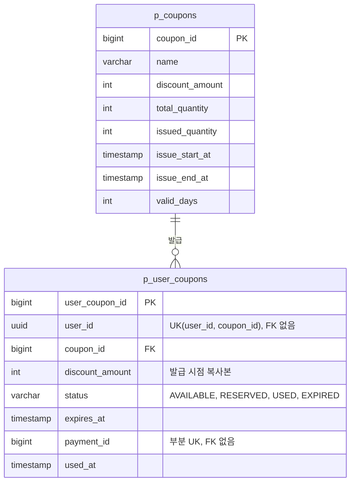

# 쿠폰 테이블 명세

- 상태: 작성 중
- 담당:
- DDL: `backend/sql/payment-service/schema.sql`
- 출처: Notion 테이블 명세서 "쿠폰" 토글 (2026-10-26 기준). 담당자가 검토하며 고친다.

## 1. ERD

감사 컬럼 6개는 ERD에서 뺐다.

## 2. 공통 사항

| 항목 | 내용 |
| --- | --- |
| 서비스 | payment-service |
| 스키마 | payment_schema |
| DDL 위치 | backend/sql/payment-service/schema.sql |
| 소유 | 쿠폰 담당 (결제는 CouponUsage의 reserve / use / release로만 접근) |
| 공통 규칙 | Audit 컬럼 6개, BaseEntity 상속, @SQLRestriction("deleted_at IS NULL") |

결제와의 계약은 [shared/modules/coupon-usage.md](../shared/modules/coupon-usage.md)다. 이 명세대로 메서드 3개(`reserve`, `use`, `release`)로 합의했다.

### 테이블 관계

| 부모 | 자식 | 관계 | 연결 | FK |
| --- | --- | --- | --- | --- |
| p_coupons | p_user_coupons | 1 : N | coupon_id | 있음 |
| p_users (user_schema) | p_user_coupons | 1 : N | user_id | 없음 (스키마가 다름) |
| p_payments (결제 담당) | p_user_coupons | 1 : 0..1 | payment_id | 없음 (소유자가 다름) |

## 3. p_coupons — 쿠폰 정의

| 컬럼명 | 타입 | 키 | NULL | 기본값 | 설명 |
| --- | --- | --- | --- | --- | --- |
| coupon_id | BIGINT | PK | N | IDENTITY | 쿠폰 ID |
| name | VARCHAR(100) |  | N |  | 쿠폰 이름 (1~100자) |
| discount_amount | INT |  | N |  | 정액 할인액(원). 발급 시작 후 변경 불가 |
| total_quantity | INT |  | N |  | 총 발급 수량. 발급 시작 후에도 issued_quantity 이상으로 변경 가능 |
| issued_quantity | INT |  | N | 0 | 발급된 수량. 선착순 발급의 조건부 UPDATE로만 올림 |
| issue_start_at | TIMESTAMP |  | N |  | 발급 시작 시각. 발급 시작 후 변경 불가 |
| issue_end_at | TIMESTAMP |  | N |  | 발급 종료 시각. 발급 중단 시 현재 시각으로 당김 |
| valid_days | INT |  | N |  | 발급 후 사용 가능 일수. 발급 시작 후 변경 불가 |
| created_at | TIMESTAMP |  | N |  | 생성 시각 |
| created_by | VARCHAR(100) |  | N |  | 생성자 |
| updated_at | TIMESTAMP |  | N |  | 수정 시각 |
| updated_by | VARCHAR(100) |  | N |  | 수정자 |
| deleted_at | TIMESTAMP |  | Y |  | 논리 삭제 시각 (삭제 API 없음) |
| deleted_by | VARCHAR(100) |  | Y |  | 논리 삭제자 |

**제약·인덱스**

| 이름 | 종류 | 조건 | 목적 |
| --- | --- | --- | --- |
| ck_p_coupons_discount | CHECK | discount_amount > 0 | 할인액은 양수 |
| ck_p_coupons_quantity | CHECK | total_quantity > 0 AND issued_quantity BETWEEN 0 AND total_quantity | 초과 발급을 DB에서 마지막으로 막음 |
| ck_p_coupons_period | CHECK | issue_start_at <= issue_end_at | 발급 기간 순서. 시작 전 중단 시 둘이 같아질 수 있음 |
| ck_p_coupons_valid_days | CHECK | valid_days > 0 | 유효 일수는 양수 |

**계산 값 (컬럼 없음)**

| 응답 필드 | 계산 |
| --- | --- |
| remainingQuantity | total_quantity - issued_quantity |
| issueStatus | 현재 < issue_start_at 이면 UPCOMING, issue_start_at <= 현재 < issue_end_at 이면 ISSUING, 그 밖은 ENDED |
| issuedByMe | 현재 사용자의 p_user_coupons 행이 있으면 true |

## 4. p_user_coupons — 회원 쿠폰

| 컬럼명 | 타입 | 키 | NULL | 기본값 | 설명 |
| --- | --- | --- | --- | --- | --- |
| user_coupon_id | BIGINT | PK | N | IDENTITY | 회원 쿠폰 ID. 결제 준비에 넣는 값 |
| user_id | UUID | UK① | N |  | 발급받은 회원. user_schema에 있어 FK 없음 |
| coupon_id | BIGINT | FK, UK① | N |  | 쿠폰 정의 (p_coupons.coupon_id) |
| discount_amount | INT |  | N |  | 발급 시점 할인액 복사본 |
| status | VARCHAR(20) |  | N |  | AVAILABLE / RESERVED / USED / EXPIRED |
| expires_at | TIMESTAMP |  | N |  | 만료 시각 = 발급 시각 + valid_days |
| payment_id | BIGINT | UK② | Y |  | 쿠폰을 잡은 결제. 소유자가 달라 FK 없음 |
| used_at | TIMESTAMP |  | Y |  | 사용 확정 시각 |
| created_at | TIMESTAMP |  | N |  | 발급 시각 (API의 issuedAt) |
| created_by | VARCHAR(100) |  | N |  | 생성자 |
| updated_at | TIMESTAMP |  | N |  | 수정 시각 |
| updated_by | VARCHAR(100) |  | N |  | 수정자 (만료 배치는 system) |
| deleted_at | TIMESTAMP |  | Y |  | 논리 삭제 시각 |
| deleted_by | VARCHAR(100) |  | Y |  | 논리 삭제자 |

**제약·인덱스**

| 이름 | 종류 | 조건 | 목적 |
| --- | --- | --- | --- |
| uk_p_user_coupons_user_coupon | UNIQUE ① | (user_id, coupon_id) | 1인 1장. 위반 시 COUPON_ALREADY_ISSUED. 내 쿠폰·issuedByMe 조회에도 사용 |
| uk_p_user_coupons_payment | 부분 UNIQUE ② | (payment_id) WHERE payment_id IS NOT NULL | 결제 하나에 쿠폰 하나. use·release 조회에 사용 |
| ck_p_user_coupons_discount | CHECK | discount_amount > 0 | 할인액은 양수 |
| ck_p_user_coupons_status | CHECK | status IN ('AVAILABLE', 'RESERVED', 'USED', 'EXPIRED') | 상태 값 제한 |
| ck_p_user_coupons_payment | CHECK | (status IN ('RESERVED', 'USED')) = (payment_id IS NOT NULL) | 잡힌 쿠폰에만 결제가 있음 |
| ck_p_user_coupons_used | CHECK | (status = 'USED') = (used_at IS NOT NULL) | 사용 확정된 쿠폰에만 사용 시각이 있음 |
| ix_p_user_coupons_expire | 부분 INDEX | (expires_at) WHERE status = 'AVAILABLE' | 만료 배치 조회 |

**상태 전이**

| 현재 | 다음 | 계기 | 바뀌는 컬럼 |
| --- | --- | --- | --- |
| (없음) | AVAILABLE | 선착순 발급 | 행 생성, expires_at |
| AVAILABLE | RESERVED | 결제 준비 (reserve) | payment_id |
| RESERVED | USED | 결제 승인 확정 (use) | used_at |
| RESERVED | AVAILABLE / EXPIRED | 결제 실패·대체 (release), 유효 기간에 따라 | payment_id = NULL |
| USED | AVAILABLE / EXPIRED | 환불 (release), 유효 기간에 따라 | payment_id = NULL, used_at = NULL |
| AVAILABLE | EXPIRED | 만료 배치 (RESERVED는 대상 아님) | - |
