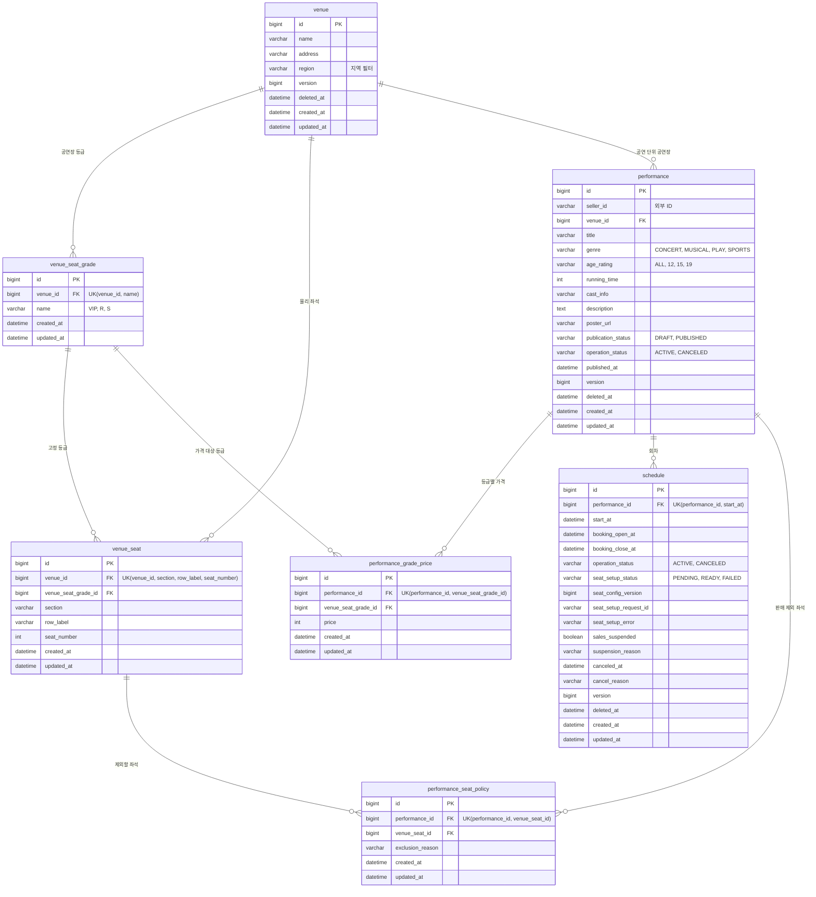

# 공연 테이블 명세

- 상태: 작성 중
- 담당:
- DDL: `backend/sql/event-service/schema.sql`
- 출처: Notion 테이블 명세서 3.1~3.8 (2026-10-26 기준). 담당자가 검토하며 고친다.

## 1. ERD

- 실선은 테이블 명세의 FK 표기를 따른 관계다.
- `performance.seller_id`는 회원 서비스의 ID라 FK 없이 값만 둔다.
- 회차 좌석(`schedule_seat`)은 예매 서비스 소유라 [좌석 테이블 명세](../seat/tables.md)에 둔다.

## 2. 공통 사항

**현재 설계의 책임 경계:** 예매 서비스가 `schedule_seat`, `reservation`, `ticket`을 소유한다.
선점·예매 확정은 예매 서비스의 로컬 트랜잭션으로 처리한다.
담당자 간 상세 계약·구현 방식은 협의 대상이지만, 현재 문서는 이 소유권을 기준으로 작성한다.
회원과 공연 서비스 데이터는 외부 ID로 참조하며 서비스 간 물리 FK를 만들지 않는다.

- MySQL 기준 구현 제안.
금액은 원 단위 INT이며 0 이상이다.
통화는 KRW 고정이므로 별도 통화 컬럼을 생략한다.
- 기존 문서에 맞춰 DB 시각은 KST DATETIME(3), API는 +09:00 오프셋을 포함한 ISO 8601로 표현한다.
DB·서버·드라이버 시간대도 일치시킨다.
- `deleted_at`이 있는 데이터는 기본 조회에서 제외한다.
**회차 취소와 삭제는 구분한다.**
- 판매자 수정은 performance 행을 기준으로 직렬화하거나 낙관적 잠금으로 보호한다.
자식 가격·회차·판매 제외 변경도 부모의 공개 상태와 version을 같은 트랜잭션에서 확인한다.
- 아래 NOT NULL 조건은 저장 가능한 최소 초안 기준이다.
공개 시 설명·포스터·회차·공연장 등급·가격 등 추가 조건을 검증한다.

**공통 감사 컬럼 — 모든 테이블에 실제 포함**

| 컬럼(영문) | 컬럼(한글) | 타입 | 제약·기본값 | 설명 |
| --- | --- | --- | --- | --- |
| created_at | 생성 시각 | DATETIME(3) | NOT NULL, DEFAULT CURRENT_TIMESTAMP(3) | 행 최초 생성 시 서버에서 기록한다. 클라이언트 입력 불가. 이후 변경하지 않는다. |
| updated_at | 최종 변경 시각 | DATETIME(3) | NOT NULL, DEFAULT CURRENT_TIMESTAMP(3) | 서버가 매 변경 시 갱신한다. version이 있는 테이블은 version으로 수정 충돌을 확인한다. schedule_seat 선점은 상태·현재 소유 예매·만료 시각을 포함한 조건부 UPDATE로 보호한다. |

`deleted_at`은 venue, performance, schedule에만 둔다.
NULL이면 미삭제, 값이 있으면 삭제 처리된 데이터다.
venue_seat_grade와 venue_seat은 사용 중 삭제하지 않는다.
가격·공연별 판매 제외 행은 DRAFT의 집합 변경 API로만 관리한다.
부모 삭제 시 참조 이력은 유지하고 부모의 삭제 여부로 조회를 차단한다.

## 3. venue — 공연장

| 컬럼(영문) | 컬럼(한글) | 타입 | 제약·기본값 | 설명 |
| --- | --- | --- | --- | --- |
| id | 식별자 | BIGINT | PK, NOT NULL, AUTO_INCREMENT (구현 제안) | 공연장 ID |
| name | 이름 | VARCHAR(100) | NOT NULL | 이름 |
| address | 주소 | VARCHAR(255) | NOT NULL | 주소 |
| region | 지역 | VARCHAR(20) | NOT NULL | 지역 필터 |
| version | 낙관적 잠금 버전 | BIGINT | NOT NULL DEFAULT 0 | 동시 수정 방지 |
| deleted_at | 삭제 시각 | DATETIME(3) | NULL | 소프트 삭제 |

## 4. venue_seat_grade — 공연장별 좌석 등급

등급명과 좌석 배정은 공연장이 소유한다.
가격은 이 테이블에 저장하지 않는다.

| 컬럼(영문) | 컬럼(한글) | 타입 | 제약·기본값 | 설명 |
| --- | --- | --- | --- | --- |
| id | 공연장 좌석 등급 식별자 | BIGINT | PK, NOT NULL, AUTO_INCREMENT | 공연장 내 등급 ID. 공연별 가격과 물리 좌석에서 참조한다. |
| venue_id | 공연장 식별자 | BIGINT | FK → venue.id, NOT NULL | 등급이 속한 공연장. |
| name | 좌석 등급명 | VARCHAR(20) | NOT NULL, 공백 문자열 불가 | VIP, R, S 등. 공연장이 다르면 같은 이름 사용 가능. |
| created_at | 생성 시각 | DATETIME(3) | NOT NULL, DEFAULT CURRENT_TIMESTAMP(3) | 서버 기록. |
| updated_at | 최종 변경 시각 | DATETIME(3) | NOT NULL, DEFAULT CURRENT_TIMESTAMP(3) | 서버가 변경 시 갱신. |

**키·인덱스**

UK(venue_id, name).
공연이 하나라도 해당 공연장을 참조한 이후 등급 추가·이름 변경·삭제를 차단하는 초기 구현안이다.
기존 공연을 바꾸지 않으려면 별도 배치 버전 도입이 필요하다.

## 5. venue_seat — 공연장 물리 좌석

| 컬럼(영문) | 컬럼(한글) | 타입 | 제약·기본값 | 설명 |
| --- | --- | --- | --- | --- |
| id | 물리 좌석 식별자 | BIGINT | PK, NOT NULL, AUTO_INCREMENT | 공연장 좌석 ID. |
| venue_id | 공연장 식별자 | BIGINT | FK → venue.id, NOT NULL | 좌석 소속 공연장. |
| venue_seat_grade_id | 고정 좌석 등급 식별자 | BIGINT | FK → venue_seat_grade.id, NOT NULL | 공연장에 고정된 등급. 공연·회차에서 덮어쓸 수 없다. |
| section | 좌석 구역 | VARCHAR(20) | NOT NULL, 빈 문자열 불가 | 예: A, 1층. |
| row_label | 좌석 열 | VARCHAR(10) | NOT NULL, 빈 문자열 불가 | 예: 1, 가. |
| seat_number | 좌석 번호 | INT | NOT NULL, 0 초과 | 구역·열 안에서의 좌석 번호. |
| created_at | 생성 시각 | DATETIME(3) | NOT NULL, DEFAULT CURRENT_TIMESTAMP(3) | 서버 기록. |
| updated_at | 최종 변경 시각 | DATETIME(3) | NOT NULL, DEFAULT CURRENT_TIMESTAMP(3) | 서버가 변경 시 갱신. |

**키·인덱스**

UK(venue_id, section, row_label, seat_number).
INDEX(venue_id, venue_seat_grade_id).
좌석과 등급의 venue_id가 같아야 한다.
공연에 사용된 이후 물리 좌석·등급 배정은 변경하지 않는 초기 정책이다.
**예: A구역 1열 1번이 VIP라면 이 공연장을 쓰는 모든 공연·회차에서 VIP다.**

## 6. performance — 공연

| 컬럼(영문) | 컬럼(한글) | 타입 | 제약·기본값 | 설명 |
| --- | --- | --- | --- | --- |
| id | 식별자 | BIGINT | PK, NOT NULL, AUTO_INCREMENT (구현 제안) | 공연 ID |
| seller_id | 판매자 식별자 | VARCHAR(36) | NOT NULL, 외부 ID | 인증 주체로 설정. 요청 본문으로 받지 않음 |
| venue_id | 공연장 식별자 | BIGINT | FK NOT NULL | 공연 단위 공연장 |
| title | 공연 제목 | VARCHAR(200) | NOT NULL | 공연명 |
| genre | 공연 장르 | VARCHAR(20) | NOT NULL | CONCERT / MUSICAL / PLAY / SPORTS |
| age_rating | 관람 등급 | VARCHAR(20) | NOT NULL | ALL / 12 / 15 / 19 |
| running_time | 공연 시간(분) | INT | NOT NULL | 분, 0 초과 |
| cast_info | 출연진 정보 | VARCHAR(500) | NULL | 출연진 안내 |
| description | 공연 상세 설명 | TEXT | NULL | 공개 시 필수 제안 |
| poster_url | 포스터 주소 | VARCHAR(500) | NULL | 공개 시 필수 제안 |
| publication_status | 공개 상태 | VARCHAR(20) | NOT NULL DEFAULT `DRAFT` | DRAFT / PUBLISHED |
| operation_status | 운영 상태 | VARCHAR(20) | NOT NULL DEFAULT `ACTIVE` | ACTIVE / CANCELED. 공개 여부와 별개 |
| published_at | 최초 공개 시각 | DATETIME(3) | NULL | 최초 공개 시각. 공개 이력·변경 제한 판단 |
| version | 낙관적 잠금 버전 | BIGINT | NOT NULL DEFAULT `0` | 부모 및 자식 구성 변경 시 증가 |
| deleted_at | 삭제 시각 | DATETIME(3) | NULL | 소프트 삭제 |

**키·인덱스**

INDEX(seller_id, deleted_at),
INDEX(publication_status, genre, id).
공연 기간은 삭제·취소되지 않은 회차의 시작 일시 최솟값·최댓값에서 계산하는 구현 제안이다.
기존 start_date/end_date를 유지한다면 회차 변경과 함께 갱신해야 한다.

## 7. performance_grade_price — 공연별 등급 가격

기존 공연 소유 seat_grade를 공연장 등급과 공연 가격으로 분리했다.
판매자는 등급을 만들거나 좌석에 배정하지 않고, 공연장의 기존 등급에 가격만 설정한다.

| 컬럼(영문) | 컬럼(한글) | 타입 | 제약·기본값 | 설명 |
| --- | --- | --- | --- | --- |
| id | 공연별 등급 가격 식별자 | BIGINT | PK, NOT NULL, AUTO_INCREMENT | 가격 행 ID. 등급 자체의 ID와 다르다. |
| performance_id | 공연 식별자 | BIGINT | FK → performance.id, NOT NULL | 가격이 적용되는 공연. |
| venue_seat_grade_id | 공연장 좌석 등급 식별자 | BIGINT | FK → venue_seat_grade.id, NOT NULL | 해당 공연장의 고정 등급. |
| price | 기본 가격(원) | INT | NOT NULL, 0 이상 | 할인 전 원화 금액. 동일 공연의 모든 회차에 공통 적용. |
| created_at | 생성 시각 | DATETIME(3) | NOT NULL, DEFAULT CURRENT_TIMESTAMP(3) | 서버 기록. |
| updated_at | 최종 변경 시각 | DATETIME(3) | NOT NULL, DEFAULT CURRENT_TIMESTAMP(3) | 서버가 변경 시 갱신. |

**키·인덱스**

UK(performance_id, venue_seat_grade_id).
공연의 venue_id와 등급의 venue_id가 일치해야 한다.
가격 누락과 0원을 구분한다.
공개 시 판매 대상 좌석에 사용되는 모든 등급의 가격이 필요하다.
`DRAFT`에서만 가격 집합 변경 가능하며, 공개 후 변경·삭제는 금지한다.
개별 가격 행의 소프트 삭제는 두지 않고 `DRAFT` 전체 교체 시 삭제한다.
공연이 삭제되면 부모 삭제 여부로 가격 조회도 차단한다.

## 8. schedule — 공연 회차 (공연 서비스 소유)

회차는 공연장 등급과 공연별 가격을 새로 정의하지 않는다.
performance_id로 공연을 참조하고 공연장의 고정 좌석·등급 및 공연별 가격을 공통으로 사용한다.
회차별로 달라지는 것은 공연·판매 시각과 운영·판매 준비 상태이며, 좌석별 선점·판매 상태는 예매 서비스 schedule_seat이 관리한다.

| 컬럼(영문) | 컬럼(한글) | 타입 | 제약·기본값 | 설명 |
| --- | --- | --- | --- | --- |
| id | 식별자 | BIGINT | PK, NOT NULL, AUTO_INCREMENT (구현 제안) | 회차 ID |
| performance_id | 공연 식별자 | BIGINT | FK NOT NULL | 공연 |
| start_at | 공연 시작 시각 | DATETIME(3) | NOT NULL | 공연 시작 |
| booking_open_at | 예매 오픈 시각 | DATETIME(3) | NOT NULL | 회차별 예매 오픈 |
| booking_close_at | 예매 마감 시각 | DATETIME(3) | NOT NULL | 회차별 예매 마감 |
| operation_status | 운영 상태 | VARCHAR(20) | NOT NULL DEFAULT `ACTIVE` | ACTIVE / CANCELED |
| seat_setup_status | 좌석 준비 상태 | VARCHAR(20) | NOT NULL DEFAULT `PENDING` | PENDING / READY / FAILED |
| seat_config_version | 좌석 구성 버전 | BIGINT | NOT NULL DEFAULT `1` | 좌석 구성 변경 시 증가 |
| seat_setup_request_id | 좌석 생성 요청 식별자 | VARCHAR(36) | NOT NULL | 현재 생성 요청 상관관계 ID |
| seat_setup_error | 좌석 생성 실패 사유 | VARCHAR(500) | NULL | 실패 요약. 판매자에게 민감한 내부 정보 노출 금지 |
| sales_suspended | 판매 일시 중지 여부 | BOOLEAN | NOT NULL DEFAULT `false` | 판매 일시 중지. 지원 자체는 구현 제안 |
| suspension_reason | 판매 중지 사유 | VARCHAR(500) | NULL | 운영 사유 |
| canceled_at | 회차 취소 시각 | DATETIME(3) | NULL | 취소 시각 |
| cancel_reason | 회차 취소 사유 | VARCHAR(500) | NULL | 취소 사유 |
| version | 낙관적 잠금 버전 | BIGINT | NOT NULL DEFAULT `0` | 동시 수정 방지 |
| deleted_at | 삭제 시각 | DATETIME(3) | NULL | 소프트 삭제 |

**키·인덱스**

UK(performance_id, start_at),
INDEX(performance_id, booking_open_at).
삭제한 동일 시각 회차는 새로 만들기보다 복원 또는 운영 절차를 적용하는 초기 제안이다.

booking_open_at < booking_close_at <= start_at.
공연 당일 시작 후 판매는 지원하지 않는 초기 제안이다.
취소는 되돌리지 않는다.
회차별 공연장은 두지 않는다.

## 9. performance_seat_policy — 공연 공통 판매 제외 좌석

회차별 등급 배정 테이블 schedule_seat_assignment는 제거한다.
등급은 venue_seat에서 결정하므로 별도 배정 테이블이 필요 없다.
기존 판매 제외 기능은 공연 공통 예외만 저장하는 아래 테이블로 분리하는 구현 제안이다.
이 테이블은 등급이나 가격을 변경할 수 없다.

| 컬럼(영문) | 컬럼(한글) | 타입 | 제약·기본값 | 설명 |
| --- | --- | --- | --- | --- |
| id | 판매 제외 정책 식별자 | BIGINT | PK, NOT NULL, AUTO_INCREMENT | 공연별 제외 좌석 행 ID. |
| performance_id | 공연 식별자 | BIGINT | FK → performance.id, NOT NULL | 제외 정책이 적용될 공연. |
| venue_seat_id | 제외할 물리 좌석 식별자 | BIGINT | FK → venue_seat.id, NOT NULL | 반드시 해당 공연장의 좌석이어야 한다. |
| exclusion_reason | 판매 제외 사유 | VARCHAR(255) | NOT NULL, 빈 문자열 불가 | 예: 운영석, 시야 제한석. 관리용이며 공개 응답에 내부 사유를 노출하지 않는다. |
| created_at | 생성 시각 | DATETIME(3) | NOT NULL, DEFAULT CURRENT_TIMESTAMP(3) | 서버 기록. |
| updated_at | 최종 변경 시각 | DATETIME(3) | NOT NULL, DEFAULT CURRENT_TIMESTAMP(3) | 서버가 변경 시 갱신. |

**키·인덱스**

UK(performance_id, venue_seat_id).
행이 없으면 판매 대상, 행이 있으면 판매 제외다.
모든 회차가 동일한 제외 정책을 사용한다.
DRAFT에서만 변경하며 공개 후 고정한다.
독립적인 회차별 등급·제외 배정 API는 제공하지 않는다.
선점·판매 완료 상태는 예매 서비스의 회차별 schedule_seat에서 별도로 관리한다.
