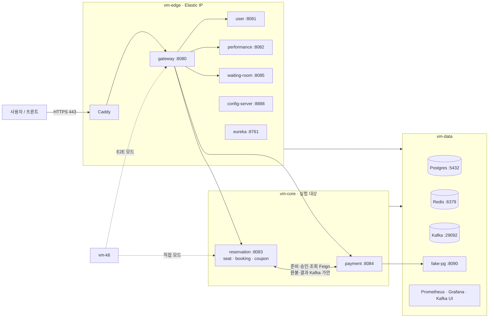
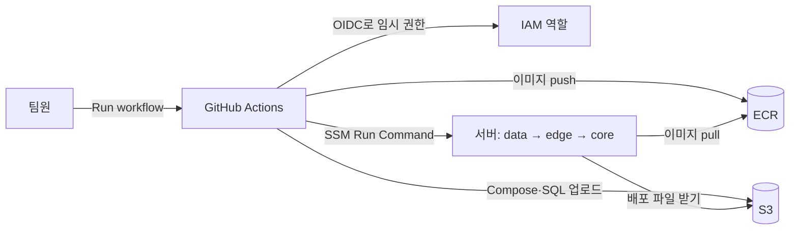
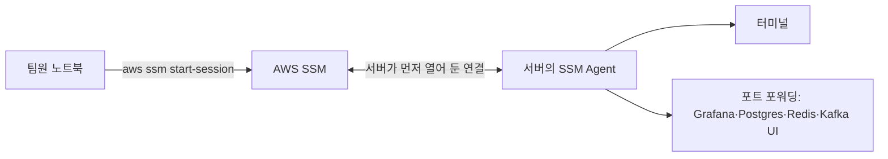

# 인프라 아키텍처

- 원본: 팀 Notion [인프라 구성도](https://app.notion.com/p/404b3ff41d3980cfa2ddf135e5507530) (2026-10-27 12:10 UTC 수정본). 0~8절은 Notion 전사본을 저장소의 후속 결정에 맞춰 정리한 현재 기준이다. 따라 하기 가이드 01~10의 단계별 명령은 Notion 하위 페이지에만 있다(9절 링크).
- 실제 AWS 배포 상태는 검증하지 않았다. 계획과 저장소의 현재 파일을 구분한다(10절).
- Notion 원본은 수정하지 않았다. 본문은 후속 합의를 반영했으며 실제 구현·배포 여부는10절과 실제 설정을 확인한다.
- 서비스 책임·통신은 [architecture.md](architecture.md)에 있다.

**이 문서 읽는 법**

- 우리 인프라가 어떻게, 왜 이렇게 생겼는지 알고 싶다 → 0~5절
- 인프라를 처음부터 직접 만든다 → Notion 「따라 하기 가이드」 01부터 10까지 순서대로. 가이드는 모두 목표 → 사전 준비 → 단계 → 완료 확인 → 자주 막히는 곳 순서다
- 이미 만들어져 있고 쓰기만 한다 → Notion 09. 운영 가이드

## 0. 한눈에 보기

| 항목 | 우리 선택 |
| --- | --- |
| 클라우드 | AWS 서울 리전(ap-northeast-2), 한 AZ(ap-northeast-2a), 기본 VPC 퍼블릭 서브넷 |
| 서버 | EC2 4대 — vm-edge, vm-core, vm-data (m7i.large), vm-k6 (c8i.large) |
| 실행 방식 | 서버별 Docker Compose. 쿠버네티스·ECS 없음 |
| 데이터 | Postgres·Redis·Kafka를 vm-data에 직접 실행. 관리형(RDS·ElastiCache·MSK) 없음 |
| 배포 | GitHub Actions → ECR(이미지)·S3(설정 파일) → SSM으로 서버에 명령. 수동 실행 |
| 접속 | SSM만 사용. SSH(22) 없음. DB·Grafana도 SSM 포트 포워딩 |
| 외부 공개 | vm-edge의 80·443(Caddy, HTTPS)뿐 |
| 운영 | 테스트·배포 시 기동,03:00 자동 중지는 목표(실행 여부 미확인) |
| 비용 | 켜 둔 동안 시간당 약 $0.39 (k6 포함 약 $0.50), 꺼 둔 동안 한 달 약 $17 |

## 1. 결정 요약

| # | 결정 | 이유 |
| --- | --- | --- |
| 1 | AWS 서울 리전, 서버 전부 같은 AZ | 팀원 중 AWS 경험자가 있어 막혔을 때 해결이 빠르다(GCP 대신 고른 이유). AZ 간 트래픽 요금이 없고 지연이 일정해 측정이 안정적이다 |
| 2 | EC2 + Docker Compose (쿠버네티스·ECS 미사용) | 로컬 `docker-compose.yml`을 서버별로 나누기만 하면 된다. 인프라 초보 팀이 MVP 기간 안에 끝낼 수 있고, 측정 결과에 플랫폼 변수가 끼지 않는다 |
| 3 | Postgres·Redis·Kafka를 EC2에 직접 | 어차피 켜 둘 vm-data에 올려 추가 비용이 거의 없다. MSK는 최소 2브로커라 비싸고, 소형 RDS·ElastiCache는 T 계열이라 CPU 크레딧이 떨어지면 측정이 흔들린다. 자동 백업·다중 AZ는 이 프로젝트에 필요 없다 |
| 4 | 앱 서버는 m7i.large로 고정 | T 계열은 CPU 크레딧 때문에 같은 실험을 반복해도 결과가 달라진다. 켤 때만 쓰므로 t3와의 차이는 몇 달러 수준이다 |
| 5 | 테스트할 때만 켜고 새벽 자동 중지 | 24시간 켜 두면 한 달 약 $300, 필요할 때만 켜면 수십 달러 |
| 6 | 앱 컨테이너는 `network_mode: host` | 컨테이너가 EC2 IP를 그대로 써서 다른 서버에서 닿는 주소가 Eureka에 등록된다. Docker NAT가 없어 측정에도 유리하다 |
| 7 | 퍼블릭 서브넷, NAT Gateway 없음 | NAT Gateway는 꺼 둘 수 없고 서버보다 비쌀 수 있다. 외부 차단은 보안 그룹이 맡는다 |
| 8 | 접속은 SSM만, 22번 포트 없음 | 서버에 열 포트가 없고, 키 파일을 나눠 갖지 않는다. 누가 접속할 수 있는지 AWS 계정 권한으로 관리하고, 기록이 남는다 |
| 9 | HTTPS는 vm-edge의 Caddy (ALB 미사용) | 인증서가 무료·자동 갱신이고 추가 비용이 없다. ALB는 꺼 둘 수 없어 안 쓰는 동안에도 과금된다 |
| 10 | 배포는 GitHub OIDC → ECR·S3 → SSM, 수동 실행만 | AWS 키를 GitHub에 저장하지 않는다. 서버가 꺼져 있을 때의 실패와, 측정 중 배포가 끼어드는 것을 막는다 |
| 11 | k6는 VPC 안 전용 서버, 노트북에서 원격 실행 | 인터넷 구간이나 SSM 터널이 측정값에 섞이지 않는다. 결과는 Grafana와 JSON으로 받는다 |
| 12 | fake-pg는 vm-data에 둔다 | 결제 서비스 밖의 외부 PG 역할. Eureka·config 없이 주소로 호출한다 (결정 필요 사항 I7) |

## 2. 구성도

### 2-1. 요청이 흐르는 길

- 인터넷에서 들어오는 길은 **Caddy(443) 하나**다. 서비스 포트, Eureka, config, DB는 VPC 안에서만 닿는다.
- 서비스는 gateway가 넣어 준 `X-User-*` 헤더를 그대로 믿는다. 그래서 서비스 포트를 외부에 열지 않는 것이 이 구조의 핵심 보안 규칙이다(Notion 10. 배포 전 보안 체크리스트).

### 2-2. 배포되는 길

### 2-3. 팀원이 서버에 접속하는 길

서버의 SSM Agent가 AWS 쪽으로 먼저 연결을 열어 두고, AWS가 내 명령을 그 연결로 전달한다. 그래서 서버에 열어 둘 포트가 없다.

## 3. 서버별 배치

현재 저장소의 performance-service 이름을 사용한다. ECR·Eureka 이름은 배포 구성 시 아래 이름으로 맞춘다. 실제 Gateway의 기존 경로 차이는 10절에 기록한다.

| 구분 | 기준 |
|---|---|
| 모듈·Compose 서비스 / ECR 목표 | `performance-service` / `ticket/performance-service` |
| Eureka 목표 이름 | `PERFORMANCE-SERVICE` |
| 포트 / API 계약 prefix | 8082 / `/api/performances`, `/api/schedules` |
| DB 계정·스키마·비밀번호 변수 | `performance_app`, `performance_schema`, `PERFORMANCE_DB_PASSWORD` |
| 스키마 SQL | `backend/sql/performance-service/schema.sql` |

| 서버 | 프라이빗 IP | 컨테이너 (포트) | 인스턴스 | 디스크 | Compose 파일 |
| --- | --- | --- | --- | --- | --- |
| vm-edge | `<채우기>` | Caddy(80·443), gateway(8080, 관리 9080), user(8081), performance(8082), waiting-room(8085), config-server(8888), eureka(8761) | m7i.large | gp3 30GB | `compose.edge.yml` |
| vm-core | `<채우기>` | reservation(8083, 쿠폰 모듈 포함), payment(8084) | m7i.large | gp3 30GB | `compose.core.yml` |
| vm-data | `<채우기>` | Postgres(5432), Redis(6379), Kafka(29092), fake-pg(8090), Prometheus(9090), Grafana(3000), Kafka UI(8989) | m7i.large | gp3 50GB | `compose.data.yml` |
| vm-k6 | `<채우기>` | k6 (실행할 때만) | c8i.large | gp3 20GB | — |

- m7i.large = 2 vCPU, 8GB. vm-edge는 JVM 6개 × 약 600MB ≈ 3.6GB(waiting-room은 예매 서버와 CPU를 나눠 쓰지 않게 vm-edge에 둔다, #298), vm-core는 실험용으로 서비스당 힙 1GB.
- 쿠폰 모듈은 reservation-service로 이전 예정이다. 예매와의 연결 계약은 #125에서 합의했다. 쿠폰 발급은 현재 동기201 계약이며 Kafka 소비는 미합의다. 오픈 부하가 겹치면 reservation CPU·힙·HikariCP를 함께 측정한다(I8).
- gateway 외부 경로는 `/api/**`다. 버전(`v1`)은 붙이지 않는다.
- OS는 Ubuntu 24.04 x86_64. 이미지는 amd64로만 만든다(Mac에서 빌드할 때는 `--platform linux/amd64`).
- PostgreSQL은 인스턴스 하나에 서비스별 스키마와 전용 계정을 둔다. 논리 격리일 뿐 장애·IO·CPU는 공유한다. 단일 AZ·Kafka 1대·vm-data 집중은 고가용성 구성이 아니다. fake-pg와 DB·관측 도구의 CPU 경합도 측정에 포함한다.

## 4. 포트 지도

| 포트 | 서버 | 용도 | 인터넷 | VPC 안 | 팀원 접근 |
| --- | --- | --- | --- | --- | --- |
| 80, 443 | edge | Caddy (HTTPS) | ✅ | ✅ | 브라우저·curl |
| 8080 | edge | gateway | ❌ | ✅ | k6 E2E 모드 |
| 9080 | edge | gateway 관리(actuator) | ❌ | ✅ | Prometheus 수집 |
| 8081~8084 | edge·core | 서비스 | ❌ | ✅ | k6 직접 모드 |
| 8761, 8888 | edge | Eureka, config | ❌ | ✅ | SSM 포트 포워딩 |
| 5432, 6379, 29092 | data | Postgres, Redis, Kafka | ❌ | ✅ | SSM 포트 포워딩 |
| 8090 | data | fake-pg (장애 주입 API 포함) | ❌ | ✅ | k6, payment |
| 3000, 9090, 8989 | data | Grafana, Prometheus, Kafka UI | ❌ | ✅ | SSM 포트 포워딩 |
| 22 | — | SSH | ❌ | ❌ | 쓰지 않음 (SSM) |

## 5. 비용

**원본 설계의 비용 추정(서울 리전, Linux 온디맨드)**

아래는 전사본의 추정값이며 이번 작업에서 현재 요금·청구액을 검증하지 않았다. 배포 예산에 쓰기 전 계산기로 재확인한다.

| 항목 | 단가 | 근거 |
| --- | --- | --- |
| EC2 m7i.large | $0.124/시간 | AWS 가격표 확인 |
| EC2 c8i.large (k6) | $0.106/시간 | AWS 가격표 확인 |
| (참고) t3.large | $0.104/시간 | AWS 가격표 확인 |
| EBS gp3 130GB | 약 $12/월 | 알려진 단가로 계산, 확인 필요 |
| 퍼블릭 IPv4 (서버 3~4개) | 개당 약 $0.005/시간 | 알려진 단가로 계산, 확인 필요 |
| ECR·S3 | 월 $1 내외 | 확인 필요 |

**사용 방식별 예상**

| 상황 | 비용 |
| --- | --- |
| 켜 둔 동안 (앱 서버 3대) | 시간당 약 **$0.39** |
| 켜 둔 동안 (k6 포함 4대) | 시간당 약 **$0.50** |
| 꺼 둔 동안 (디스크·Elastic IP·ECR) | 한 달 약 **$17** |
| 3주 동안 총 60시간 사용 | 약 **$42** |
| 3주 동안 총 100시간 사용 | 약 **$62** |
| (참고) 3대를 24시간 켜 두면 | 한 달 약 $300 |

크레딧 금액·만료일은 가이드 01에서 확인해 7절 기록표에 적는다. 정확한 금액은 [AWS Pricing Calculator](https://calculator.aws/)로 확인한다.

## 6. 따라 하기 가이드 순서

> 보안 체크리스트의 코드 변경은 첫 배포 전에 develop에 머지해 배포 이미지에 포함한다. 실제 릴리스는 공통 PR·배포 절차를 따른다.

| 순서 | 하는 일 | 끝나면 | 누가 | 시간 |
| --- | --- | --- | --- | --- |
| 01 계정·권한 | 루트 MFA, 예산 알림, 팀원 계정, 노트북 CLI | 각자 `aws` 명령 사용 | 담당 + 전원 | 30분~1시간 |
| 02 네트워크 | 서브넷·IP 정하기, 보안 그룹 2개, Elastic IP | 방화벽 준비 | 담당 | 20분 |
| 03 IAM·ECR·S3 | 이미지 저장소, 배포 버킷, 역할 2개, GitHub OIDC | 저장소·권한 준비 | 담당 | 40분 |
| 04 EC2 | 서버 4대, Docker·AWS CLI, `.env` | SSM 접속되는 서버 | 담당 | 1시간 |
| 05 첫 배포 | `deploy/` 작성, 손으로 배포, DB 스키마 | gateway가 401 응답 | 담당 | 2~3시간 |
| 06 HTTPS | 도메인 연결, Caddy | `https://api.<도메인>` 401 | 담당 | 30분 |
| 07 자동화 | Deploy·Infra Start·Infra Stop 워크플로 | 버튼으로 배포·켜기·끄기 | 담당 | 1~2시간 |
| 08 부하 테스트 | vm-k6, `load-test/` | 노트북에서 원격 부하 | 담당 + 전원 | 1시간 |
| 09 운영 | 켜고 끄기, 접속, 로그, 비용, 문제 해결 | — | 전원 | 수시 |
| 10 보안 | 배포 전 점검 | 외부 공개 준비 완료 | 담당 | 30분 |

## 7. 인프라 값 기록표

가이드를 진행하며 채운다. 다른 가이드의 `<vm-edge 프라이빗 IP>` 같은 자리에 이 값을 넣는다.

> 비밀번호·JWT 시크릿·액세스 키는 여기에 적지 않는다. 비밀값은 각 서버의 `/opt/ticket/.env`에만 둔다.

| 항목 | 값 | 채우는 가이드 |
| --- | --- | --- |
| 크레딧 금액 / 만료일 / 적용 서비스 |  | 01 |
| AWS 계정 ID |  | 03 |
| 서브넷 ID / CIDR (ap-northeast-2a) |  | 02 |
| 프라이빗 IP: edge / core / data / k6 |  | 02 |
| Elastic IP |  | 02 |
| 인스턴스 ID: edge / core / data / k6 |  | 04 |
| S3 버킷 | `ticket-deploy-<계정ID>` | 03 |
| 배포 역할 ARN |  | 03 |
| API 도메인 |  | 06 |

## 8. 결정 필요 사항

| # | 항목 | 관련 가이드 |
| --- | --- | --- |
| I1 | 크레딧 금액·만료일·적용 서비스 확인, Budgets 알림 금액 | 01 |
| I2 | 팀원 계정 방식: IAM Identity Center(권장) / IAM 사용자 | 01 |
| I3 | 도메인 구입처·이름 | 06 |
| I4 | 프론트 배포 위치와 CORS 설정 | 06 |
| I5 | 인프라 담당자 (프로젝트 공통 배포 업무) | 전체 |
| I6 | 자동 중지 시각 (기본 03:00 KST) | 07 |
| I7 | fake-pg 위치 확정 (현재 vm-data). 결제 지연 주입 실험 때 vm-data CPU 사용률도 같이 기록한다 | 05, 08 |
| I8 | 쿠폰 모듈이 reservation으로 옮겨진 뒤 쿠폰 발급 부하가 좌석 선점에 주는 영향. 크면 vm-core 사양이나 쿠폰 소비자 동시성을 조정한다 | 08 |

## 9. 따라 하기 가이드 (Notion 하위 페이지)

- [01. AWS 계정·권한 준비](https://app.notion.com/p/405b3ff41d398190b87ccaba10e238cc)
- [02. 네트워크·보안 그룹](https://app.notion.com/p/405b3ff41d3981dabdbac9907ed8ff45)
- [03. IAM 역할·ECR·S3](https://app.notion.com/p/405b3ff41d3981d8b450e2b6e282d748)
- [04. EC2 생성과 서버 초기 설정](https://app.notion.com/p/405b3ff41d3981d68489fd3318b127c8)
- [05. Compose 분리와 첫 수동 배포](https://app.notion.com/p/405b3ff41d398131945fc61714642f52)
- [06. HTTPS (Caddy·도메인)](https://app.notion.com/p/405b3ff41d3981a98364ceaf7276e1c1)
- [07. GitHub Actions 배포 자동화](https://app.notion.com/p/405b3ff41d39815b8765ebfa021ab403)
- [08. 부하 테스트 환경 (k6)](https://app.notion.com/p/405b3ff41d398155a473e7b10543121b)
- [09. 운영 가이드](https://app.notion.com/p/405b3ff41d3981d7afacf76f9a5319d2)
- [10. 배포 전 보안 체크리스트](https://app.notion.com/p/405b3ff41d3981579b5ce116807189a2)

## 10. 저장소 현행 (Notion에 없는 사실)

- 로컬 구성: 루트 `docker-compose.yml`, `infra/`, `script/`. Gradle 빌드 문맥은 `backend/`. 실행 안내는 루트 README. 실제 비밀 파일 대신 `.env.example`만 참조한다.
- Config: `backend/config-repo/{서비스}.yml`, 공통 `application.yml`, 로컬 `application-local.yml`. 앱의 `application.yml`은 이름과 config import 중심이다. fake-pg는 Config·Eureka·common에 의존하지 않는다.
- 서버별 `compose.edge/core/data.yml`과 기동·중지 워크플로는 구현·존재를 확인한 뒤 사용한다. 현재 루트 `docker-compose.yml`을 서버 배포 완료 증거로 보지 않는다. Config 파일은 config-server 이미지에 포함되므로 바꾸면 재빌드·재배포가 필요하다.
- 데이터 초기화·볼륨 삭제는 승인 없이 하지 않는다. 운영 DB에서 `ddl-auto: create`를 쓰지 않는다. DDL 이행·백업·복원 뒤에는 미완료 작업 보존과 PG 재대조를 확인한다(실제 과금 운영 전 검증 항목).

- 결제 서비스는 local에서도 `payment-service-local.yml`의 `ddl-auto: validate`를 사용한다(#317). 금융 원장과 JDBC 운영 테이블·트리거·Batch 메타데이터를 재기동 때 보존하기 위한 예외다. 다른 서비스의 local 기본 create는 유지한다.
- 기본 Compose의 빈 PostgreSQL은 `infra/postgres/init.sh`가 마운트된 결제 `schema.sql`을 `SET ROLE payment_app`으로 적용한다. 새 DB는 현재 schema.sql만 적용하며 이행을 다시 실행할 필요가 없다.
- 기존 DB 볼륨에는 초기화 스크립트가 다시 실행되지 않는다. 결제 프로세스를 멈추고 필요한 이행을 payment_app으로 적용한 뒤 새 코드·validate 설정으로 기동한다. #316 적용 DB는 018→019→020 순서이며, PG 입금 회계 미적용 DB는 017도 먼저 필요하다. 볼륨을 지워 이행을 대신하지 않는다.
- #334는 기존 020 적용 DB에 022~024를 순서대로 추가한다. 021은 결제 결과 Outbox PR #349에서 사용하며 별도 업무 이행이다. 조회용 원천·세대 테이블을 만들며 기존 금융 대조 head를 변경하지 않는다. 새 빈 DB는 현재 schema.sql을 사용한다.
- #363 브랜치의 신규 작업 기본값은 `payment.settlement.posting.transport=KAFKA`이며 `posting.kafka.enabled=true`다. 금융 입력은 `settlement.posting.requested.v1`, Group은 `settlement-posting-v1`, key는 paymentId다. 초기 6파티션·Consumer2를 사용한다. relay-enabled와 consumer-enabled를 나누면 같은 코드의 발행/소비 역할을 독립 실행할 수 있다. DB 소유권은 payment에 남는다.
- #363은 기존 025 적용 DB에 026→027을 앱 소유자로 적용한다. 새 빈 DB는 현재 schema.sql만 사용한다. 구버전 worker와 KAFKA 행을 섞지 않는다. 전체 인스턴스를 중지하고 이행하거나, 신규 코드 배포 중 transport=DB를 명시해 모든 인스턴스의 분기 지원을 확인한 후 신규 작업만 KAFKA로 전환한다. 기존 DB 작업은 행별 transport를 따라 drain한다.
- 예상 정산은 `payment.settlement.projection.enabled=true,auto-start=true,mode=B`가 #363 브랜치 기본이다. D(DB 워커)·C(Streams) 구현도 유지한다. 실행기는 1초 fixed delay로 source fanout·집계·후보 검증을 진행한다. 묶음은 최대500건, 한 실행 최대8배치·새 배치 시작 예산1초다. D는 전달과 집계를 같은 TX로 기록한다. B는 Consumer2가 같은 세대 Group에서 DB 집계 후 offset을 commit하며 Streams 출력/sink를 기동하지 않는다. C일 때만 별도 출력/sink를 사용한다. 스케줄러 풀은19개이며 DB 풀20과 함께 관측한다.
- 기존 세대의 mode는 설정 변경으로 변환하지 않는다. 운영 중인 B/C가 있으면 D 후보를 새로 구축·검증·activate해 이전 세대를 RETIRED로 전환한다. 혼합 세대가 있으면 해당 B/C 처리에는 Kafka가 필요하다. 022/023 적용 DB는 기동 전 024를 추가 적용한다.
- 기존 D가 있으면 B 후보를 새로 구축·검증하고 generation CAS로 활성화한다. Kafka 기본값으로 기동한 사실만으로 기존 세대가 전환됐다고 보지 않는다. rollback은 신규 금융 작업부터 DB로 전환하되 Kafka 인수분은 Consumer로 drain한다. 집계는 보존한 D를 최신 source까지 따라잡고 재검증한 뒤 활성화한다. 기존 job의 transport와 불변 eventId/payload는 직접 변경하지 않는다.
- 금융/DLT 원문은 저장·경보에 복사하지 않는다. incident 저장→마스킹 DLT broker ACK→확인 기록 뒤 원본 offset을 진행한다. 일시 DB 재시도 소진/미분류 오류는 Consumer를 중지하고 offset을 보존한다. MASTER 재처리 API 계약은 api.md를 따른다. `consumer-recovery.replay-enabled=true`이며 발행 ACK는 처리 완료가 아니다.
- 미해결 Consumer 경보의 Slack 조치 안내에는 MASTER 장애 조회, 재처리 요청과 명령 완료 조회 API 경로를 표시한다. 원천 불명 poison은 생산자 확인 후 해소하며, Slack에서 금액·payload를 수정하거나 인증 없이 재처리하지 않는다.
- Slack 대시보드 주소는 localhost로 고정하지 않는다. 미해결 Consumer 경보는 Prometheus `global.external_labels.payment_dashboard_url`에 지정한 접근 가능한 주소를 사용하며, 미설정 시 링크를 표시하지 않는다. 수신자가 접속할 수 있는 Grafana 주소와 Consumer 현황 패널을 배포 시 확인한다.
- 금융 relay와 운영 재처리 relay는1초 fixed delay다. 각각1분마다 발행 후10분이 지나도 미완료인 금융 PENDING 최대200개/운영 PUBLISHED 최대20개를 같은 메시지로 재전달한다. 금융 격리 인수분은 자동 복구에서 제외한다. Kafka 보존 밖에도 DB 원천 책임은 남으며 polling 비용이0이 되지는 않는다. 집계 보존 밖 복원은 원천 기반 새 세대 구축·검증으로 수행한다.
- 금융 입력 보존7일·DLT14일과 RF1은 초기 로컬 값이다. 운영 HA를 보장하지 않는다. B도 세대별 입력/DLT를 사용한다. Hikari 연결의 DB 세션 timezone은 Asia/Seoul로 고정해 SQL 운영 시각과 JVM 업무 시각을 일치시킨다.
- `financial-consumer-alerts.yml`은 영속 미해결 incident·금융 PENDING 나이·재처리 적체·관측 실패·집계 Consumer 중단을 경보한다. 최근 counter가 멈춰도 미해결 gauge 경보는 유지한다. 원본 DB/금융 대조와 판매자 health를 함께 확인하며 lag0만으로 완료를 판정하지 않는다.
- 금융 원천 수집은 실행기의 enabled/auto-start와 독립적으로 원장 TX에서 계속한다. 실행기 중지·재개 사이의 완료 거래를 놓치지 않게 한다. 추가 쓰기 OFF 비교는 시험 전용 no-op 포트이며 제품 운영 옵션이 아니다.
- `max-publish-batches`는 1~16, `max-publish-run-millis`는 1~5000 범위로 설정한다. 실행 예산이 끝나면 새 배치를 시작하지 않으며 이미 시작한 전송은 `send-timeout`(기본 5초)까지 기다릴 수 있다. 따라서 1초 예산은 전체 tick의 강제 종료 시한이 아니다.
- 배치의 send-timeout 예산은 producer enqueue 시작 전부터 센다. 예산이 끝나면 다음 enqueue를 시작하지 않으며 미시도 전달도 미완료로 유지한다. 이미 시작한 동기 send는 max.block.ms(같은 기본 5초)까지 추가 대기할 수 있어 전체 배치의 강제 5초 종료를 보장하지 않는다.
- 실행기는 15초에 한 번 미발행 전달 수·원천 저장 후 최장 미발행 나이·보류·미해결 오류·활성 여부·관측 성공 시각을 `payment.settlement.projection.*` 지표로 갱신한다. 신규 스케줄러를 추가하지 않는다. 단계별 실패의 phase 라벨은 고정 enum이며 판매자·결제·build ID는 지표 라벨에 넣지 않는다.
- 관측 전 값은 NaN이며 관측 실패 시 마지막 값과 성공 시각을 보존한다. 미발행 지표는 생성된 전달 목록 기준이고 아직 fanout 전 원천까지 포함하는 판매자 API health와 범위가 다르다. DB 전역 완료 이력을 매 tick 재스캔하지 않는다. Kafka 처리·sink 지연은 Kafka lag와 판매자 health를 함께 확인한다.
- `infra/prometheus/rules/settlement-projection-alerts.yml`은 발행 지연·격리·단계 실패·관측 중단의 초기 WARNING 경보다. DB 전역 상태는 인스턴스 값을 합산하지 않고 max로 중복을 제거한다. 초기 임계값은 업계 보장이 아니며 정상 부하와 복구 관측으로 조정한다.
- broker 주소는 공통 `spring.kafka.bootstrap-servers`를 사용한다. 입력 토픽·Streams application ID는 build UUID마다 분리하고 출력은 `settlement.projection.results.v1`이다. 기본 입력 파티션은 6개·처리 스레드는 1개다. 단일 broker의 replication factor 1은 HA가 아니다.
- Streams의 기본 로컬 state는 JVM 임시 디렉터리 아래 `ticket-settlement-streams`다. 재기동은 같은 application ID의 changelog로 복원하며 전체 재구축은 DB 원천으로 새 build를 만든다. 원천·활성 업무 중복 기록을 짧은 TTL로 만료시키지 않는다. 토픽·state·원천 보존에 따른 디스크 비용은 별도 관측 대상이다.
- 대조 기준이 없거나 무효하면 최초 FULL을 수행한다. DB 복원·클러스터 이전 시 `p_reconcile_checkpoint.valid=false`로 무효화하고 FULL을 다시 수행한다. 기존 클러스터의 가시성 snapshot을 그대로 쓰지 않는다.
- Gateway 현행 라우트(`backend/config-repo/gateway-service.yml`): `/api/auth/**`·`/api/users/**` → user, `/api/reservations/**`·`/api/coupons/**`·`/api/seats/**` → reservation, `/api/waiting-rooms/**`·`/api/admin/waiting-rooms/**` → waiting-room, `/api/v1/payments/**`·`/api/admin/payments/**`·`/api/admin/settlements/**`·`/api/seller/settlements/**`·`/api/seller/payout-account` → payment. 공연은 공개 조회 `/api/performances/**`·`/api/schedules/{scheduleId}`(한 단계)와 판매자·관리자 `/api/seller/performances/**`·`/api/seller/schedules/**`·`/api/seller/venues/**`·`/api/admin/venues/**`·`/api/admin/schedules/**`·`/api/admin/performances/**` → performance다(이슈 #134). `/api/v1/payments/**`는 현재 API 명세(`v1` 없음)와 다른 이전 라우트다.
- 공연 판매자·관리자는 `/api/seller/**`·`/api/admin/**`로 넓히지 않고 리소스별로 나열한다. 넓히면 공연 라우트가 결제의 `/api/seller/settlements/**`·`/api/admin/payments/**`를 먼저 잡는다. 판매자·관리자 리소스를 새로 만들면 이 목록에 더한다.
- 인증 제외(whitelist): 공개 공연 조회 `/api/performances/**`, 공개 회차 상세 `/api/schedules/*`, 공개 잔여석 `/api/seats/schedules/*/remaining`. 회차 단건은 한 단계 경로만 매칭해 `/api/schedules/{id}/queue`(reservation)와 겹치지 않는다(#115). 공연 판매자·관리자 경로는 인증이 필요하다.
- Gateway 역할 검사: 결제 관리자(`/api/admin/payments/**`·`/api/admin/settlements/**`)는 MASTER(매 요청 사용자 조회, 12절), 판매자 정산·수취 계좌는 SELLER. 공연 판매자·관리자 경로는 Gateway가 로그인만 확인하고 역할은 공연 서비스(`@RequireRole`)가 확인한다. Gateway에서도 역할을 검사할지는 이슈 #236에서 정한다.
- 필요한 라우트 이행: 공연 판매자·관리자 라우트는 이슈 #134로 반영했다. `/api/schedules/{id}/seats|holds|remaining|queue`와 `/api/coupons/**` → reservation. 구체적인 하위 경로를 먼저 매칭해 충돌을 막는다. 이 문서는 실제 gateway 설정을 바꾸지 않는다.
- Actuator는 관리 포트·내부망에서만 수집한다. 현행 Gateway의 공개 Prometheus whitelist는 배포 전 차단하거나 분리해야 한다.
- Swagger 집계는 `/{서비스}/v3/api-docs` RewritePath를 쓴다. 내부 API가 외부 문서에 노출되는지는 별도 필터·스키마로 확인한다.

## 11. 관측·측정 환경

- #346 작업 브랜치의 승인 Consumer는 `payment.messaging.confirm.enabled=false`가 전환 전 기본값이다. 이행025와 결제 모든 인스턴스의 시한/READY 정리 버전, 결과 relay·Consumer 준비, 예매 모든 인스턴스의 메시지 승인 버전을 확인한 뒤 켠다. 구버전 결제 노드가 READY를 선점 만료 즉시 정리하는 혼합 배포에서는 메시지 모드를 켜지 않는다. 실제 운영 배포 완료를 의미하지 않는다.
- 기본 concurrency3·max.poll.records16·worker16·PG별 승인8·미완료48건이다. PG별 승인 상한은 기존 PG 전체 상한보다 작아야 하며, 지연 재시도도 같은 미완료 집합 안에서만 유지한다. 한 PG의 느린 호출이 모든 승인 worker를 차지하지 않게 한다.
- MANUAL+asyncAcks로 성공한 DB 책임 인수·마스킹 DLT 송신에만 ACK한다. PG 대기는 poll 스레드에서 하지 않는다. 재배정 후 옛 소유권의 ACK와 새 승인을 막으며, 이미 진행한 PG의 결과 저장·조회 복구는 보존한다.
- DB 책임 인수 시점은 claim 커밋이다(#417). claim이 결제를 IN_PROGRESS로 바꾸고 조회 복구 근거를 남긴 직후 ACK하고, PG 호출은 그 뒤에 이어 간다. asyncAcks는 한 partition의 poll 묶음이 모두 ACK돼야 다음 묶음을 가져오므로, PG 응답을 기다리는 레코드가 그 partition의 진행을 막지 않게 하려는 것이다. claim 뒤에는 재배정이 나도 PG까지 보낸다. ACK 뒤 결과 저장 실패·프로세스 종료는 조회 Recovery가 마무리한다. `payment.messaging.confirm.acknowledge-on-claim=false`면 결과 저장 뒤 ACK하는 이전 동작이다.
- 결제 JDBC는 `logServerErrorDetail=false`로 제약 실패 행의 거래 키가 애플리케이션 오류 로그에 복사되지 않게 한다. 기본 오류·제약 이름은 유지한다. DB 서버 로그·토픽 ACL은 별도 운영 통제 대상이다.
- 로컬 허가 대기는 최초 confirmBefore 안에서 재시도한다. 메시지 인수된 READY는 저장된 시한으로 정리하고, Consumer 활성 시 미수신 READY는 expiresAt+6분 뒤 정리한다. Consumer를 끄더라도 이미 저장한 메시지 시한은 유지한다.
- DB/DLT 일시 실패는 제한 재시도 뒤 ACK 없이 관련 partition을 운영 중지한다. 원인 제거 뒤 Consumer를 재기동해 미커밋 원본을 다시 읽는다. 정상 메시지를 재시도 소진만으로 DLT/FAILED 처리하지 않는다. asyncAcks의 선행 gap은 같은 poll의 다른 partition 진행도 기다리게 할 수 있다.
- 승인 poison message의 DLT 격리 발생도 기존 Prometheus → Alertmanager → 결제 Slack 경로로 알린다. 최근 5분의 격리 증가를 서비스 단위로 묶고 인증값·본문·거래 ID는 알림에 넣지 않는다. DLT 좌표로 원인과 현재 금융 상태·최초 시한을 확인한다. 경보 해제는 발생 창 종료이며 개별 건 조치 완료가 아니다. 메모리 counter 수집 전 프로세스 종료 등으로 경보를 놓칠 수 있어 DLT 확인을 대체하지 않는다.
- 이행025를 앱 기동 전에 적용한다. 원 토픽1일·마스킹 DLT7일은 시한 연장이 아니며, 보존 기간이 지난 원본 복원을 보장하지 않는다. DLT 재처리는 원본 좌표·현재 금융 상태·최초 시한·PG 전송 가능성을 확인하고 작업자·사유·결과를 운영 기록에 남긴다. 시한을 새로 만들어 재승인하지 않는다.
- 전환 rollback은 신규 접수 모드부터 바꾸고 기존 메시지를 drain한다. 미완료 요청이 남은 동안 Consumer를 끄거나 READY 정리 여유를 줄이지 않는다. 결과 relay·조회 Recovery·AUTO_VOID는 유지한다. 단일 broker/RF1은 HA가 아니다.

- Prometheus → Grafana로 `/actuator/prometheus`를 수집한다. 서비스·거래 ID는 로그로 추적하고, ID별 고카디널리티 메트릭 label을 쓰지 않는다.
- 결제 운영 대시보드는 `infra/grafana/provisioning/dashboards/`에서 자동 등록한다. 히스토그램·DB 수집 주기는 `backend/config-repo/payment-service.yml`에 있으며 Config Server 재빌드·재배포 후 적용한다.
- 결제 DB 상태는 별도 관측 스레드에서 15초마다 읽고 scrape는 메모리만 읽는다. 대시보드는 마지막 성공이 45초 이상 지난 값을 제외하며, 같은 DB를 보는 인스턴스의 상태 게이지는 합산하지 않는다.
- 관측 대상: CPU·메모리·DB 풀·락·HTTP 지연·PG 호출·가장 오래된 Unknown의 나이·미환불 금액. 고도화 후 Outbox·DB 작업 대기·Kafka lag.
- 경보는 Prometheus 규칙(`infra/prometheus/rules/`) → Alertmanager(`infra/alertmanager/`) → Slack으로 보낸다. 거래마다 보내지 않고 환경·서비스·PG·경보 종류로 묶으며, 같은 위험의 CRITICAL이 WARNING을 억제한다. 정산 경보(`settlement-*.yml`)는 한 경보 이름 안에서 `reason`·`check` 라벨로 위험을 나누므로 억제도 이 라벨이 같을 때만 한다. 임계값은 초기 운영안이고 기준선 측정 뒤 조정한다.
- Slack webhook URL은 저장소에 두지 않는다. URL 한 줄짜리 파일을 `infra/alertmanager/secrets/`(Git 비추적)에 두고 `SLACK_WEBHOOK_URL_FILE`로 지정한다. 지정하지 않으면 모의 수신기 `alert-mock`(127.0.0.1:9094, `GET /messages`)으로 보낸다.
- 알림 전송 실패는 금융 처리에 영향을 주지 않는다. 실패는 `alertmanager_notifications_failed_total`과 `AlertmanagerNotificationsFailing` 경보로 따로 본다.
- k6는 VPC 안에서 Gateway E2E 모드와 서비스 직접 호출 모드를 구분한다. SSM 터널·노트북 네트워크를 부하 경로에 넣지 않는다.
- 같은 자원·PG 한도·데이터·설정에서 개선 전후를 비교하고, 환경과 원본 결과는 이슈·PR에 남긴다. 시험이 끝나면 PG·payment·예매의 상태와 금액을 대조한다.

## 12. 결제 관리자 접근 (#88 브랜치 구현)

- 관리자 API 계약은 api.md의 결제 관리자 절에 둔다. Gateway가 `/api/admin/payments/**`를 payment로 전달하고 MASTER만 허용한다. 이 경로는 사용자 캐시를 우회해 매 요청 현재 계정·역할을 확인한다. 조회 장애는503이며 기존 캐시로 대체하지 않는다.
- 정산 관리자 `/api/admin/settlements/**`도 같은 방식으로 MASTER만 허용한다. 판매자 정산 `/api/seller/settlements/**`·`/api/seller/payout-account`는 Gateway가 SELLER만 허용하고, 본인 정산인지는 payment가 `X-User-Id`로 확인한다(#160).
- payment도 공통 `@RequireRole(MASTER)`로 검사하고 실행자를 인증된 사용자 ID로 기록한다. 직접 접근 시 사용자 헤더를 위조할 수 있으므로 서비스 포트 비공개와 Gateway 경유 접근을 배포 환경에서 보장해야 한다. 실제 보안 그룹·내부 호출자 통제는 미검증이다.
- `/internal/**` 외부 차단을 유지한다. 서비스 인증 전반의 미합의 상태를 이번 관리자 경로 구현으로 해결했다고 간주하지 않는다.
- 기존 DB는 002→003→004 이행 후 배포한다. 실행자는 조회→원인 확인·수정→최신 상태로 명령→PG/DB 대조 순서로 처리한다. 결과 불명은 동일 commandId로 확인하며 DB 상태를 직접 덮어쓰지 않는다.
- MASTER 생성은 user-service의 기존 초기 계정 설정을 사용한다. 실제 계정 발급과 배포 접근 검증·운영 DB 이행은 별도 확인한다. Slack·Alertmanager 연결은 Task11 범위다.
