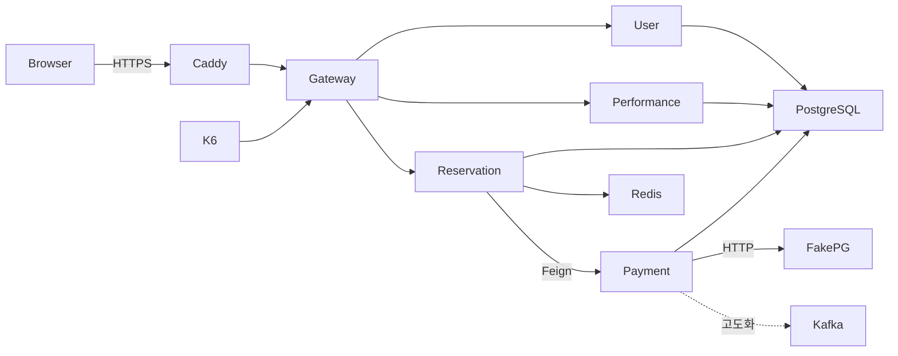

# 인프라 아키텍처

기준: 저장소의 2026-10-26 [Notion 인프라 구성도](https://app.notion.com/p/404b3ff41d3980cfa2ddf135e5507530) 스냅샷과 develop 7a48c5e 설정. Notion 실시간/실제 AWS 배포 상태는 미검증. 계획과 현재 파일을 구분한다.

## 배포 목표

AWS 서울 ap-northeast-2, ap-northeast-2a 기본 VPC 퍼블릭 서브넷. Ubuntu24.04 amd64, EC2별 Docker Compose, 앱은 host network·Eureka에 private IP 등록. RDS/MSK/ECS/Kubernetes 미사용. 보안 그룹으로 인터넷 접근 제한.

| 서버 | 인스턴스·디스크 | 배치(포트) |
|---|---|---|
| vm-edge | m7i.large·gp3 30GB | Caddy80/443,Gateway8080(관리9080),user8081,performance8082,Config8888,Eureka8761 |
| vm-core | m7i.large·gp3 30GB | reservation8083(queue/seat/booking/coupon),payment8084 |
| vm-data | m7i.large·gp3 50GB | PostgreSQL5432,Redis6379,Kafka29092,fake-pg8090,Prometheus9090,Grafana3000,Kafka UI8989 |
| vm-k6 | c8i.large·gp3 20GB | VPC 내부 k6 발생기 |

PostgreSQL은 단일 인스턴스에 user_schema/performance_schema/reservation_schema/payment_schema/fake_pg_schema와 전용 계정. 논리 격리이며 장애/IO/CPU는 공유한다. 단일 AZ·Kafka1대·vm-data 집중은 HA 구성이 아니다. fake-pg와 DB/관측 도구 CPU 경합도 측정에 포함한다.

## 접근·운영

| 구간 | 허용 |
|---|---|
| 인터넷→edge | 80/443만. 8080/관리포트 직접 공개 금지 |
| 앱→데이터·내부 서비스 | 필요한 VPC/보안그룹 간 포트만 |
| 팀원→서버/DB/관측 | SSM Session Manager/포트포워딩. SSH22 미사용 |
| fake-pg·관리 API | 내부 결제/k6/승인된 운영 접근만. Gateway 노출 금지 |
| Actuator | 관리 포트/내부망 수집. 현행 Gateway의 공개 Prometheus whitelist는 배포 전 차단/분리 필요 |

목표 배포: 수동 GitHub Actions → OIDC → ECR 이미지/S3 배포파일 → SSM(data→edge→core). 서버별 compose.edge/core/data.yml과 기동/중지 워크플로는 구현·존재 확인 후 사용하며, 현재 루트 docker-compose.yml을 서버 배포 완료 증거로 보지 않는다. Config 파일은 config-server 이미지에 포함되어 변경 시 재빌드/재배포 필요.
테스트 시간만 기동·03:00KST 자동 중지 정책은 초안. 실제 스케줄·IAM·도메인·CORS·프론트 배치·인프라 담당 미확정. 데이터 초기화/볼륨 삭제는 승인 없이 수행 금지. 운영 DB는 create 사용 금지, DDL 이행·백업·복원 대사는 architecture R18 관문.

## 저장소 현행

- 로컬 구성: 루트 docker-compose.yml, infra/, script/. Gradle 빌드 문맥 backend/. 실행 안내는 루트 README. 실제 비밀 파일 대신 .env.example만 참조.
- Config: backend/config-repo/{서비스}.yml, 공통 application.yml, 로컬 application-local.yml. 앱의 application.yml은 이름/config import 중심. fake-pg는 Config/Eureka/common에 의존하지 않음.
- Gateway 현행 라우트: `/api/auth/**,/api/users/**`→user, `/api/reservations/**`→reservation, `/api/v1/events/**`→performance, `/api/v1/payments/**`→payment. 뒤 두 개는 현재 API 명세와 불일치한 이전 라우트다.
- 필요한 라우트 이행: 공연 `/api/performances/**,/api/seller/**,/api/admin/**`와 회차 단건→performance, `/api/schedules/{id}/seats|holds|remaining|queue` 및 `/api/coupons/**`→reservation. 구체 하위 경로 우선으로 충돌 방지. 이 문서 작업은 실제 gateway 설정을 수정하지 않는다.
- Swagger 집계는 `/{서비스}/v3/api-docs` RewritePath, 실제 외부 내부 API 노출 여부는 별도 필터/스키마 확인. 문서 통합은 Swagger 자동 생성 규격 변경이 아님.

## 관측·측정 환경

Prometheus→Grafana, /actuator/prometheus 수집. 서비스/거래ID는 로그로 추적하고 ID별 고카디널리티 메트릭 label 금지. CPU/메모리/DB풀·락·HTTP 지연·PG 호출·Unknown 최고 나이·미환불금액, 고도화 후 Outbox/DB작업대기·Kafka lag 관측. 구체 경보 임계값/Slack/Alertmanager 도입은 아직 확정하지 않는다.
k6는 VPC 내부에서 Gateway E2E와 서비스 직접 호출을 구분한다. SSM터널/노트북 네트워크를 부하 경로에 넣지 않는다. 동일 자원·PG한도·데이터·설정에서 개선 전후를 비교하며 환경/원본 결과는 이슈·PR에 남긴다. 시험 종료 시 PG/payment/예매의 상태·금액을 대조한다.
