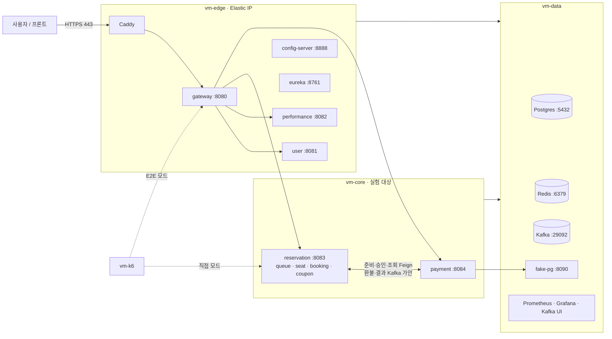
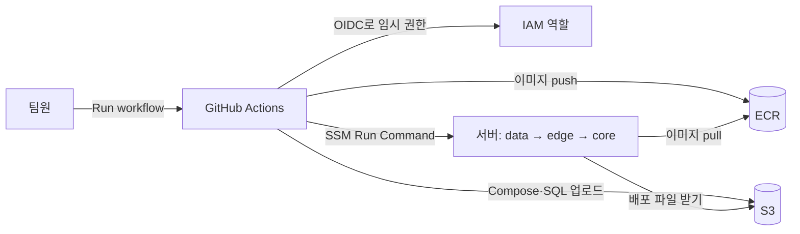
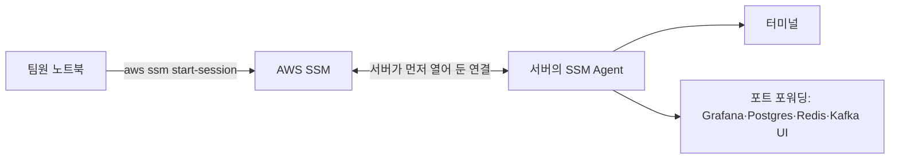

# 인프라 아키텍처

- 원본: 팀 Notion [인프라 구성도](https://app.notion.com/p/404b3ff41d3980cfa2ddf135e5507530) (2026-10-27 12:10 UTC 수정본). 0~8절은 Notion 전사본을 저장소의 후속 결정에 맞춰 정리한 현재 기준이다. 따라 하기 가이드 01~10의 단계별 명령은 Notion 하위 페이지에만 있다(9절 링크).
- 실제 AWS 배포 상태는 검증하지 않았다. 계획과 저장소의 현재 파일을 구분한다(10절).
- Notion 원본은 수정하지 않았다. 본문은 후속 합의를 반영했으며 실제 구현·배포 여부는10절과 실제 설정을 확인한다.
- 서비스 책임·통신은 [architecture.md](architecture.md)에 있다.

**이 문서 읽는 법**

- 우리 인프라가 어떻게, 왜 이렇게 생겼는지 알고 싶다 → 0~5절
- 인프라를 처음부터 직접 만든다 → Notion 「따라 하기 가이드」 01부터 10까지 순서대로. 가이드는 모두 목표 → 사전 준비 → 단계 → 완료 확인 → 자주 막히는 곳 순서다
- 이미 만들어져 있고 쓰기만 한다 → Notion 09. 운영 가이드

## 0. 한눈에 보기

| 항목 | 우리 선택 |
| --- | --- |
| 클라우드 | AWS 서울 리전(ap-northeast-2), 한 AZ(ap-northeast-2a), 기본 VPC 퍼블릭 서브넷 |
| 서버 | EC2 4대 — vm-edge, vm-core, vm-data (m7i.large), vm-k6 (c8i.large) |
| 실행 방식 | 서버별 Docker Compose. 쿠버네티스·ECS 없음 |
| 데이터 | Postgres·Redis·Kafka를 vm-data에 직접 실행. 관리형(RDS·ElastiCache·MSK) 없음 |
| 배포 | GitHub Actions → ECR(이미지)·S3(설정 파일) → SSM으로 서버에 명령. 수동 실행 |
| 접속 | SSM만 사용. SSH(22) 없음. DB·Grafana도 SSM 포트 포워딩 |
| 외부 공개 | vm-edge의 80·443(Caddy, HTTPS)뿐 |
| 운영 | 테스트·배포 시 기동,03:00 자동 중지는 목표(실행 여부 미확인) |
| 비용 | 켜 둔 동안 시간당 약 $0.39 (k6 포함 약 $0.50), 꺼 둔 동안 한 달 약 $17 |

## 1. 결정 요약

| # | 결정 | 이유 |
| --- | --- | --- |
| 1 | AWS 서울 리전, 서버 전부 같은 AZ | 팀원 중 AWS 경험자가 있어 막혔을 때 해결이 빠르다(GCP 대신 고른 이유). AZ 간 트래픽 요금이 없고 지연이 일정해 측정이 안정적이다 |
| 2 | EC2 + Docker Compose (쿠버네티스·ECS 미사용) | 로컬 `docker-compose.yml`을 서버별로 나누기만 하면 된다. 인프라 초보 팀이 MVP 기간 안에 끝낼 수 있고, 측정 결과에 플랫폼 변수가 끼지 않는다 |
| 3 | Postgres·Redis·Kafka를 EC2에 직접 | 어차피 켜 둘 vm-data에 올려 추가 비용이 거의 없다. MSK는 최소 2브로커라 비싸고, 소형 RDS·ElastiCache는 T 계열이라 CPU 크레딧이 떨어지면 측정이 흔들린다. 자동 백업·다중 AZ는 이 프로젝트에 필요 없다 |
| 4 | 앱 서버는 m7i.large로 고정 | T 계열은 CPU 크레딧 때문에 같은 실험을 반복해도 결과가 달라진다. 켤 때만 쓰므로 t3와의 차이는 몇 달러 수준이다 |
| 5 | 테스트할 때만 켜고 새벽 자동 중지 | 24시간 켜 두면 한 달 약 $300, 필요할 때만 켜면 수십 달러 |
| 6 | 앱 컨테이너는 `network_mode: host` | 컨테이너가 EC2 IP를 그대로 써서 다른 서버에서 닿는 주소가 Eureka에 등록된다. Docker NAT가 없어 측정에도 유리하다 |
| 7 | 퍼블릭 서브넷, NAT Gateway 없음 | NAT Gateway는 꺼 둘 수 없고 서버보다 비쌀 수 있다. 외부 차단은 보안 그룹이 맡는다 |
| 8 | 접속은 SSM만, 22번 포트 없음 | 서버에 열 포트가 없고, 키 파일을 나눠 갖지 않는다. 누가 접속할 수 있는지 AWS 계정 권한으로 관리하고, 기록이 남는다 |
| 9 | HTTPS는 vm-edge의 Caddy (ALB 미사용) | 인증서가 무료·자동 갱신이고 추가 비용이 없다. ALB는 꺼 둘 수 없어 안 쓰는 동안에도 과금된다 |
| 10 | 배포는 GitHub OIDC → ECR·S3 → SSM, 수동 실행만 | AWS 키를 GitHub에 저장하지 않는다. 서버가 꺼져 있을 때의 실패와, 측정 중 배포가 끼어드는 것을 막는다 |
| 11 | k6는 VPC 안 전용 서버, 노트북에서 원격 실행 | 인터넷 구간이나 SSM 터널이 측정값에 섞이지 않는다. 결과는 Grafana와 JSON으로 받는다 |
| 12 | fake-pg는 vm-data에 둔다 | 결제 서비스 밖의 외부 PG 역할. Eureka·config 없이 주소로 호출한다 (결정 필요 사항 I7) |

## 2. 구성도

### 2-1. 요청이 흐르는 길

- 인터넷에서 들어오는 길은 **Caddy(443) 하나**다. 서비스 포트, Eureka, config, DB는 VPC 안에서만 닿는다.
- 서비스는 gateway가 넣어 준 `X-User-*` 헤더를 그대로 믿는다. 그래서 서비스 포트를 외부에 열지 않는 것이 이 구조의 핵심 보안 규칙이다(Notion 10. 배포 전 보안 체크리스트).

### 2-2. 배포되는 길

### 2-3. 팀원이 서버에 접속하는 길

서버의 SSM Agent가 AWS 쪽으로 먼저 연결을 열어 두고, AWS가 내 명령을 그 연결로 전달한다. 그래서 서버에 열어 둘 포트가 없다.

## 3. 서버별 배치

현재 저장소의 performance-service 이름을 사용한다. ECR·Eureka 이름은 배포 구성 시 아래 이름으로 맞춘다. 실제 Gateway의 기존 경로 차이는 10절에 기록한다.

| 구분 | 기준 |
|---|---|
| 모듈·Compose 서비스 / ECR 목표 | `performance-service` / `ticket/performance-service` |
| Eureka 목표 이름 | `PERFORMANCE-SERVICE` |
| 포트 / API 계약 prefix | 8082 / `/api/performances`, `/api/schedules` |
| DB 계정·스키마·비밀번호 변수 | `performance_app`, `performance_schema`, `PERFORMANCE_DB_PASSWORD` |
| 스키마 SQL | `backend/sql/performance-service/schema.sql` |

| 서버 | 프라이빗 IP | 컨테이너 (포트) | 인스턴스 | 디스크 | Compose 파일 |
| --- | --- | --- | --- | --- | --- |
| vm-edge | `<채우기>` | Caddy(80·443), gateway(8080, 관리 9080), user(8081), performance(8082), config-server(8888), eureka(8761) | m7i.large | gp3 30GB | `compose.edge.yml` |
| vm-core | `<채우기>` | reservation(8083, 쿠폰 모듈 포함), payment(8084) | m7i.large | gp3 30GB | `compose.core.yml` |
| vm-data | `<채우기>` | Postgres(5432), Redis(6379), Kafka(29092), fake-pg(8090), Prometheus(9090), Grafana(3000), Kafka UI(8989) | m7i.large | gp3 50GB | `compose.data.yml` |
| vm-k6 | `<채우기>` | k6 (실행할 때만) | c8i.large | gp3 20GB | — |

- m7i.large = 2 vCPU, 8GB. vm-edge는 JVM 5개 × 약 600MB ≈ 3GB, vm-core는 실험용으로 서비스당 힙 1GB.
- 쿠폰 모듈은 reservation-service로 이전 예정이다. 예매와의 연결 계약은 #125에서 합의했다. 쿠폰 발급은 현재 동기201 계약이며 Kafka 소비는 미합의다. 오픈 부하가 겹치면 reservation CPU·힙·HikariCP를 함께 측정한다(I8).
- gateway 외부 경로는 `/api/**`다. 버전(`v1`)은 붙이지 않는다.
- OS는 Ubuntu 24.04 x86_64. 이미지는 amd64로만 만든다(Mac에서 빌드할 때는 `--platform linux/amd64`).
- PostgreSQL은 인스턴스 하나에 서비스별 스키마와 전용 계정을 둔다. 논리 격리일 뿐 장애·IO·CPU는 공유한다. 단일 AZ·Kafka 1대·vm-data 집중은 고가용성 구성이 아니다. fake-pg와 DB·관측 도구의 CPU 경합도 측정에 포함한다.

## 4. 포트 지도

| 포트 | 서버 | 용도 | 인터넷 | VPC 안 | 팀원 접근 |
| --- | --- | --- | --- | --- | --- |
| 80, 443 | edge | Caddy (HTTPS) | ✅ | ✅ | 브라우저·curl |
| 8080 | edge | gateway | ❌ | ✅ | k6 E2E 모드 |
| 9080 | edge | gateway 관리(actuator) | ❌ | ✅ | Prometheus 수집 |
| 8081~8084 | edge·core | 서비스 | ❌ | ✅ | k6 직접 모드 |
| 8761, 8888 | edge | Eureka, config | ❌ | ✅ | SSM 포트 포워딩 |
| 5432, 6379, 29092 | data | Postgres, Redis, Kafka | ❌ | ✅ | SSM 포트 포워딩 |
| 8090 | data | fake-pg (장애 주입 API 포함) | ❌ | ✅ | k6, payment |
| 3000, 9090, 8989 | data | Grafana, Prometheus, Kafka UI | ❌ | ✅ | SSM 포트 포워딩 |
| 22 | — | SSH | ❌ | ❌ | 쓰지 않음 (SSM) |

## 5. 비용

**원본 설계의 비용 추정(서울 리전, Linux 온디맨드)**

아래는 전사본의 추정값이며 이번 작업에서 현재 요금·청구액을 검증하지 않았다. 배포 예산에 쓰기 전 계산기로 재확인한다.

| 항목 | 단가 | 근거 |
| --- | --- | --- |
| EC2 m7i.large | $0.124/시간 | AWS 가격표 확인 |
| EC2 c8i.large (k6) | $0.106/시간 | AWS 가격표 확인 |
| (참고) t3.large | $0.104/시간 | AWS 가격표 확인 |
| EBS gp3 130GB | 약 $12/월 | 알려진 단가로 계산, 확인 필요 |
| 퍼블릭 IPv4 (서버 3~4개) | 개당 약 $0.005/시간 | 알려진 단가로 계산, 확인 필요 |
| ECR·S3 | 월 $1 내외 | 확인 필요 |

**사용 방식별 예상**

| 상황 | 비용 |
| --- | --- |
| 켜 둔 동안 (앱 서버 3대) | 시간당 약 **$0.39** |
| 켜 둔 동안 (k6 포함 4대) | 시간당 약 **$0.50** |
| 꺼 둔 동안 (디스크·Elastic IP·ECR) | 한 달 약 **$17** |
| 3주 동안 총 60시간 사용 | 약 **$42** |
| 3주 동안 총 100시간 사용 | 약 **$62** |
| (참고) 3대를 24시간 켜 두면 | 한 달 약 $300 |

크레딧 금액·만료일은 가이드 01에서 확인해 7절 기록표에 적는다. 정확한 금액은 [AWS Pricing Calculator](https://calculator.aws/)로 확인한다.

## 6. 따라 하기 가이드 순서

> 보안 체크리스트의 코드 변경은 첫 배포 전에 develop에 머지해 배포 이미지에 포함한다. 실제 릴리스는 공통 PR·배포 절차를 따른다.

| 순서 | 하는 일 | 끝나면 | 누가 | 시간 |
| --- | --- | --- | --- | --- |
| 01 계정·권한 | 루트 MFA, 예산 알림, 팀원 계정, 노트북 CLI | 각자 `aws` 명령 사용 | 담당 + 전원 | 30분~1시간 |
| 02 네트워크 | 서브넷·IP 정하기, 보안 그룹 2개, Elastic IP | 방화벽 준비 | 담당 | 20분 |
| 03 IAM·ECR·S3 | 이미지 저장소, 배포 버킷, 역할 2개, GitHub OIDC | 저장소·권한 준비 | 담당 | 40분 |
| 04 EC2 | 서버 4대, Docker·AWS CLI, `.env` | SSM 접속되는 서버 | 담당 | 1시간 |
| 05 첫 배포 | `deploy/` 작성, 손으로 배포, DB 스키마 | gateway가 401 응답 | 담당 | 2~3시간 |
| 06 HTTPS | 도메인 연결, Caddy | `https://api.<도메인>` 401 | 담당 | 30분 |
| 07 자동화 | Deploy·Infra Start·Infra Stop 워크플로 | 버튼으로 배포·켜기·끄기 | 담당 | 1~2시간 |
| 08 부하 테스트 | vm-k6, `load-test/` | 노트북에서 원격 부하 | 담당 + 전원 | 1시간 |
| 09 운영 | 켜고 끄기, 접속, 로그, 비용, 문제 해결 | — | 전원 | 수시 |
| 10 보안 | 배포 전 점검 | 외부 공개 준비 완료 | 담당 | 30분 |

## 7. 인프라 값 기록표

가이드를 진행하며 채운다. 다른 가이드의 `<vm-edge 프라이빗 IP>` 같은 자리에 이 값을 넣는다.

> 비밀번호·JWT 시크릿·액세스 키는 여기에 적지 않는다. 비밀값은 각 서버의 `/opt/ticket/.env`에만 둔다.

| 항목 | 값 | 채우는 가이드 |
| --- | --- | --- |
| 크레딧 금액 / 만료일 / 적용 서비스 |  | 01 |
| AWS 계정 ID |  | 03 |
| 서브넷 ID / CIDR (ap-northeast-2a) |  | 02 |
| 프라이빗 IP: edge / core / data / k6 |  | 02 |
| Elastic IP |  | 02 |
| 인스턴스 ID: edge / core / data / k6 |  | 04 |
| S3 버킷 | `ticket-deploy-<계정ID>` | 03 |
| 배포 역할 ARN |  | 03 |
| API 도메인 |  | 06 |

## 8. 결정 필요 사항

| # | 항목 | 관련 가이드 |
| --- | --- | --- |
| I1 | 크레딧 금액·만료일·적용 서비스 확인, Budgets 알림 금액 | 01 |
| I2 | 팀원 계정 방식: IAM Identity Center(권장) / IAM 사용자 | 01 |
| I3 | 도메인 구입처·이름 | 06 |
| I4 | 프론트 배포 위치와 CORS 설정 | 06 |
| I5 | 인프라 담당자 (프로젝트 공통 배포 업무) | 전체 |
| I6 | 자동 중지 시각 (기본 03:00 KST) | 07 |
| I7 | fake-pg 위치 확정 (현재 vm-data). 결제 지연 주입 실험 때 vm-data CPU 사용률도 같이 기록한다 | 05, 08 |
| I8 | 쿠폰 모듈이 reservation으로 옮겨진 뒤 쿠폰 발급 부하가 좌석 선점에 주는 영향. 크면 vm-core 사양이나 쿠폰 소비자 동시성을 조정한다 | 08 |

## 9. 따라 하기 가이드 (Notion 하위 페이지)

- [01. AWS 계정·권한 준비](https://app.notion.com/p/405b3ff41d398190b87ccaba10e238cc)
- [02. 네트워크·보안 그룹](https://app.notion.com/p/405b3ff41d3981dabdbac9907ed8ff45)
- [03. IAM 역할·ECR·S3](https://app.notion.com/p/405b3ff41d3981d8b450e2b6e282d748)
- [04. EC2 생성과 서버 초기 설정](https://app.notion.com/p/405b3ff41d3981d68489fd3318b127c8)
- [05. Compose 분리와 첫 수동 배포](https://app.notion.com/p/405b3ff41d398131945fc61714642f52)
- [06. HTTPS (Caddy·도메인)](https://app.notion.com/p/405b3ff41d3981a98364ceaf7276e1c1)
- [07. GitHub Actions 배포 자동화](https://app.notion.com/p/405b3ff41d39815b8765ebfa021ab403)
- [08. 부하 테스트 환경 (k6)](https://app.notion.com/p/405b3ff41d398155a473e7b10543121b)
- [09. 운영 가이드](https://app.notion.com/p/405b3ff41d3981d7afacf76f9a5319d2)
- [10. 배포 전 보안 체크리스트](https://app.notion.com/p/405b3ff41d3981579b5ce116807189a2)

## 10. 저장소 현행 (Notion에 없는 사실)

- 로컬 구성: 루트 `docker-compose.yml`, `infra/`, `script/`. Gradle 빌드 문맥은 `backend/`. 실행 안내는 루트 README. 실제 비밀 파일 대신 `.env.example`만 참조한다.
- Config: `backend/config-repo/{서비스}.yml`, 공통 `application.yml`, 로컬 `application-local.yml`. 앱의 `application.yml`은 이름과 config import 중심이다. fake-pg는 Config·Eureka·common에 의존하지 않는다.
- 서버별 `compose.edge/core/data.yml`과 기동·중지 워크플로는 구현·존재를 확인한 뒤 사용한다. 현재 루트 `docker-compose.yml`을 서버 배포 완료 증거로 보지 않는다. Config 파일은 config-server 이미지에 포함되므로 바꾸면 재빌드·재배포가 필요하다.
- 데이터 초기화·볼륨 삭제는 승인 없이 하지 않는다. 운영 DB에서 `ddl-auto: create`를 쓰지 않는다. DDL 이행·백업·복원 뒤에는 미완료 작업 보존과 PG 재대조를 확인한다(실제 과금 운영 전 검증 항목).
- Gateway 현행 라우트: `/api/auth/**`·`/api/users/**` → user, `/api/reservations/**` → reservation, `/api/performances/**`·`/api/schedules/{scheduleId}`(한 단계) → performance, `/api/v1/payments/**` → payment. 결제 라우트는 현재 API 명세(`v1` 없음)와 다른 이전 라우트다. 공개 공연 조회 `/api/performances/**`와 공개 회차 상세 `/api/schedules/*`는 인증 제외(whitelist)다. 회차 단건은 한 단계 경로만 매칭해 `/api/schedules/{id}/queue`(reservation)와 겹치지 않는다(#115). #88의 결제 관리자 라우트 추가는 12절을 따른다.
- 필요한 라우트 이행: 공연 `/api/seller/**`·`/api/admin/**` → performance. `/api/schedules/{id}/seats|holds|remaining|queue`와 `/api/coupons/**` → reservation. 구체적인 하위 경로를 먼저 매칭해 충돌을 막는다. 이 문서는 실제 gateway 설정을 바꾸지 않는다.
- Actuator는 관리 포트·내부망에서만 수집한다. 현행 Gateway의 공개 Prometheus whitelist는 배포 전 차단하거나 분리해야 한다.
- Swagger 집계는 `/{서비스}/v3/api-docs` RewritePath를 쓴다. 내부 API가 외부 문서에 노출되는지는 별도 필터·스키마로 확인한다.

## 11. 관측·측정 환경

- Prometheus → Grafana로 `/actuator/prometheus`를 수집한다. 서비스·거래 ID는 로그로 추적하고, ID별 고카디널리티 메트릭 label을 쓰지 않는다.
- 결제 운영 대시보드는 `infra/grafana/provisioning/dashboards/`에서 자동 등록한다. 히스토그램·DB 수집 주기는 `backend/config-repo/payment-service.yml`에 있으며 Config Server 재빌드·재배포 후 적용한다.
- 결제 DB 상태는 별도 관측 스레드에서 15초마다 읽고 scrape는 메모리만 읽는다. 대시보드는 마지막 성공이 45초 이상 지난 값을 제외하며, 같은 DB를 보는 인스턴스의 상태 게이지는 합산하지 않는다.
- 관측 대상: CPU·메모리·DB 풀·락·HTTP 지연·PG 호출·가장 오래된 Unknown의 나이·미환불 금액. 고도화 후 Outbox·DB 작업 대기·Kafka lag.
- 경보는 Prometheus 규칙(`infra/prometheus/rules/`) → Alertmanager(`infra/alertmanager/`) → Slack으로 보낸다. 거래마다 보내지 않고 환경·서비스·PG·경보 종류로 묶으며, 같은 위험의 CRITICAL이 WARNING을 억제한다. 정산 경보(`settlement-*.yml`)는 한 경보 이름 안에서 `reason`·`check` 라벨로 위험을 나누므로 억제도 이 라벨이 같을 때만 한다. 임계값은 초기 운영안이고 기준선 측정 뒤 조정한다.
- Slack webhook URL은 저장소에 두지 않는다. URL 한 줄짜리 파일을 `infra/alertmanager/secrets/`(Git 비추적)에 두고 `SLACK_WEBHOOK_URL_FILE`로 지정한다. 지정하지 않으면 모의 수신기 `alert-mock`(127.0.0.1:9094, `GET /messages`)으로 보낸다.
- 알림 전송 실패는 금융 처리에 영향을 주지 않는다. 실패는 `alertmanager_notifications_failed_total`과 `AlertmanagerNotificationsFailing` 경보로 따로 본다.
- k6는 VPC 안에서 Gateway E2E 모드와 서비스 직접 호출 모드를 구분한다. SSM 터널·노트북 네트워크를 부하 경로에 넣지 않는다.
- 같은 자원·PG 한도·데이터·설정에서 개선 전후를 비교하고, 환경과 원본 결과는 이슈·PR에 남긴다. 시험이 끝나면 PG·payment·예매의 상태와 금액을 대조한다.

## 12. 결제 관리자 접근 (#88 브랜치 구현)

- 관리자 API 계약은 api.md의 결제 관리자 절에 둔다. Gateway가 `/api/admin/payments/**`를 payment로 전달하고 MASTER만 허용한다. 이 경로는 사용자 캐시를 우회해 매 요청 현재 계정·역할을 확인한다. 조회 장애는503이며 기존 캐시로 대체하지 않는다.
- 정산 관리자 `/api/admin/settlements/**`도 같은 방식으로 MASTER만 허용한다. 판매자 정산 `/api/seller/settlements/**`·`/api/seller/payout-account`는 Gateway가 SELLER만 허용하고, 본인 정산인지는 payment가 `X-User-Id`로 확인한다(#160).
- payment도 공통 `@RequireRole(MASTER)`로 검사하고 실행자를 인증된 사용자 ID로 기록한다. 직접 접근 시 사용자 헤더를 위조할 수 있으므로 서비스 포트 비공개와 Gateway 경유 접근을 배포 환경에서 보장해야 한다. 실제 보안 그룹·내부 호출자 통제는 미검증이다.
- `/internal/**` 외부 차단을 유지한다. 서비스 인증 전반의 미합의 상태를 이번 관리자 경로 구현으로 해결했다고 간주하지 않는다.
- 기존 DB는 002→003→004 이행 후 배포한다. 실행자는 조회→원인 확인·수정→최신 상태로 명령→PG/DB 대조 순서로 처리한다. 결과 불명은 동일 commandId로 확인하며 DB 상태를 직접 덮어쓰지 않는다.
- MASTER 생성은 user-service의 기존 초기 계정 설정을 사용한다. 실제 계정 발급과 배포 접근 검증·운영 DB 이행은 별도 확인한다. Slack·Alertmanager 연결은 Task11 범위다.
