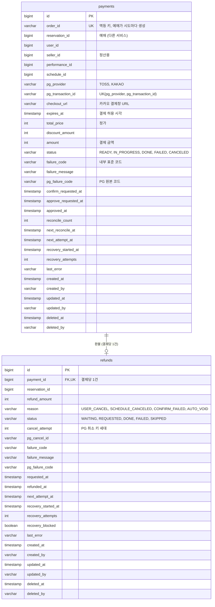
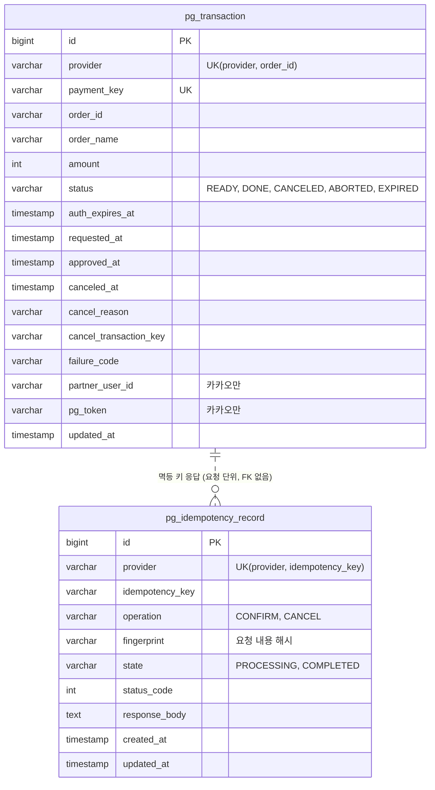

# 결제 테이블 명세

- 상태: 작성 완료
- 담당: 강현민
- DDL: `backend/sql/payment-service/schema.sql`, `backend/sql/fake-pg/schema.sql`
- Notion 테이블 명세서 3.10~3.14가 원본이었다. 2026-10-26 팀 결정(회원 ID BIGINT, 결제 차단 제거)은 이 문서에 먼저 반영했다.
- 현재 `schema.sql`의 테이블 이름은 `p_payments`, `p_refunds`다. `p_`를 빼는 변경은 별도 PR로 반영한다.

## 1. ERD

### payment-service (`payment_schema`)

- 실선은 DB FK가 있는 관계다(`refunds.payment_id`).
- `reservation_id`, `user_id`, `seller_id`, `performance_id`, `schedule_id`는 다른 서비스의 ID라 FK 없이 값만 둔다.

### fake PG (`fake_pg_schema`, 테스트용 PG 서버)

- 토스처럼 PG 쪽 거래 장부(`pg_transaction`)와 멱등 키 응답(`pg_idempotency_record`)을 가진다. 조회 API, 중복 승인 거절, 늦은 승인 재현, 응답 유실 후 같은 키 재시도를 흉내 내기 위해 필요하다.
- payment의 `payments`와는 DB로 연결되지 않는다. 대사는 `order_id`로 두 기록을 비교한다.

## 2. 공통 사항

**소유 서비스: 결제 서비스.**

payments, refunds는 결제 서비스가 소유한다.
결제 준비·승인·환불 상태는 결제 서비스의 로컬 트랜잭션으로 바꾸고, PG 호출은 트랜잭션 밖에서 한다.
예매·회원·공연 데이터는 외부 ID로 참조하며 서비스 간 물리 FK를 만들지 않는다.
쿠폰은 reservation-service가 소유하며 결제는 쿠폰을 조회·변경하지 않는다.

- 결제 서비스는 PostgreSQL 16 기준으로 구현했다.
식별자는 BIGINT IDENTITY, 시각은 KST TIMESTAMP다.
모든 컨테이너는 TZ=Asia/Seoul로 시간대를 맞춘다.
- 금액은 원 단위 INT이며 통화는 KRW 고정이다.
- 결제·환불은 금융 기록이라 삭제 API를 두지 않는다.
- 상태 변경은 행 잠금(SELECT ... FOR UPDATE) 후 상태를 다시 확인하고 바꾼다.
- 요청 밖 작업(복구·대사 잡)이 바꾼 행의 작성자는 SYSTEM이다.

**감사 컬럼 — payments, refunds에 실제 포함**

공통 감사 컬럼(created_at, updated_at)에 더해 팀 BaseEntity의 작성자·삭제 컬럼을 가진다.

| 컬럼(영문) | 컬럼(한글) | 타입 | 제약·기본값 | 설명 |
| --- | --- | --- | --- | --- |
| created_at | 생성 시각 | TIMESTAMP | NOT NULL | JPA Auditing이 행 최초 생성 시 기록한다. 이후 변경하지 않는다. |
| created_by | 생성자 | VARCHAR(100) | NOT NULL | 요청한 사용자(팀 `HeaderAuditorAware`가 요청 헤더로 정한다). 요청 밖 작업은 SYSTEM. |
| updated_at | 최종 변경 시각 | TIMESTAMP | NOT NULL | 서버가 매 변경 시 갱신한다. |
| updated_by | 최종 변경자 | VARCHAR(100) | NOT NULL | 마지막으로 바꾼 주체. 요청 밖 작업은 SYSTEM. |
| deleted_at | 삭제 시각 | TIMESTAMP | NULL | BaseEntity 공통 컬럼. 결제·환불은 삭제하지 않는다. |
| deleted_by | 삭제자 | VARCHAR(100) | NULL | BaseEntity 공통 컬럼. |

## 3. payments — 결제

결제 준비 시도 한 번이 결제 한 건이다.
예매가 준비 시도마다 만든 `order_id`로 같은 요청을 구분한다.
한 예매에 살아 있는(READY·IN_PROGRESS·DONE) 결제는 하나뿐이다.
상태 전이는 `READY → IN_PROGRESS → DONE / FAILED`, `DONE → CANCELED`다.

| 컬럼(영문) | 컬럼(한글) | 타입 | 제약·기본값 | 설명 |
| --- | --- | --- | --- | --- |
| id | 결제 식별자 | BIGINT | PK, NOT NULL, IDENTITY | 결제 행 ID. |
| order_id | 주문 번호 | VARCHAR(64) | NOT NULL, UNIQUE | 예매가 준비 시도마다 만드는 멱등 키. PG에 주문번호로 보낸다. |
| reservation_id | 예매 식별자 | BIGINT | NOT NULL, 외부 참조 ID | 예매 서비스의 예매 ID. 서비스 간 물리 FK는 두지 않는다. |
| user_id | 결제 사용자 식별자 | BIGINT | NOT NULL, 외부 참조 ID | 결제한 회원. 회원 서비스의 회원 ID. 예매가 요청 헤더에서 받아 넘긴다. |
| seller_id | 판매자 식별자 | BIGINT | NOT NULL, 외부 참조 ID | 정산 받을 판매자(SELLER 회원 ID). 정산은 범위 밖이지만 1차부터 저장한다. |
| performance_id | 공연 식별자 | BIGINT | NOT NULL, 외부 참조 ID | 정산·조회용. |
| schedule_id | 회차 식별자 | BIGINT | NOT NULL, 외부 참조 ID | 정산·조회용. |
| pg_provider | PG 종류 | VARCHAR(20) | NOT NULL, CHECK IN (TOSS, KAKAO) | 결제에 쓴 PG. 조회·취소할 PG를 고른다. |
| pg_transaction_id | PG 거래 식별자 | VARCHAR(200) | NULL | PG가 조회·취소에 쓰는 거래 ID. 카카오 tid는 준비 때, 토스 paymentKey는 승인 시작 때 들어온다. |
| checkout_url | 결제창 주소 | VARCHAR(500) | NULL | 카카오 결제창 URL. 같은 주문 번호의 준비 재요청에 그대로 돌려준다. 토스는 NULL. |
| expires_at | 결제 허용 시각 | TIMESTAMP | NOT NULL | 예매의 좌석 선점 만료 시각. 이 뒤에는 PG 승인을 부르지 않는다. |
| total_price | 정가(원) | INT | NOT NULL | 할인 전 금액. |
| discount_amount | 할인 금액(원) | INT | NOT NULL, DEFAULT 0, 0 이상 | 예매가 확정해 보낸 할인액. 결제는 값을 보정하지 않는다. |
| amount | 결제 금액(원) | INT | NOT NULL, 100 이상, total_price - discount_amount와 같음 | PG에 승인 요청하는 금액. 승인 요청 금액과 대조한다. |
| status | 결제 상태 | VARCHAR(20) | NOT NULL, DEFAULT READY | READY / IN_PROGRESS / DONE / FAILED / CANCELED. |
| failure_code | 실패 코드 | VARCHAR(80) | NULL | 내부 표준 코드. 예: PG_REJECTED, EXPIRED. 응답의 failureType과 대응한다. |
| failure_message | 실패 메시지 | VARCHAR(255) | NULL | 실패 설명. |
| pg_failure_code | PG 원본 실패 코드 | VARCHAR(80) | NULL | PG가 준 거절 코드 그대로. 예: REJECT_CARD_PAYMENT. |
| confirm_requested_at | 승인 요청 접수 시각 | TIMESTAMP | NULL | 승인 요청을 처음 받은 시각. 예매가 재전송 여부를 판단한다. |
| approve_requested_at | PG 승인 호출 시각 | TIMESTAMP | NULL | PG 승인을 부른 시각. 결과 확정 시한(1분), "승인 기록 없음" 유예(1분), 최소 대사 대상 판단 기준. |
| approved_at | 승인 시각 | TIMESTAMP | NULL | PG 승인 시각. 정산 기준. |
| reconcile_count | 대사 횟수 | INT | NOT NULL, DEFAULT 0 | 최소 대사로 PG를 확인한 횟수. |
| next_reconcile_at | 다음 대사 시각 | TIMESTAMP | NULL | FAILED 확정 11분·24시간 뒤. 마지막 대사가 끝나면 NULL. |
| next_attempt_at | 다음 복구 시각 | TIMESTAMP | NULL | 복구 잡이 다음에 볼 시각(10초 간격). 다른 인스턴스가 잡지 못하게 점유할 때도 쓴다. |
| recovery_started_at | 복구 시작 시각 | TIMESTAMP | NULL | 승인 호출 시각과 같다. 결제는 차단하지 않으므로 시한 판단은 approve_requested_at으로 한다. |
| recovery_attempts | 복구 시도 횟수 | INT | NOT NULL, DEFAULT 0 | 결과 불명으로 다시 본 횟수. 운영 지표용. |
| last_error | 마지막 오류 | VARCHAR(80) | NULL | 마지막 결과 불명 사유. 운영용. |

**키·인덱스**

UK(order_id): 같은 주문 번호 중복 결제 방지.
UK(pg_provider, pg_transaction_id): 인증값 재사용·조작 차단.
부분 UK(reservation_id) WHERE status IN (READY, IN_PROGRESS, DONE): 한 예매에 살아 있는 결제는 하나.
새 준비는 같은 트랜잭션에서 이전 READY를 FAILED로 바꾼 뒤 넣는다.
CHECK(discount_amount >= 0 AND amount::BIGINT = total_price::BIGINT - discount_amount::BIGINT AND amount >= 100).
INDEX(expires_at) WHERE status = READY: 만료된 준비 정리.
INDEX(next_attempt_at) WHERE status = IN_PROGRESS: 결과 불명 복구. 결제는 차단하지 않고 승인 호출 1분 뒤 FAILED(PG_UNRESOLVED)로 끝낸다.
INDEX(next_reconcile_at) WHERE status = FAILED AND next_reconcile_at IS NOT NULL: 최소 대사.

**상태와 의미**

| 상태 | pg_transaction_id | approved_at | 의미 |
| --- | --- | --- | --- |
| READY | 카카오만 값 있음 | NULL | 결제 준비 완료. 승인 요청 대기. |
| IN_PROGRESS | 필수 | NULL | PG 승인을 불렀고 결과를 아직 모름. 복구 잡이 조회로 확정하고, 1분 안에 모르면 FAILED(PG_UNRESOLVED). |
| DONE | 필수 | 필수 | PG 승인 완료. |
| FAILED | NULL 허용 | NULL | 이 결제 시도를 끝냄. 쿠폰 점유 해제는 예매가 처리한다. PG_UNRESOLVED에 늦은 승인이 발견되면 AUTO_VOID 환불이 붙는다. |
| CANCELED | 필수 | 필수 | 전액 환불 완료. |

**실패 코드와 응답의 failureType**

| failureType | failure_code | 예매가 할 일 |
| --- | --- | --- |
| REJECTED | PG_REJECTED, AMOUNT_MISMATCH, INVALID_AUTH_TOKEN | 다른 수단으로 다시 결제 |
| UNAVAILABLE | PG_UNAVAILABLE, PG_BUSY, PG_UNRESOLVED | 잠시 후 같은 수단으로 다시 시도 |
| EXPIRED | EXPIRED | 선점이 끝났으면 만료, 아니면 다시 준비 |
| NOT_APPROVED | NOT_APPROVED, CANCELED_AT_PG | 결제 안 됨으로 확정. 다시 결제 가능 |
| CLOSED | SUPERSEDED, ABANDONED, READY_FAILED | 이 시도는 끝. 필요하면 새 준비 |

## 4. refunds — 환불

결제 하나에 환불 행 하나다(1차는 전액 환불).
사용자 환불과 늦은 승인 자동 취소(AUTO_VOID)가 겹쳐도 같은 행을 쓴다.
상태 전이는 `WAITING → REQUESTED / SKIPPED`, `REQUESTED → DONE / FAILED`, `FAILED → REQUESTED`(관리자 재시도), `SKIPPED → REQUESTED`(늦은 승인 발견)다.
부분 환불을 지원하면 환불 시도 단위로 다시 설계하고 payment_id 유니크를 푼다.

| 컬럼(영문) | 컬럼(한글) | 타입 | 제약·기본값 | 설명 |
| --- | --- | --- | --- | --- |
| id | 환불 식별자 | BIGINT | PK, NOT NULL, IDENTITY | 환불 행 ID. |
| payment_id | 결제 식별자 | BIGINT | FK → payments.id, NOT NULL, UNIQUE | 환불 대상 결제. 결제당 환불 1건. |
| reservation_id | 예매 식별자 | BIGINT | NOT NULL, 외부 참조 ID | 예매 기준 조회용. 서비스 간 물리 FK는 두지 않는다. |
| refund_amount | 환불 금액(원) | INT | NOT NULL, 0 초과 | USER_CANCEL·SCHEDULE_CANCELED·CONFIRM_FAILED는 결제 금액 전액, AUTO_VOID는 PG가 승인한 금액. 취소 수수료는 없다. |
| reason | 환불 사유 | VARCHAR(30) | NOT NULL | USER_CANCEL(사용자 취소) / SCHEDULE_CANCELED(회차 취소) / CONFIRM_FAILED(결제 후 예매 확정 실패) / AUTO_VOID(늦은 승인·금액 불일치 자동 취소). 처음 사유를 유지한다. |
| status | 환불 상태 | VARCHAR(20) | NOT NULL | WAITING / REQUESTED / DONE / FAILED / SKIPPED. |
| cancel_attempt | 취소 키 세대 | INT | NOT NULL, DEFAULT 0 | PG 취소 멱등 키 = {order_id}:cancel:{cancel_attempt}. 관리자가 업무 거절을 다시 시도할 때만 올린다. |
| pg_cancel_id | PG 취소 식별자 | VARCHAR(200) | NULL | PG가 준 취소 거래 ID. |
| failure_code | 실패 코드 | VARCHAR(80) | NULL | 내부 표준 코드. |
| failure_message | 실패 메시지 | VARCHAR(255) | NULL | 실패 설명. |
| pg_failure_code | PG 원본 실패 코드 | VARCHAR(80) | NULL | PG가 준 거절 코드 그대로. |
| requested_at | 환불 요청 시각 | TIMESTAMP | NULL | 처음 REQUESTED가 된 시각. |
| refunded_at | 환불 완료 시각 | TIMESTAMP | NULL | 정산 기준. |
| next_attempt_at | 다음 복구 시각 | TIMESTAMP | NULL | 복구 잡이 PG 취소를 다시 보낼 시각. 점유에도 쓴다. |
| recovery_started_at | 복구 시작 시각 | TIMESTAMP | NULL | 자동 처리 중단(60분) 기준. 관리자가 차단을 풀면(refund/unblock) 다시 센다. |
| recovery_attempts | 복구 시도 횟수 | INT | NOT NULL, DEFAULT 0 | 결과 불명으로 다시 보낸 횟수. |
| recovery_blocked | 자동 처리 중단 여부 | BOOLEAN | NOT NULL, DEFAULT false | 업무 거절이나 시간 초과로 중단. 관리자가 확인한다(refund/retry, refund/unblock). 결제에는 이 컬럼이 없다. |
| last_error | 마지막 오류 | VARCHAR(80) | NULL | 마지막 결과 불명 사유. 운영용. |

**키·인덱스**

FK(payment_id) → payments.id.
UK(payment_id): 결제당 환불 1건.
CHECK(refund_amount > 0).
INDEX(next_attempt_at) WHERE status = REQUESTED AND recovery_blocked = false: 환불 복구.

**상태와 의미**

| 상태 | 의미 |
| --- | --- |
| WAITING | 결제가 아직 IN_PROGRESS라 확정을 기다림. 결제가 DONE이면 REQUESTED, FAILED면 SKIPPED. |
| REQUESTED | PG 취소 호출 전·중이거나 결과를 모름. 복구 잡이 같은 키로 다시 보낸다. 60분 넘게 모르면 REQUESTED 그대로 차단한다. |
| DONE | PG 취소 완료. 결제는 CANCELED가 된다. |
| FAILED | PG 업무 거절. 자동 처리를 멈추고 관리자가 새 키 세대로 재시도한다. |
| SKIPPED | 결제가 실패해 환불할 돈 없음. 늦은 승인이 발견되면 REQUESTED로 되살린다. |

## 5. pg_transaction — fake PG 거래 장부

**소유 서비스: fake PG (테스트용 PG 서버, fake_pg_schema).**

결제 서비스 테이블이 아니다.
실제 토스가 자기 서버에 두는 거래 장부를 흉내 내는 테스트 서버의 데이터다.
결제 기록과는 order_id로 대조(대사)할 뿐 물리 FK로 연결되지 않는다.
토스는 결제 인증 시뮬레이션, 카카오는 결제 준비에서 READY로 생긴다.
카카오는 사용자 승인 시뮬레이션이 pg_token을 채워야 승인할 수 있다.
승인하면 DONE, 거절하면 ABORTED, 취소하면 CANCELED가 된다.

| 컬럼(영문) | 컬럼(한글) | 타입 | 제약·기본값 | 설명 |
| --- | --- | --- | --- | --- |
| id | 거래 식별자 | BIGINT | PK, NOT NULL, IDENTITY | 거래 행 ID. |
| provider | PG 종류 | VARCHAR(20) | NOT NULL | TOSS / KAKAO. |
| payment_key | 결제 키 | VARCHAR(200) | NOT NULL, UNIQUE | 토스 paymentKey(tgen_..., 인증 때 발급) 또는 카카오 tid(T..., 준비 때 발급). 카카오는 재준비하면 새 tid로 바뀐다. |
| order_id | 주문 번호 | VARCHAR(64) | NOT NULL | 결제의 order_id와 같은 값. |
| order_name | 주문명 | VARCHAR(100) | NOT NULL | 결제창에 보이는 상품명. 토스 기본값 "공연 티켓", 카카오는 item_name. |
| amount | 결제 금액(원) | INT | NOT NULL, 0 초과 | 인증(카카오는 준비)한 금액. 토스는 승인 요청 금액과 다르면 거절하고, 카카오는 승인 응답으로 돌려준다. |
| status | 거래 상태 | VARCHAR(20) | NOT NULL | READY / DONE / CANCELED / ABORTED / EXPIRED. 토스 상태값. |
| auth_expires_at | 인증 만료 시각 | TIMESTAMP | NOT NULL | 인증(카카오는 준비) 후 승인까지 허용하는 시각(10분). |
| requested_at | 인증 시각 | TIMESTAMP | NOT NULL | 결제 인증 시뮬레이션(카카오는 준비) 시각. |
| approved_at | 승인 시각 | TIMESTAMP | NULL | 승인한 시각. 늦은 승인이면 나중에 채워진다. |
| canceled_at | 취소 시각 | TIMESTAMP | NULL | 취소한 시각. |
| cancel_reason | 취소 사유 | VARCHAR(200) | NULL | 취소 요청의 사유. |
| cancel_transaction_key | 취소 거래 키 | VARCHAR(200) | NULL | 취소할 때 발급한 키(tcancel_...). |
| failure_code | 실패 코드 | VARCHAR(80) | NULL | 거절 코드. 예: REJECT_CARD_PAYMENT. |
| partner_user_id | 가맹점 회원 ID | VARCHAR(100) | NULL | 카카오 partner_user_id. 준비와 승인에 같은 값이 와야 한다. 토스는 NULL. |
| pg_token | 사용자 승인 토큰 | VARCHAR(100) | NULL | 카카오 사용자 승인 시뮬레이션이 발급한 값. 승인 요청의 pg_token과 비교한다. 사용자 승인 전과 토스는 NULL. |
| updated_at | 최종 변경 시각 | TIMESTAMP | NOT NULL | 상태가 바뀔 때 갱신. |

**키·인덱스**

UK(payment_key).
UK(provider, order_id): 주문 하나에 거래 하나.
CHECK(status), CHECK(amount > 0).

## 6. pg_idempotency_record — fake PG 멱등 키 응답

**소유 서비스: fake PG (테스트용 PG 서버, fake_pg_schema).**

같은 `Idempotency-Key`로 다시 온 요청에 처음 응답을 그대로 돌려주기 위한 기록이다.
처리를 시작할 때 PROCESSING으로 넣고, 응답이 정해지면 COMPLETED와 응답을 저장한다.
성공·업무 거절만 저장한다.
처리 전에 막힌 응답(5xx, 429)은 기록을 지워 같은 키로 다시 처리되게 한다.

| 컬럼(영문) | 컬럼(한글) | 타입 | 제약·기본값 | 설명 |
| --- | --- | --- | --- | --- |
| id | 기록 식별자 | BIGINT | PK, NOT NULL, IDENTITY | 기록 행 ID. |
| provider | PG 종류 | VARCHAR(20) | NOT NULL | TOSS / KAKAO. |
| idempotency_key | 멱등 키 | VARCHAR(300) | NOT NULL | 요청 헤더 Idempotency-Key 값. 같은 키가 동시에 오면 유니크 제약으로 하나만 처리한다. |
| operation | 요청 종류 | VARCHAR(20) | NOT NULL | CONFIRM(승인) / CANCEL(취소). |
| fingerprint | 요청 지문 | VARCHAR(64) | NOT NULL | 요청 내용의 SHA-256. 같은 키에 다른 내용이 오면 422. |
| state | 처리 상태 | VARCHAR(20) | NOT NULL | PROCESSING / COMPLETED. |
| status_code | 응답 상태 코드 | INT | NULL | 저장한 HTTP 상태. 예: 200, 403. |
| response_body | 응답 본문 | TEXT | NULL | 저장한 응답 JSON. |
| created_at | 생성 시각 | TIMESTAMP | NOT NULL | 처음 받은 시각. |
| updated_at | 최종 변경 시각 | TIMESTAMP | NOT NULL | 응답을 저장한 시각. |

**키·인덱스**

UK(provider, idempotency_key).
CHECK(state).

**상태와 의미**

| 상태 | status_code·response_body | 같은 키 재요청 응답 |
| --- | --- | --- |
| PROCESSING | NULL | 409 (처리 중) |
| COMPLETED | 필수 | 저장한 응답을 그대로 재현 |
