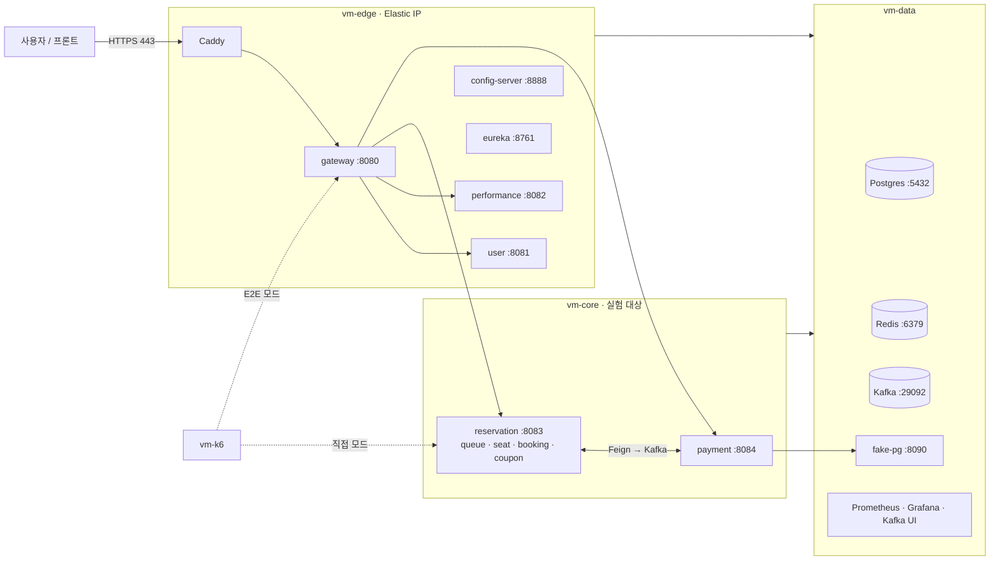
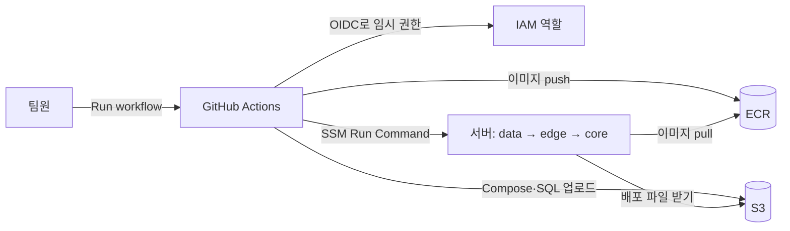
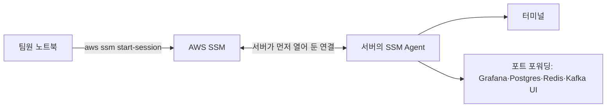

# 인프라 구성도

서버 배치, 포트, 배포, 접속 방법과 그렇게 정한 이유를 둔다. 서비스 책임과 서비스 간 통신은 [architecture.md](architecture.md)에 있다.

- 상태: 작성 중
- 출처: Notion [인프라 구성도](https://app.notion.com/p/404b3ff41d3980cfa2ddf135e5507530) (2026-10-26 기준)
- 서버를 직접 만드는 단계별 가이드(01~10)는 Notion에만 둔다. [6장](#6-따라-하기-가이드) 링크를 따라간다.
- 로컬 실행 환경은 루트의 `docker-compose.yml`과 `infra/`가 기준이다. 서버용 `compose.{edge,core,data}.yml`과 `deploy/`는 가이드 05에서 만든다.

> 비밀번호·JWT 시크릿·액세스 키는 이 문서와 Notion에 적지 않는다. 비밀값은 각 서버의 `/opt/ticket/.env`에만 둔다.

## 0. 한눈에 보기

| 항목 | 우리 선택 |
|---|---|
| 클라우드 | AWS 서울 리전(ap-northeast-2), 한 AZ(ap-northeast-2a), 기본 VPC 퍼블릭 서브넷 |
| 서버 | EC2 4대 — vm-edge, vm-core, vm-data (m7i.large), vm-k6 (c8i.large) |
| 실행 방식 | 서버별 Docker Compose. 쿠버네티스·ECS 없음 |
| 데이터 | Postgres·Redis·Kafka를 vm-data에 직접 실행. 관리형(RDS·ElastiCache·MSK) 없음 |
| 배포 | GitHub Actions → ECR(이미지)·S3(설정 파일) → SSM으로 서버에 명령. 수동 실행 |
| 접속 | SSM만 사용. SSH(22) 없음. DB·Grafana도 SSM 포트 포워딩 |
| 외부 공개 | vm-edge의 80·443(Caddy, HTTPS)뿐 |
| 운영 | 테스트·배포할 때만 켜고, 매일 03:00에 자동으로 끈다 |
| 비용 | 켜 둔 동안 시간당 약 $0.39 (k6 포함 약 $0.50), 꺼 둔 동안 한 달 약 $17 |

## 1. 결정 요약

| # | 결정 | 이유 |
|---|---|---|
| 1 | AWS 서울 리전, 서버 전부 같은 AZ | 팀원 중 AWS 경험자가 있어 막혔을 때 해결이 빠르다(GCP 대신 고른 이유). AZ 간 트래픽 요금이 없고 지연이 일정해 측정이 안정적이다 |
| 2 | EC2 + Docker Compose (쿠버네티스·ECS 미사용) | 로컬 `docker-compose.yml`을 서버별로 나누기만 하면 된다. 인프라 초보 팀이 MVP 기간 안에 끝낼 수 있고, 측정 결과에 플랫폼 변수가 끼지 않는다 |
| 3 | Postgres·Redis·Kafka를 EC2에 직접 | 어차피 켜 둘 vm-data에 올려 추가 비용이 거의 없다. MSK는 최소 2브로커라 비싸고, 소형 RDS·ElastiCache는 T 계열이라 CPU 크레딧이 떨어지면 측정이 흔들린다. 자동 백업·다중 AZ는 이 프로젝트에 필요 없다 |
| 4 | 앱 서버는 m7i.large로 고정 | T 계열은 CPU 크레딧 때문에 같은 실험을 반복해도 결과가 달라진다. 켤 때만 쓰므로 t3와의 차이는 몇 달러 수준이다 |
| 5 | 테스트할 때만 켜고 새벽 자동 중지 | 24시간 켜 두면 한 달 약 $300, 필요할 때만 켜면 수십 달러 |
| 6 | 앱 컨테이너는 `network_mode: host` | 컨테이너가 EC2 IP를 그대로 써서 다른 서버에서 닿는 주소가 Eureka에 등록된다. Docker NAT가 없어 측정에도 유리하다 |
| 7 | 퍼블릭 서브넷, NAT Gateway 없음 | NAT Gateway는 꺼 둘 수 없고 서버보다 비쌀 수 있다. 외부 차단은 보안 그룹이 맡는다 |
| 8 | 접속은 SSM만, 22번 포트 없음 | 서버에 열 포트가 없고, 키 파일을 나눠 갖지 않는다. 누가 접속할 수 있는지 AWS 계정 권한으로 관리하고, 기록이 남는다 |
| 9 | HTTPS는 vm-edge의 Caddy (ALB 미사용) | 인증서가 무료·자동 갱신이고 추가 비용이 없다. ALB는 꺼 둘 수 없어 안 쓰는 동안에도 과금된다 |
| 10 | 배포는 GitHub OIDC → ECR·S3 → SSM, 수동 실행만 | AWS 키를 GitHub에 저장하지 않는다. 서버가 꺼져 있을 때의 실패와, 측정 중 배포가 끼어드는 것을 막는다 |
| 11 | k6는 VPC 안 전용 서버, 노트북에서 원격 실행 | 인터넷 구간이나 SSM 터널이 측정값에 섞이지 않는다. 결과는 Grafana와 JSON으로 받는다 |
| 12 | fake-pg는 vm-data에 둔다 | 결제 서비스 밖의 외부 PG 역할. Eureka·config 없이 주소로 호출한다 (I7) |

## 2. 구성도

### 2-1. 요청이 흐르는 길

- 인터넷에서 들어오는 길은 **Caddy(443) 하나**다. 서비스 포트, Eureka, config, DB는 VPC 안에서만 닿는다.
- 서비스는 gateway가 넣어 준 `X-User-*` 헤더를 그대로 믿는다. 그래서 서비스 포트를 외부에 열지 않는 것이 이 구조의 핵심 보안 규칙이다 (가이드 10).

### 2-2. 배포되는 길

### 2-3. 팀원이 서버에 접속하는 길

서버의 SSM Agent가 AWS 쪽으로 먼저 연결을 열어 두고, AWS가 내 명령을 그 연결로 전달한다. 그래서 서버에 열어 둘 포트가 없다.

## 3. 서버별 배치

문서에서는 설계서를 따라 **performance**라고 부르지만, 저장소에서는 아직 `event-service`다. 명령·설정 파일은 저장소 값을 그대로 쓴다.

| 구분 | 값 |
|---|---|
| 모듈·Compose 서비스·ECR 저장소 | `event-service`, `ticket/event-service` |
| Eureka 이름 | `EVENT-SERVICE` |
| 포트 / gateway 라우트 | 8082 / `/api/v1/events/**` |
| DB 계정·스키마·비밀번호 변수 | `event_app`, `event_schema`, `EVENT_DB_PASSWORD` |
| 스키마 SQL | `backend/sql/event-service/schema.sql` |

저장소 이름을 바꾸면 이 표와 가이드의 명령을 함께 고친다 (설계서 D10).

| 서버 | 컨테이너 (포트) | 인스턴스 | 디스크 | Compose 파일 |
|---|---|---|---|---|
| vm-edge | Caddy(80·443), gateway(8080, 관리 9080), user(8081), performance(8082), config-server(8888), eureka(8761) | m7i.large | gp3 30GB | `compose.edge.yml` |
| vm-core | reservation(8083, 쿠폰 모듈 포함), payment(8084) | m7i.large | gp3 30GB | `compose.core.yml` |
| vm-data | Postgres(5432), Redis(6379), Kafka(29092), fake-pg(8090), Prometheus(9090), Grafana(3000), Kafka UI(8989) | m7i.large | gp3 50GB | `compose.data.yml` |
| vm-k6 | k6 (실행할 때만) | c8i.large | gp3 20GB | — |

- m7i.large = 2 vCPU, 8GB. vm-edge는 JVM 5개 × 약 600MB ≈ 3GB, vm-core는 실험용으로 서비스당 힙 1GB
- 쿠폰 모듈은 reservation-service 안에 있다(제안, #27). 쿠폰 테이블은 `reservation_app` 계정의 `reservation_schema`에 두고, 쿠폰 선착순 발급(`coupon.issue.requested` 소비)도 reservation 컨테이너에서 돈다. 쿠폰 오픈과 좌석 오픈이 겹치는 실험에서는 reservation의 CPU·힙·HikariCP를 함께 기록한다 (I8)
- OS는 Ubuntu 24.04 x86_64. 이미지는 amd64로만 만든다 (Mac에서 빌드할 때는 `--platform linux/amd64`)
- 프라이빗 IP·인스턴스 ID 같은 계정별 값은 Notion의 「인프라 값 기록표」에 적는다. 저장소에는 두지 않는다.

## 4. 포트 지도

| 포트 | 서버 | 용도 | 인터넷 | VPC 안 | 팀원 접근 |
|---|---|---|---|---|---|
| 80, 443 | edge | Caddy (HTTPS) | ✅ | ✅ | 브라우저·curl |
| 8080 | edge | gateway | ❌ | ✅ | k6 E2E 모드 |
| 9080 | edge | gateway 관리(actuator) | ❌ | ✅ | Prometheus 수집 |
| 8081~8084 | edge·core | 서비스 | ❌ | ✅ | k6 직접 모드 |
| 8761, 8888 | edge | Eureka, config | ❌ | ✅ | SSM 포트 포워딩 |
| 5432, 6379, 29092 | data | Postgres, Redis, Kafka | ❌ | ✅ | SSM 포트 포워딩 |
| 8090 | data | fake-pg (장애 주입 API 포함) | ❌ | ✅ | k6, payment |
| 3000, 9090, 8989 | data | Grafana, Prometheus, Kafka UI | ❌ | ✅ | SSM 포트 포워딩 |
| 22 | — | SSH | ❌ | ❌ | 쓰지 않음 (SSM) |

## 5. 비용

단가 (서울 리전, Linux 온디맨드)

| 항목 | 단가 | 근거 |
|---|---|---|
| EC2 m7i.large | $0.124/시간 | AWS 가격표 확인 |
| EC2 c8i.large (k6) | $0.106/시간 | AWS 가격표 확인 |
| (참고) t3.large | $0.104/시간 | AWS 가격표 확인 |
| EBS gp3 130GB | 약 $12/월 | 알려진 단가로 계산, 확인 필요 |
| 퍼블릭 IPv4 (서버 3~4개) | 개당 약 $0.005/시간 | 알려진 단가로 계산, 확인 필요 |
| ECR·S3 | 월 $1 내외 | 확인 필요 |

사용 방식별 예상

| 상황 | 비용 |
|---|---|
| 켜 둔 동안 (앱 서버 3대) | 시간당 약 **$0.39** |
| 켜 둔 동안 (k6 포함 4대) | 시간당 약 **$0.50** |
| 꺼 둔 동안 (디스크·Elastic IP·ECR) | 한 달 약 **$17** |
| 3주 동안 총 60시간 사용 | 약 **$42** |
| 3주 동안 총 100시간 사용 | 약 **$62** |
| (참고) 3대를 24시간 켜 두면 | 한 달 약 $300 |

정확한 금액은 [AWS Pricing Calculator](https://calculator.aws/)로 확인한다.

## 6. 따라 하기 가이드

단계별 명령은 Notion에 있다. 가이드는 모두 *목표 → 사전 준비 → 단계 → 완료 확인 → 자주 막히는 곳* 순서다.

> 가이드 10의 A(코드에 반영할 것)는 05(첫 배포) 전에 main에 넣는다. 첫 이미지에 그 설정이 들어가야 한다.

| 순서 | 하는 일 | 끝나면 | 누가 | 시간 |
|---|---|---|---|---|
| [01 계정·권한](https://app.notion.com/p/405b3ff41d398190b87ccaba10e238cc) | 루트 MFA, 예산 알림, 팀원 계정, 노트북 CLI | 각자 `aws` 명령 사용 | 담당 + 전원 | 30분~1시간 |
| [02 네트워크](https://app.notion.com/p/405b3ff41d3981dabdbac9907ed8ff45) | 서브넷·IP 정하기, 보안 그룹 2개, Elastic IP | 방화벽 준비 | 담당 | 20분 |
| [03 IAM·ECR·S3](https://app.notion.com/p/405b3ff41d3981d8b450e2b6e282d748) | 이미지 저장소, 배포 버킷, 역할 2개, GitHub OIDC | 저장소·권한 준비 | 담당 | 40분 |
| [04 EC2](https://app.notion.com/p/405b3ff41d3981d68489fd3318b127c8) | 서버 4대, Docker·AWS CLI, `.env` | SSM 접속되는 서버 | 담당 | 1시간 |
| [05 첫 배포](https://app.notion.com/p/405b3ff41d398131945fc61714642f52) | `deploy/` 작성, 손으로 배포, DB 스키마 | gateway가 401 응답 | 담당 | 2~3시간 |
| [06 HTTPS](https://app.notion.com/p/405b3ff41d3981a98364ceaf7276e1c1) | 도메인 연결, Caddy | `https://api.<도메인>` 401 | 담당 | 30분 |
| [07 자동화](https://app.notion.com/p/405b3ff41d39815b8765ebfa021ab403) | Deploy·Infra Start·Infra Stop 워크플로 | 버튼으로 배포·켜기·끄기 | 담당 | 1~2시간 |
| [08 부하 테스트](https://app.notion.com/p/405b3ff41d398155a473e7b10543121b) | vm-k6, `load-test/` | 노트북에서 원격 부하 | 담당 + 전원 | 1시간 |
| [09 운영](https://app.notion.com/p/405b3ff41d3981d7afacf76f9a5319d2) | 켜고 끄기, 접속, 로그, 비용, 문제 해결 | — | 전원 | 수시 |
| [10 보안](https://app.notion.com/p/405b3ff41d3981579b5ce116807189a2) | 배포 전 점검 | 외부 공개 준비 완료 | 담당 | 30분 |

## 7. 결정 필요 사항

| # | 항목 | 관련 가이드 |
|---|---|---|
| I1 | 크레딧 금액·만료일·적용 서비스 확인, Budgets 알림 금액 | 01 |
| I2 | 팀원 계정 방식: IAM Identity Center(권장) / IAM 사용자 | 01 |
| I3 | 도메인 구입처·이름 | 06 |
| I4 | 프론트 배포 위치와 CORS 설정 | 06 |
| I5 | 인프라 담당자 (설계서 1.1의 공통 업무 "배포") | 전체 |
| I6 | 자동 중지 시각 (기본 03:00 KST) | 07 |
| I7 | fake-pg 위치 확정 (현재 vm-data). 결제 지연 주입 실험 때 vm-data CPU 사용률도 같이 기록한다 | 05, 08 |
| I8 | 쿠폰 모듈이 reservation으로 옮겨진 뒤(제안) 쿠폰 발급 부하가 좌석 선점에 주는 영향. 크면 vm-core 사양이나 쿠폰 소비자 동시성을 조정한다 | 08 |

## 변경 이력

| 날짜 | 내용 |
|---|---|
| 2026-10-26 | Notion 인프라 구성도에서 옮겼다. 값 기록표와 단계별 가이드는 Notion 링크로 남겼다 |
| 2026-10-27 | 쿠폰 모듈을 reservation-service로 옮기는 제안에 맞춰 vm-core 배치 설명과 I8을 더했다 (#27) |
