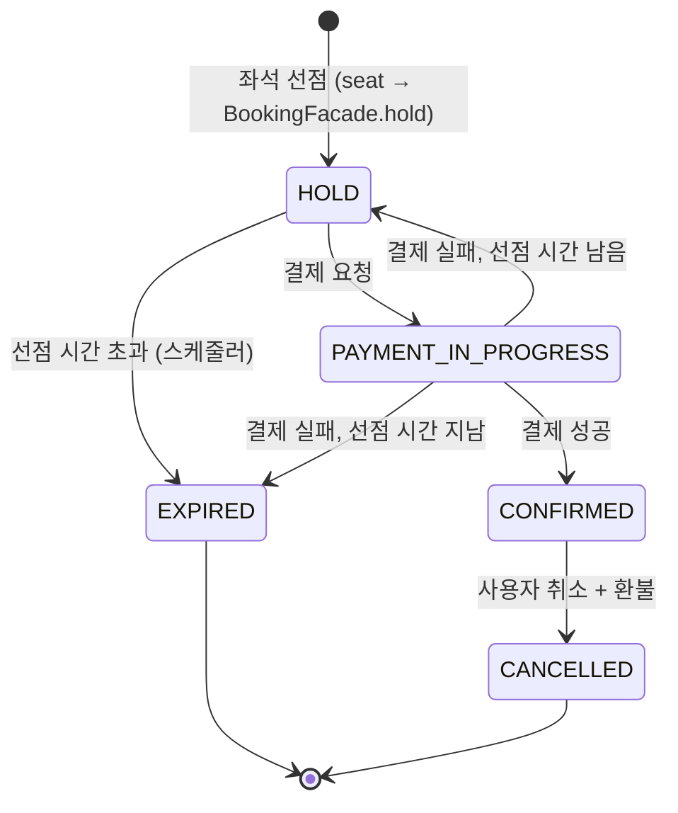

# 예약 오케스트레이션 설계 (reservation / booking)

reservation-service의 booking 모듈이 맡는 예약 흐름을 구현할 수 있는 수준으로 정리한다. 대상은 선점 만료, 결제 요청과 결과 반영, 예약 확정·취소, Saga 조정과 보상, 예약↔결제 통신의 Feign → Kafka 전환이다.

- 팀 설계서「공연 좌석 예매 백엔드 MSA 아키텍처 설계서」v4의 2·3·6~10·13장을 따른다. 이 문서가 설계서와 다르면 설계서를 따르고 이 문서를 고친다. 이 문서를 쓰며 찾은 문제는 설계서 v4에 반영했다.
- 상태 이름과 테이블은「공연 티켓 예매 서비스 ERD·기능 명세서」를 따른다. 명세서와 맞춰 보지 않은 이름은 `(확인 필요)`로 표시한다.
- **제안**은 이 문서가 내놓은 안이고, 관련 담당자와 합의하기 전에는 구현하지 않는다. 합의할 항목은 11장에 모았고, 설계서 17장의 결정 필요 사항(D 번호)과 연결된다.

| 버전 | 날짜 | 변경 |
| --- | --- | --- |
| 0.1 | 2026-10-24 | 초안 |
| 0.2 | 2026-10-24 | 설계서 v4에 맞춰 정리. 합의할 항목에 설계서 결정 번호(D10~D17) 연결, `BookingFacade.expire` 추가 |

---

## 1. 범위

| 구분 | 내용 | 담당 |
| --- | --- | --- |
| 맡는 것 | 선점 만료 정리, 결제 요청, 결제 결과 반영(확정·실패), 예약 취소와 환불, Saga 보상, Phase 1 Feign → Phase 2 Kafka 전환 | booking (한얼) |
| 트러블슈팅 기간 | Transactional Outbox, 멱등 소비, 결과 불명 복구, 취소표 즉시 재판매 | booking (한얼) |
| 맡지 않는 것 | 좌석 선점(비관적 락), 좌석 상태 조회, 1인 매수 제한 | seat (정민) |
| | 대기열, 입장 토큰 | queue (태현) |
| | 결제·환불, 가짜 PG, 쿠폰 사용·복구 | payment (현민, 윤범) |

---

## 2. 설계서와 저장소의 차이

설계서를 그대로 구현하기 전에 저장소와 맞춰야 할 곳이다.

| 설계서 | 저장소 (develop `be83123`) | 처리 |
| --- | --- | --- |
| 서비스 이름 `performance` | `event-service` (8082) | 이 문서는 저장소 이름 `event-service`로 쓴다 (설계서 D10) |
| reservation 안을 `queue`·`seat`·`booking` 모듈과 Facade로 나눈다 | 패키지가 `presentation / application / domain / infrastructure`로만 나뉘고, 모듈 구분은 없다 | 모듈 안을 계층으로 나눈다 (3장, 설계서 D11) |
| Resilience4j (Timeout, Retry, Circuit Breaker) | `build.gradle`에 없다 | Phase 1 구현 때 추가한다. 공유 파일이므로 seat 담당에게 먼저 알린다 |
| Kafka 발행·소비 | `spring-kafka` 의존성이 없다. 연결 정보(`spring.kafka.bootstrap-servers`)와 Compose의 Kafka는 이미 있다 | Phase 2 전환 때 추가한다 |
| `schedule_seat`, 예약 테이블 | `schema.sql`이 비어 있다(`SELECT 1;`) | 첫 테이블을 넣는 PR에서 `SELECT 1;`을 지운다. 순서는 11장 S7 |
| Feign 기본 타임아웃 | `config-repo/application.yml`에서 connect 5초, read 20초 | 결제 호출만 짧게 따로 정한다(5.2) |

게이트웨이 라우트 `/api/v1/reservations/** → reservation-service`는 이미 있어서 7장의 외부 API는 게이트웨이를 고치지 않아도 된다.

---

## 3. 모듈 경계와 코드 배치

### 3.1 패키지 (제안)

설계서 3장의 모듈 경계와 저장소의 계층 규칙을 함께 지키려면 **모듈을 먼저 나누고, 그 안을 계층으로 나눈다.**

```
com.sparta.ticket.reservation
├── booking/                   # 한얼
│   ├── presentation/          # 예약 API (Controller, HTTP DTO)
│   ├── application/           # 유스케이스, PaymentPort, BookingFacade 구현
│   ├── domain/                # Reservation, ReservationStatus, 상태 전이 규칙
│   └── infrastructure/        # client(Feign), messaging(Kafka), persistence, scheduler
├── seat/                      # 정민
├── queue/                     # 태현
└── common/                    # 모듈이 함께 쓰는 설정
```

- `LayeredArchitectureRules`는 `..domain..`, `..application..` 같은 패턴으로 검사하므로 `booking.domain`에도 그대로 적용된다. 규칙을 바꿀 필요가 없다.
- 디렉터리마다 담당이 나뉘어서 `CODEOWNERS`로 리뷰어를 지정하기 쉽고, 같은 파일을 둘이 고칠 일이 줄어든다.
- 설계서의 "다른 모듈의 Repository·Entity 직접 사용 금지"는 ArchUnit 규칙으로 추가할 수 있다. 예: `booking..`은 `seat..domain..`, `seat..infrastructure..`에 의존하지 않는다.
- CLAUDE.md의 "패키지는 `com.sparta.ticket.{서비스}`, 내부는 `presentation / application / domain / infrastructure`" 문장과 어긋나므로, 합의되면 그 문장도 같이 고친다.

### 3.2 seat와 booking 사이의 경계 (제안)

설계서는 좌석 상태와 예약 상태를 한 트랜잭션에서 바꾸되 다른 모듈의 Entity는 직접 쓰지 않게 한다. 그래서 두 모듈은 서로의 Facade만 부른다. 같은 프로세스·같은 DataSource이므로 Facade 호출도 바깥 `@Transactional` 안에 묶인다.

**예약은 booking이 소유한다.** 선점할 때 seat가 예약을 직접 만들지 않고 `BookingFacade`에 생성을 요청한다. 그러면 예약 상태를 바꾸는 코드가 booking 한 곳에만 있게 된다.

| Facade | 메서드 (이름은 가안) | 부르는 쪽 | 쓰임 |
| --- | --- | --- | --- |
| `BookingFacade` (booking이 구현) | `hold(userId, scheduleId, seatIds, holdExpiresAt)` → reservationId | seat | 선점 트랜잭션 안에서 예약을 `HOLD`로 만든다 |
| | `countActiveSeats(userId, scheduleId)` | seat | 1인 매수 제한. `HOLD + PAYMENT_IN_PROGRESS + CONFIRMED` 좌석 수 |
| | `expire(reservationId)` | seat | 시간이 지난 좌석을 다시 선점할 때 남아 있는 예전 예약을 `EXPIRED`로 바꾼다 (5.1) |
| `SeatFacade` (seat가 구현) | `lockSeats(seatIds)` | booking | 좌석 행을 id 오름차순으로 잠근다(4.3 잠금 순서) |
| | `sell(seatIds)` | booking | 확정할 때 `HOLD → SOLD` |
| | `release(seatIds)` | booking | 만료·취소할 때 `HOLD/SOLD → AVAILABLE`. 취소표 재판매를 넣으면 여기서 다음 대기자에게 넘긴다 |
| | `priceSnapshot(seatIds)` | booking | 결제 금액 계산. 좌석 생성 때 복사해 둔 가격을 쓴다 |

booking 테스트는 `SeatFacade`의 가짜 구현으로 하고, seat 쪽 실제 구현은 seat 담당이 만든다.

---

## 4. 예약 상태와 전이

### 4.1 상태 (설계서 9장, 확인 필요)



### 4.2 전이 표

모든 전이는 조건부 UPDATE(`UPDATE ... SET status = :to WHERE id = :id AND status = :from AND ...`)로 한다. 재시도나 중복 이벤트가 와도 한 번만 반영된다.

| 전이 | 계기 | UPDATE 조건 (`status = from` 외) | 좌석 |
| --- | --- | --- | --- |
| → `HOLD` | 좌석 선점 | (생성) | `AVAILABLE → HOLD` (seat) |
| `HOLD → PAYMENT_IN_PROGRESS` | 결제 요청 | 본인, `hold_expires_at > now` | 그대로 |
| `HOLD → EXPIRED` | 만료 스케줄러 | `hold_expires_at <= now` | `HOLD → AVAILABLE` |
| `PAYMENT_IN_PROGRESS → CONFIRMED` | 결제 성공 | 없음 | `HOLD → SOLD` |
| `PAYMENT_IN_PROGRESS → HOLD` | 결제 실패 | `hold_expires_at > now` | 그대로 |
| `PAYMENT_IN_PROGRESS → EXPIRED` | 결제 실패 | `hold_expires_at <= now` | `HOLD → AVAILABLE` |
| `CONFIRMED → CANCELLED` | 사용자 취소 | 본인, 취소 가능 기간 (설계서 D6) | `SOLD → AVAILABLE` |

### 4.3 규칙

- **예약과 좌석은 한 트랜잭션에서 바꾼다.** 둘 중 하나만 바뀐 상태가 남지 않게 한다.
- **잠금 순서는 좌석 먼저, 예약 나중이다.** seat의 선점이 좌석 행을 먼저 잠그므로 booking도 같은 순서로 잠근다. 순서가 반대이면 선점과 만료가 동시에 돌 때 교착 상태가 생긴다.
- **`PAYMENT_IN_PROGRESS`는 만료 대상이 아니다.** 결제가 진행 중인 좌석이 풀리면 다른 사람이 같은 좌석을 선점한 뒤 결제 성공이 도착할 수 있다. 오래 머무는 예약은 결과 확인 스케줄러가 처리한다(5.2).
- **원격 호출은 트랜잭션 밖에서 한다.** 트랜잭션 안에서 Feign을 부르면 PG가 지연되는 동안 DB 커넥션을 잡고 있게 된다. 그러면 Phase 1 측정에서 보려던 스레드 포화가 아니라 커넥션 풀 고갈이 먼저 나타난다.
- **UPDATE된 행이 0개이면 지금 상태를 다시 읽고 판단한다.** 같은 결과가 다시 온 것인지(무시), 이미 다른 경로로 끝난 예약에 결과가 온 것인지(보상, 6장 F6)를 구분한다.

---

## 5. 흐름

### 5.1 선점 만료 (F1)

```
주기마다 (간격은 설정값, 예: 10초):
  1. 후보 조회: status = HOLD AND hold_expires_at <= now, hold_expires_at 순, 최대 N건 (잠그지 않음)
  2. 예약마다 한 트랜잭션:
     SeatFacade.lockSeats → 조건부 UPDATE HOLD → EXPIRED → 1건이면 SeatFacade.release
```

- 인스턴스가 여러 개여도 조건부 UPDATE가 한 번만 성공하므로 결과는 맞다. 중복 작업이 문제가 되면 그때 ShedLock이나 `FOR UPDATE SKIP LOCKED`를 검토한다.
- 설계서 7장은 "`hold_expires_at`이 지나면 정리 전이라도 선택 가능"으로 판단한다. 그 좌석을 다른 사람이 선점하면 seat가 같은 트랜잭션에서 `BookingFacade.expire`로 예전 예약을 정리한다(제안, 11장 S4).

### 5.2 결제 요청과 결과 반영 (Phase 1, Feign)

```
POST /api/v1/reservations/{reservationId}/payment   { "couponId": 1 }

1. [트랜잭션 1] HOLD → PAYMENT_IN_PROGRESS (본인, 만료 전)
               금액 = SeatFacade.priceSnapshot 합계. 클라이언트가 보낸 금액은 받지 않는다
2. [트랜잭션 밖] PaymentPort.requestPayment(reservationId, userId, amount, couponId)
3. [트랜잭션 2] PaymentResultApplier.apply(결과)
     성공          → CONFIRMED, 좌석 SOLD
     실패          → 시간 남으면 HOLD, 지났으면 EXPIRED + 좌석 AVAILABLE
     결과 모름     → PAYMENT_IN_PROGRESS 유지 (F10)
4. 응답: 예약 상태 (아래)
```

**결과를 모를 때 (F10, MVP).** Feign 타임아웃이나 5xx 응답이 오면 결제가 됐는지 알 수 없다. 결제 요청 API는 같은 요청을 다시 보내도 안전한지(멱등인지) 확인되지 않았으므로 재시도하지 않는다. 대신 결제 상태 조회(GET, `IdempotentRetryConfig` 사용)로 확인한다. 그래도 모르면 결과 확인 스케줄러가 `PAYMENT_IN_PROGRESS`에 일정 시간 이상 머문 예약을 다시 조회해 결과를 반영한다. 조회했는데 결제 기록이 없으면 요청이 도착하지 않은 것으로 보고 실패로 처리한다. 그러려면 "기록 없음"과 "결과 불명"을 구분해 주는 조회 API가 필요하다(11장 P2).

**응답 형식 (제안, 설계서 D16).** 응답 본문에는 Phase와 관계없이 예약 상태를 담는다. 클라이언트는 `PAYMENT_IN_PROGRESS`를 받으면 `GET /api/v1/reservations/{id}`로 폴링한다. 그러면 Phase 2로 바꿔도 클라이언트 코드는 그대로다.

| | Phase 1 | Phase 2 |
| --- | --- | --- |
| HTTP 상태 | 200 | 202 |
| `status` | `CONFIRMED`, `HOLD`, `EXPIRED` 중 하나 (결과를 모르면 `PAYMENT_IN_PROGRESS`) | `PAYMENT_IN_PROGRESS` |
| 그 밖 | `reservationId`, `holdExpiresAt`, 실패 사유 (`COUPON_INVALID` 등) | 같음 |

**타임아웃.** 결제 클라이언트만 기본값(read 20초)보다 짧게 둔다. 가짜 PG 지연이 3초인 측정 조건을 견디는 값이어야 한다(예: 5초). 이 값은 `config-repo/reservation-service.yml`의 `spring.cloud.openfeign.client.config.payment-service`에 둔다.

### 5.3 예약 취소와 환불 (Phase 1, Feign)

```
POST /api/v1/reservations/{reservationId}/cancel

1. 본인, CONFIRMED, 취소 가능 기간 확인 (설계서 D6)
2. [트랜잭션 밖] PaymentPort.requestRefund(reservationId)
3. 환불 성공 → [트랜잭션] CONFIRMED → CANCELLED, 좌석 release
   환불 실패·결과 모름 → 예약은 CONFIRMED 그대로, 오류 응답. 다시 취소하면 같은 reservationId로 다시 요청
```

- 환불을 먼저 하는 이유: 예약을 먼저 취소하고 환불이 실패하면 "표는 사라졌는데 돈은 돌려받지 못한" 상태가 남는다. Phase 1에는 그 상태를 자동으로 고칠 방법이 없다.
- 환불이 성공한 뒤 3번 트랜잭션이 실패하면 "돈은 돌려받았는데 예약은 `CONFIRMED`"가 남는다. 다시 취소할 때 같은 예약으로 환불이 두 번 나가지 않아야 하므로, 환불 API가 `reservationId` 기준으로 멱등이어야 한다(11장 P1).
- 이처럼 두 곳을 따로 쓰는 문제(Dual Write)는 Phase 1의 한계다. 설계서 6.3의 "결제 중 서버 재시작 시 불일치 건수"로 측정하고, Phase 2와 Outbox로 없앤다.

### 5.4 Phase 2 전환 (Kafka)

전환할 때 **전송 방식만 바꾸고 상태 전이 코드는 그대로 둔다.** 그래야 Phase 1과 Phase 2의 측정 차이가 통신 방식 때문이라고 말할 수 있다.

```java
// booking.application — 이름은 가안
public interface PaymentPort {
    PaymentOutcome requestPayment(PaymentCommand command);  // Phase 1: SUCCEEDED·FAILED·UNKNOWN, Phase 2: ACCEPTED
    RefundOutcome requestRefund(RefundCommand command);
    PaymentStatus findPayment(Long reservationId);          // 결과 확인. Phase 2에서도 Feign GET
}
```

| | Phase 1 | Phase 2 |
| --- | --- | --- |
| 결제 요청 | `PaymentPort` Feign 구현 → 응답을 바로 `PaymentResultApplier`에 넘김 | `PaymentPort` Kafka 구현 → `payment.requested` 발행, `ACCEPTED` 반환 |
| 결제 결과 | Feign 응답 | `payment.completed`·`payment.failed` 리스너 → **같은** `PaymentResultApplier` |
| 취소 | 환불 먼저(Feign), 성공하면 `CANCELLED` | 11장 P3에 따라 정한다 (아래) |
| 그대로인 것 | 상태 전이 규칙, 조건부 UPDATE, 만료 스케줄러, 금액 계산, 외부 API 경로와 응답 형식 | |

- **발행 시점 (MVP 2주차):** 트랜잭션 1이 커밋된 뒤 발행한다(`@TransactionalEventListener(phase = AFTER_COMMIT)`). 커밋과 발행 사이에 서버가 죽으면 이벤트가 사라지지만, 결과 확인 스케줄러가 "기록 없음 → 실패"로 정리한다. 트러블슈팅 기간에 Transactional Outbox로 바꿔 사라지는 이벤트를 없앤다(F7).
- **중복 수신 (MVP):** 같은 결과 이벤트가 두 번 와도 조건부 UPDATE가 두 번째를 0행으로 만든다. 이때 지금 상태가 이미 그 결과(예: `CONFIRMED`)이면 무시한다. 이 확인을 빼면 중복된 `payment.completed`가 F6(자동 환불)으로 잘못 처리된다. `processed_event` 테이블은 트러블슈팅 기간에 넣는다(F8).
- **Phase 2 취소:** 환불이 업무상 거절되지 않는다면(취소 가능 여부는 예약 쪽에서 먼저 판단하므로) `CANCELLED`, 좌석 반환, `payment.refund.requested` 발행을 한 번에 처리하고, 환불은 payment가 재시도·DLT로 끝까지 책임진다. 이 경우 상태를 새로 만들 필요가 없다. 환불이 거절될 수 있다면 `CANCEL_REQUESTED` 같은 중간 상태가 필요하다. 어느 쪽인지 11장 P3에서 정한다.
- **위치:** Kafka 발행·소비 코드는 `booking/infrastructure/messaging`에 둔다. `LayeredArchitectureRules`가 domain의 `org.springframework.kafka` 의존을 막는다.

---

## 6. 실패·보상에서 booking이 하는 일

설계서 10장 F1~F10 중 booking 쪽 처리다.

| # | 상황 | booking 처리 | 시기 |
| --- | --- | --- | --- |
| F1 | 결제하지 않음 | 만료 스케줄러 (5.1) | MVP 1주차 |
| F2 | PG 승인 실패 | 결과 반영: 시간 남으면 `HOLD`, 지났으면 `EXPIRED` | MVP 1주차 |
| F3 | 쿠폰 사용 불가 | F2와 같다. 실패 사유 `COUPON_INVALID`를 응답에 담는다 | MVP 1주차 |
| F10 | (Phase 1) Feign 타임아웃 | 상태 조회로 재확인, 결과 확인 스케줄러 (5.2) | MVP 1주차 |
| F8 | 결과 중복 수신 | 조건부 UPDATE + 지금 상태 확인 (5.4) → 트러블슈팅에 `processed_event` | MVP 2주차 / 트러블슈팅 |
| F4 | PG 결과 불명 | `PAYMENT_IN_PROGRESS` 유지, 결과 확인 스케줄러가 payment의 `UNKNOWN`이 풀릴 때까지 기다린다 | 트러블슈팅 |
| F5 | 결제 성공 후 확정 실패 | 트랜잭션 2 재시도 → 계속 실패하면 환불 요청 | 트러블슈팅 |
| F6 | 끝난 예약에 결제 성공 도착 | UPDATE 0행이고 지금 상태가 `EXPIRED`·`CANCELLED`이면 즉시 환불 요청 | 트러블슈팅 |
| F7 | 이벤트 발행 실패, 서버 재시작 | Transactional Outbox relay | 트러블슈팅 |
| F9 | Consumer 반복 실패 | 재시도 후 `{topic}.DLT`, 대시보드 알림 | 트러블슈팅 |

원칙(설계서 10장): "결제는 됐는데 표가 없는 상태"(F5, F6)는 반드시 자동 환불로 끝낸다.

---

## 7. 외부 API (제안)

| 메서드 | 경로 | 설명 | 응답 |
| --- | --- | --- | --- |
| POST | `/api/v1/reservations/{reservationId}/payment` | 결제 요청. 본문은 `couponId`(선택) | 5.2 |
| GET | `/api/v1/reservations/{reservationId}` | 예약 상태 조회 (결제 후 폴링) | 예약 상태, 좌석, 금액, `holdExpiresAt` |
| POST | `/api/v1/reservations/{reservationId}/cancel` | 예약 취소 | 예약 상태 |

- 좌석 선점 경로는 seat 담당이 정한다. 같은 `/api/v1/reservations/**` 아래이므로 경로가 겹치지 않게 맞춘다(11장 S3).
- 현재 사용자는 `@CurrentUser UserContext`로 받고, 본인 확인은 application 계층에서 한다.
- 오류 코드: 상태가 맞지 않으면 `CommonErrorCode.INVALID_STATUS_TRANSITION`, 본인이 아니면 `FORBIDDEN`을 쓴다. `ReservationErrorCode`에는 공통에 없는 것만 둔다. 예: `RESERVATION_NOT_FOUND`, `HOLD_EXPIRED`, `NOT_CANCELLABLE`. 이 enum은 seat와 함께 쓰므로 추가할 때 알린다.

---

## 8. 다른 서비스와의 계약

설계서 6.2·13장의 안이다. **payment 담당과 확인하기 전에는 Feign·Kafka 구현을 만들지 않고, `PaymentPort` 가짜 구현으로 테스트한다.**

### 8.1 Phase 1 내부 API (payment-service)

| 메서드 | 경로 | 요청 / 응답 | 재시도 |
| --- | --- | --- | --- |
| POST | `/internal/payments` | `reservationId, userId, amount, couponId` / `paymentId`, 결과(성공·실패), 실패 사유 | 하지 않음 (멱등이 확인되면 검토) |
| POST | `/internal/payments/{reservationId}/refund` | — / 환불 결과 | `reservationId` 기준 멱등이면 허용 |
| GET | `/internal/payments/{reservationId}` | — / 결제 상태 (기록 없음과 `UNKNOWN`을 구분) | 허용 (`IdempotentRetryConfig`) |

Phase 1 요청 필드를 Phase 2 이벤트 payload와 같게 맞춰 둔다. 그러면 전환할 때 전송 방식만 바뀐다.

### 8.2 Phase 2 이벤트 (Kafka)

| Topic | booking 역할 | Payload |
| --- | --- | --- |
| `payment.requested` | 발행 | `reservationId, userId, amount, couponId` |
| `payment.completed` | 소비 | `reservationId, paymentId, paidAmount` |
| `payment.failed` | 소비 | `reservationId, reason` |
| `payment.refund.requested` | 발행 | `reservationId, reason` |
| `payment.refunded` | 소비 | `reservationId, refundAmount` |
| `seat.status.changed` | (seat가 발행) | `scheduleId, grade, delta` |

- 공통 Envelope: `eventId`(UUID), `eventType`, `occurredAt`, `traceId`, `payload`
- 파티션 키: `reservationId`. 같은 예약의 이벤트 순서를 지킨다.
- consumer group: `reservation-service` (제안)

---

## 9. 측정 (Phase 1 기준선 → Phase 2 재측정)

설계서 6.3을 따른다. booking 쪽에서 준비할 것은 다음과 같다.

- 같은 k6 시나리오와 같은 가짜 PG 조건(예: 지연 3초, 실패율 20%)으로 두 번 잰다. 가짜 PG 설정은 payment 담당 몫이다.
- 주요 지표: 결제 요청 API p95, **결제와 무관한 좌석 선점 API p95**(장애 전파), reservation Tomcat busy thread, HikariCP active/pending, payment를 멈췄을 때 reservation 에러율, 결제 중 재시작 시 불일치 건수
- 4.3의 "원격 호출은 트랜잭션 밖" 규칙을 지켜야 Phase 1의 병목이 통신 방식 때문이라고 말할 수 있다.
- 결과는 `docs/perf/` 양식에 남긴다(이슈 #3).

---

## 10. 구현 순서

설계서 6.4 일정에 맞춘 이슈 후보다. 하나씩 `local/pr issue`로 올린다.

| 시기 | 이슈 후보 | 비고 |
| --- | --- | --- |
| MVP 1주차 (10/27 ~ 10/31) | 예약 상태 모델: Entity, 상태 enum, 전이 규칙, `schema.sql` | seat와 함께 쓰는 모델이므로 S1~S4 합의 후 먼저 올린다 |
| | 선점 만료 스케줄러 (F1) | |
| | 결제 요청·결과 반영 Phase 1 (F2, F3) | `PaymentPort` 가짜 구현으로 먼저, Feign 구현은 P1 합의 후 |
| | 결과 확인 스케줄러 (F10) | |
| | 예약 취소·환불 Phase 1 | |
| | Phase 1 기준선 측정 | |
| MVP 2주차 (11/3 ~ 11/6) | Phase 2 Kafka 전환 | `spring-kafka` 추가, 202 응답 |
| | Phase 2 재측정 | |
| 트러블슈팅 (11/9 ~ 11/16) | Outbox (F7), 멱등 소비 (F8), F4·F5·F6, DLT (F9), 취소표 즉시 재판매 | |

---

## 11. 합의할 항목

### seat 담당 (정민)

| # | 항목 | 이 문서의 제안 | 설계서 v4 |
| --- | --- | --- | --- |
| S1 | 패키지 구조 | 모듈 먼저, 그 안에 계층 (3.1). 합의되면 CLAUDE.md 문장도 고친다 | D11 |
| S2 | 예약 Entity 소유 | booking 소유. 선점 때 seat가 `BookingFacade.hold`를 부른다 (3.2) | D12 |
| S3 | Facade 메서드, 외부 API 경로 분담 | 3.2 표, 7장 | D12 |
| S4 | `hold_expires_at`을 예약과 좌석 중 어디에 둘지, "정리 전 선택 가능"으로 다시 선점할 때 예전 예약을 누가 `EXPIRED`로 바꿀지 | 선점 트랜잭션 안에서 seat가 `BookingFacade.expire`를 부른다 | D13 |
| S5 | `PAYMENT_IN_PROGRESS` 좌석의 선택 가능 판정 | 시간이 지나도 선택 불가 (4.3) | D13 |
| S6 | 잠금 순서 | 좌석(id 오름차순) 먼저, 예약 나중 (4.3) | 2.1 설계 원칙 |
| S7 | 공유 파일 순서: 첫 테이블 PR, `build.gradle` 의존성, `ReservationErrorCode` | 예약 상태 모델 PR을 먼저 머지하고 둘 다 그 위에서 작업한다 | — |
| S8 | 선점 만료 담당 | booking이 맡는다. 설계서 1.1과 7장을 이 기준으로 맞췄다 | D12 |

### payment 담당 (현민)

| # | 항목 | 이 문서의 제안 | 설계서 v4 |
| --- | --- | --- | --- |
| P1 | 내부 API 필드·결과 값, 결제·환불 요청의 `reservationId` 기준 멱등 여부 | 8.1 | D15 |
| P2 | 결제 상태 조회에서 "기록 없음"과 `UNKNOWN` 구분 | 결과 확인 스케줄러에 필요 (5.2) | D15 |
| P3 | 환불이 업무상 거절될 수 있는지 | 거절되지 않는다면 Phase 2 취소에 중간 상태를 두지 않는다 (5.4) | D14 |
| P4 | 이벤트 payload, Envelope, 파티션 키 | 8.2 | 13장 |
| P5 | 가짜 PG 지연·실패율 설정 방법 | 측정에 필요 (9장) | 12장, D8 |

### 팀 전체

| # | 항목 | 설계서 v4 |
| --- | --- | --- |
| T1 | booking에 걸린 기존 결정: 11/6까지 Phase 2 전환, 선점 유지 시간 10분/5분, 취소 가능 기간·수수료와 환불 시 쿠폰 복구, 취소표 결제 권한 유효 시간 | D1, D4, D6, D7 |
| T2 | 이벤트 DTO를 `common-core`에 둘지, 서비스마다 복사본을 둘지 | D17 |
| T3 | 예약 상태 이름을 ERD·기능 명세서와 대조 | 9장 |
| T4 | 서비스 이름: 설계서 `performance`와 저장소 `event-service` 중 무엇으로 통일할지 | D10 |
| T5 | 결제 요청 응답 형식: Phase 1 200 / Phase 2 202, 본문은 예약 상태. 프런트 폴링 방식과 맞춘다 (5.2) | D16 |
