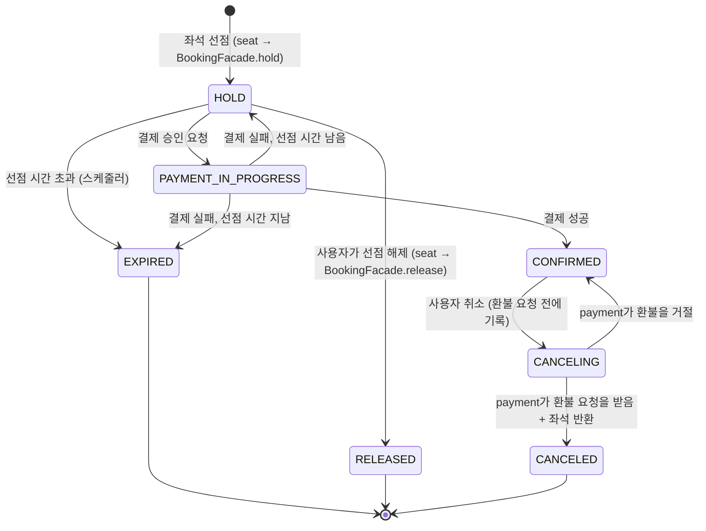

# 예약 오케스트레이션 설계 (reservation / booking)

reservation-service의 booking 모듈이 맡는 예약 흐름을 구현할 수 있는 수준으로 정리한다. 대상은 선점 만료, 결제 준비·승인과 결과 반영, 예약 확정·취소, Saga 조정과 보상, 예약↔결제 통신의 Feign → Kafka 전환이다.

- 팀 설계서「공연 좌석 예매 백엔드 MSA 아키텍처 설계서」v4의 2·3·6~10·13장을 따른다. 이 문서가 설계서와 다르면 설계서를 따르고 이 문서를 고친다. 이 문서를 쓰며 찾은 문제는 설계서 v4에 반영했다.
- 상태 이름과 테이블은「공연 티켓 예매 서비스 ERD·기능 명세서」를 따른다. 명세서와 맞춰 보지 않은 이름은 `(확인 필요)`로 표시한다.
- booking이 혼자 정한 결정과 이유는 [booking-decisions.md](booking-decisions.md)에 있다.
- **제안**은 이 문서가 내놓은 안이고, 관련 담당자와 합의하기 전에는 구현하지 않는다. 합의할 항목은 11장에 모았고, 설계서 17장의 결정 필요 사항(D 번호)과 연결된다.

| 버전 | 날짜 | 변경 |
| --- | --- | --- |
| 0.1 | 2026-10-24 | 초안 |
| 0.2 | 2026-10-24 | 설계서 v4에 맞춰 정리. 합의할 항목에 설계서 결정 번호(D10~D17) 연결, `BookingFacade.expire` 추가 |
| 0.7 | 2026-10-27 | 쿠폰 모듈을 reservation-service로 옮기는 제안 반영: 쿠폰을 예매에 잡고, 할인액을 예매가 계산해 결제 준비에 보낸다 (#27) |
| 0.6 | 2026-10-26 | 사용자가 선점을 직접 해제하는 `RELEASED` 상태와 `BookingFacade.release` 추가(B30). 상태 이름 대조(T3)를 마침 |
| 0.5 | 2026-10-26 | 팀원 제안 반영: 취소에 중간 상태 `CANCELING`을 두고, 취소 상태 철자를 ERD와 같은 `CANCELED`로 맞춤(B29). 5.3, 5.4 취소 흐름을 이 기준으로 고침 |
| 0.4 | 2026-10-26 | Facade 계약 변경: `hold`에 좌석별 가격, `sell`·`release`에 예약 ID, `priceSnapshot` 삭제. 예약 좌석을 티켓(`p_tickets`)으로 키움. 합의할 항목 S9 추가 |
| 0.3 | 2026-10-24 | payment 담당 리뷰(PR #9) 반영: 결제 준비·승인 두 번 호출, 시도마다 `orderId`, 승인 요청이 사라지면 같은 `orderId`로 다시 요청, 결제 호출 read 15초, 취소는 두 Phase 모두 환불 결과와 상관없이 처리. 남은 질문은 11장에 모았고 10/26 회의에서 정한다 |

---

## 1. 범위

| 구분 | 내용 | 담당 |
| --- | --- | --- |
| 맡는 것 | 선점 만료 정리, 결제 준비·승인 요청, 결제 결과 반영(확정·실패), 예약 취소와 환불, Saga 보상, Phase 1 Feign → Phase 2 Kafka 전환 | booking (한얼) |
| 트러블슈팅 기간 | Transactional Outbox, 멱등 소비, 결과 불명 복구, 취소표 즉시 재판매 | booking (한얼) |
| 맡지 않는 것 | 좌석 선점(비관적 락), 좌석 상태 조회, 1인 매수 제한 | seat (정민) |
| | 대기열, 입장 토큰 | queue (태현) |
| | 쿠폰 정책·발급, 쿠폰 상태 전이 (booking은 `CouponUsage`로 부른다) | coupon (윤범) |
| | 결제·환불, 가짜 PG | payment (현민) |

---

## 2. 설계서와 저장소의 차이

설계서를 그대로 구현하기 전에 저장소와 맞춰야 할 곳이다.

| 설계서 | 저장소 (develop `be83123`) | 처리 |
| --- | --- | --- |
| 서비스 이름 `performance` | `event-service` (8082) | 이 문서는 저장소 이름 `event-service`로 쓴다 (설계서 D10) |
| reservation 안을 `queue`·`seat`·`booking` 모듈과 Facade로 나눈다 | 패키지가 `presentation / application / domain / infrastructure`로만 나뉘고, 모듈 구분은 없다 | 모듈 안을 계층으로 나눈다 (3장, 설계서 D11) |
| Resilience4j (Timeout, Retry, Circuit Breaker) | `build.gradle`에 없다 | Phase 1 구현 때 추가한다. 공유 파일이므로 seat 담당에게 먼저 알린다 |
| Kafka 발행·소비 | `spring-kafka` 의존성이 없다. 연결 정보(`spring.kafka.bootstrap-servers`)와 Compose의 Kafka는 이미 있다 | Phase 2 전환 때 추가한다 |
| `schedule_seat`, 예약 테이블 | `schema.sql`이 비어 있다(`SELECT 1;`) | 첫 테이블을 넣는 PR에서 `SELECT 1;`을 지운다. 순서는 11장 S7 |
| Feign 기본 타임아웃 | `config-repo/application.yml`에서 connect 5초, read 20초 | 결제 호출만 read 15초로 따로 정한다(5.2) |

외부 경로는 `/api/reservations/**`다(버전 `v1`을 붙이지 않는다, #32). 지금 게이트웨이 라우트는 `/api/v1/reservations/** → reservation-service`라서, 라우트를 `/api/reservations/**`로 바꾸는 gateway 후속 작업(#32)이 필요하다.

---

## 3. 모듈 경계와 코드 배치

### 3.1 패키지 (제안)

설계서 3장의 모듈 경계와 저장소의 계층 규칙을 함께 지키려면 **모듈을 먼저 나누고, 그 안을 계층으로 나눈다.**

```
com.sparta.ticket.reservation
├── booking/                   # 한얼
│   ├── presentation/          # 예약 API (Controller, HTTP DTO)
│   ├── application/           # 유스케이스, PaymentPort, BookingFacade 구현
│   ├── domain/                # Reservation, ReservationStatus, 상태 전이 규칙
│   └── infrastructure/        # client(Feign), messaging(Kafka), persistence, scheduler
├── seat/                      # 정민
├── queue/                     # 태현
├── coupon/                    # 윤범 (제안, #27)
└── common/                    # 모듈이 함께 쓰는 설정
```

- `LayeredArchitectureRules`는 `..domain..`, `..application..` 같은 패턴으로 검사하므로 `booking.domain`에도 그대로 적용된다. 규칙을 바꿀 필요가 없다.
- 디렉터리마다 담당이 나뉘어서 `CODEOWNERS`로 리뷰어를 지정하기 쉽고, 같은 파일을 둘이 고칠 일이 줄어든다.
- 설계서의 "다른 모듈의 Repository·Entity 직접 사용 금지"는 ArchUnit 규칙으로 추가할 수 있다. 예: `booking..`은 `seat..domain..`, `seat..infrastructure..`에 의존하지 않는다.
- CLAUDE.md의 "패키지는 `com.sparta.ticket.{서비스}`, 내부는 `presentation / application / domain / infrastructure`" 문장과 어긋나므로, 합의되면 그 문장도 같이 고친다.

### 3.2 seat와 booking 사이의 경계 (제안)

설계서는 좌석 상태와 예약 상태를 한 트랜잭션에서 바꾸되 다른 모듈의 Entity는 직접 쓰지 않게 한다. 그래서 두 모듈은 서로의 Facade만 부른다. 같은 프로세스·같은 DataSource이므로 Facade 호출도 바깥 `@Transactional` 안에 묶인다.

**예약은 booking이 소유한다.** 선점할 때 seat가 예약을 직접 만들지 않고 `BookingFacade`에 생성을 요청한다. 그러면 예약 상태를 바꾸는 코드가 booking 한 곳에만 있게 된다.

| Facade | 메서드 (이름은 가안) | 부르는 쪽 | 쓰임 |
| --- | --- | --- | --- |
| `BookingFacade` (booking이 구현) | `hold(userId, scheduleId, seats, holdExpiresAt)` → reservationId. `seats`는 좌석 id와 선점 시점 가격 | seat | 선점 트랜잭션 안에서 예약을 `HOLD`로 만들고 좌석마다 티켓을 만든다 |
| | `countActiveSeats(userId, scheduleId)` | seat | 1인 매수 제한. `HOLD + PAYMENT_IN_PROGRESS + CONFIRMED` 좌석 수 |
| | `expire(reservationId)` | seat | 시간이 지난 좌석을 다시 선점할 때 남아 있는 예전 예약을 `EXPIRED`로 바꾼다 (5.1). 예약이 `HOLD`가 아니면(결제 진행 중 등) false를 돌려주고, seat는 새 선점을 중단한다 |
| | `release(userId, reservationId)` | seat | 사용자가 선점을 직접 해제할 때(`DELETE /api/reservations/{id}/hold`, seat가 받음) 좌석을 먼저 잠근 뒤 부른다. 예약을 `RELEASED`로 바꾸고, 선점 시간이 지났으면 `EXPIRED`로 정리한다. 이미 끝났으면 아무것도 하지 않는다. 결제 중이거나 끝난 예약은 거절한다. 좌석 반환은 seat가 한다 |
| `SeatFacade` (seat가 구현) | `lockSeats(seatIds)` | booking | 좌석 행을 id 오름차순으로 잠근다(4.3 잠금 순서) |
| | `sell(reservationId, seatIds)` | booking | 확정할 때 `HOLD → SOLD`. 좌석을 이 예약이 잡고 있지 않으면 예외 |
| | `release(reservationId, seatIds)` | booking | 만료·취소할 때 `HOLD/SOLD → AVAILABLE`. 좌석을 지금 이 예약이 잡고 있을 때만 돌려준다. 만료된 선점은 정리 전에 다른 예약이 다시 잡을 수 있기 때문이다. 취소표 재판매를 넣으면 여기서 다음 대기자에게 넘긴다 |

결제 금액은 티켓 가격(선점 시점 스냅샷)의 합계로 booking이 계산한다. 그래서 좌석 가격을 묻는 연산은 두지 않는다.

booking 테스트는 `SeatFacade`의 가짜 구현으로 하고, seat 쪽 실제 구현은 seat 담당이 만든다.

### 3.3 coupon과 booking 사이의 경계 (제안)

쿠폰은 결제 시도가 아니라 예약 하나에 잡힌다. booking은 coupon 모듈의 `CouponUsage`만 부르고, 쿠폰 테이블을 직접 읽거나 바꾸지 않는다. 계약은 [shared/modules/coupon-usage.md](../shared/modules/coupon-usage.md)다. `CouponUsage`는 호출한 쪽 트랜잭션에 합류하므로 예약 상태·좌석 상태·쿠폰 상태가 한 트랜잭션에 커밋된다.

| 메서드 | booking이 부르는 때 |
| --- | --- |
| `reserve(userCouponId, userId, reservationId)` → 할인액 | 결제 준비에서 쿠폰을 고르거나 바꿀 때 (5.2) |
| `use(reservationId)` | `PAYMENT_IN_PROGRESS → CONFIRMED` |
| `release(reservationId)` | 쿠폰 변경·빼기, `HOLD·PAYMENT_IN_PROGRESS → EXPIRED`, 선점 해제, 취소 확정 |

결제 실패로 `HOLD`에 돌아가면 쿠폰은 잡은 채로 둔다. 같은 쿠폰으로 바로 다시 결제할 수 있다.

---

## 4. 예약 상태와 전이

### 4.1 상태 (설계서 9장, 확인 필요)



### 4.2 전이 표

모든 전이는 조건부 UPDATE(`UPDATE ... SET status = :to WHERE id = :id AND status = :from AND ...`)로 한다. 재시도나 중복 이벤트가 와도 한 번만 반영된다.

| 전이 | 계기 | UPDATE 조건 (`status = from` 외) | 좌석 |
| --- | --- | --- | --- |
| → `HOLD` | 좌석 선점 | (생성) | `AVAILABLE → HOLD` (seat) |
| `HOLD → PAYMENT_IN_PROGRESS` | 결제 승인 요청 | 본인, `hold_expires_at > now`, `order_id = 요청의 orderId` | 그대로 |
| `HOLD → EXPIRED` | 만료 스케줄러 | `hold_expires_at <= now` | `HOLD → AVAILABLE` |
| `HOLD → RELEASED` | 사용자 선점 해제 (seat가 `BookingFacade.release`를 부름) | 본인, `hold_expires_at > now`. 시간이 지났으면 대신 `HOLD → EXPIRED`로 정리한다 | `HOLD → AVAILABLE` (seat) |
| `PAYMENT_IN_PROGRESS → CONFIRMED` | 결제 성공 | `order_id = 결과의 orderId` | `HOLD → SOLD` |
| `PAYMENT_IN_PROGRESS → HOLD` | 결제 실패 | `order_id = 결과의 orderId`, `hold_expires_at > now` | 그대로 |
| `PAYMENT_IN_PROGRESS → EXPIRED` | 결제 실패 | `order_id = 결과의 orderId`, `hold_expires_at <= now` | `HOLD → AVAILABLE` |
| `CONFIRMED → CANCELING` | 사용자 취소 | 본인, 취소 가능 기간 (설계서 D6) | 그대로 (`SOLD`) |
| `CANCELING → CANCELED` | payment가 환불 요청을 받음 | — | `SOLD → AVAILABLE` |
| `CANCELING → CONFIRMED` | payment가 환불을 거절 | — | 그대로 |

`CANCELING`은 예약 취소를 구현할 때 코드에 넣는다(P3, D6). 지금 코드의 상태는 `HOLD`, `PAYMENT_IN_PROGRESS`, `CONFIRMED`, `EXPIRED`, `RELEASED`, `CANCELED`다.

결제 준비는 상태를 바꾸지 않는다. `status = HOLD`인 예약에 `order_id`와 결제 금액만 기록한다(4.4).

조건부 UPDATE는 JPQL이나 SQL로 바로 실행하므로 `BaseEntity`의 `@LastModifiedDate`·`@LastModifiedBy`가 적용되지 않는다. 쿼리에서 `updated_at`, `updated_by`를 직접 설정한다. 결과 확인 스케줄러는 이 `updated_at`으로 `PAYMENT_IN_PROGRESS`에 머문 시간을 잰다(5.2).

### 4.3 규칙

- **예약과 좌석은 한 트랜잭션에서 바꾼다.** 둘 중 하나만 바뀐 상태가 남지 않게 한다.
- **잠금 순서는 좌석 먼저, 예약 나중이다.** seat의 선점이 좌석 행을 먼저 잠그므로 booking도 같은 순서로 잠근다. 순서가 반대이면 선점과 만료가 동시에 돌 때 교착 상태가 생긴다.
- **`PAYMENT_IN_PROGRESS`는 만료 대상이 아니다.** 결제가 진행 중인 좌석이 풀리면 다른 사람이 같은 좌석을 선점한 뒤 결제 성공이 도착할 수 있다. 오래 머무는 예약은 결과 확인 스케줄러가 처리한다(5.2).
- **원격 호출은 트랜잭션 밖에서 한다.** 트랜잭션 안에서 Feign을 부르면 PG가 지연되는 동안 DB 커넥션을 잡고 있게 된다. 그러면 Phase 1 측정에서 보려던 스레드 포화가 아니라 커넥션 풀 고갈이 먼저 나타난다.
- **UPDATE된 행이 0개이면 지금 상태를 다시 읽고 판단한다.** 같은 결과가 다시 온 것인지(무시), 이미 다른 경로로 끝난 예약에 결과가 온 것인지(보상, 6장 F6)를 구분한다. 결과의 `orderId`가 지금 `order_id`와 다르면 지난 시도의 결과다. 실패면 무시하고, 성공이면 F6처럼 환불한다.

### 4.4 결제 시도 값 (제안)

결제가 거절되면 같은 예약으로 다시 결제할 수 있으므로, 결제 시도마다 `orderId`가 따로 있다(payment 답변, P1). 한 예약에서 진행 중인 승인은 하나뿐이다(`PAYMENT_IN_PROGRESS`에서는 새 준비를 받지 않는다). 그래서 시도 이력은 payment에 두고, 예약에는 마지막 시도의 값만 둔다. 컬럼 이름은 ERD와 맞춰 본다(T3).

| 컬럼 | 기록 시점 | 쓰임 |
| --- | --- | --- |
| `order_id` | 준비 | 승인 요청이 마지막 준비의 것인지 확인한다. 결과 반영 조건, 결과 확인·재요청의 키. 결제가 실패해 HOLD로 돌아가면 지운다(booking-decisions.md B21) |
| `user_coupon_id` | 준비 | 이 예약에 잡은 쿠폰. 다음 준비에서 쿠폰이 바뀌었는지 비교한다 (제안) |
| `discount_amount` | 준비 | 쿠폰 할인액. 결제 준비 요청의 `discountAmount`로 보낸다 (제안) |
| `payment_amount` | 준비 | 결제 금액(할인 전 금액 - 할인액). 준비 응답의 `amount`와 같아야 하고, 승인 요청의 `amount`로 보낸다. 클라이언트가 보낸 금액은 쓰지 않는다 |
| `pg_auth_token` | 승인 (트랜잭션 1) | payment가 승인 요청을 받지 못했을 때(준비만 됨) 같은 승인 요청을 다시 보낸다 (5.2). 결제 중에만 두고, 결제 중을 벗어나면(`CONFIRMED`, `HOLD`, `EXPIRED`) 지운다 |

---

## 5. 흐름

### 5.1 선점 만료 (F1)

```
주기마다 (간격은 설정값, 예: 10초):
  1. 후보 조회: status = HOLD AND hold_expires_at <= now, hold_expires_at 순, 최대 N건 (잠그지 않음)
  2. 예약마다 한 트랜잭션:
     SeatFacade.lockSeats → 조건부 UPDATE HOLD → EXPIRED → 1건이면 SeatFacade.release(reservationId, seatIds), CouponUsage.release
```

- 인스턴스가 여러 개여도 조건부 UPDATE가 한 번만 성공하므로 결과는 맞다. 중복 작업이 문제가 되면 그때 ShedLock이나 `FOR UPDATE SKIP LOCKED`를 검토한다.
- 설계서 7장은 "`hold_expires_at`이 지나면 정리 전이라도 선택 가능"으로 판단한다. 그 좌석을 다른 사람이 선점하면 seat가 같은 트랜잭션에서 `BookingFacade.expire`로 예전 예약을 정리한다(제안, 11장 S4).

### 5.2 결제 준비·승인과 결과 반영 (Phase 1, Feign)

토스·카카오 모두 사용자가 결제창에서 인증해야 승인에 필요한 값(토스 `paymentKey`, 카카오 `pg_token`. 아래에서는 `pgAuthToken`)이 생긴다. 그래서 결제는 준비 → 인증 → 승인으로 나뉜다(payment 답변, P1).

```
① 준비  POST /api/reservations/{reservationId}/payments/checkout   { "userCouponId": 1, "pgProvider": "TOSS" }

1. 본인, HOLD, 만료 전인지 확인하고 지금 order_id, user_coupon_id를 읽는다
2. 할인 전 금액 = 티켓 가격(선점 시점 스냅샷) 합계. 클라이언트가 보낸 금액은 받지 않는다
3. [트랜잭션] 쿠폰 (제안): 요청 쿠폰이 user_coupon_id와 다르면 이전 쿠폰 CouponUsage.release → 새 쿠폰 CouponUsage.reserve
             할인액 = min(쿠폰 할인액, max(0, 할인 전 금액 - 최소 결제 금액)). 할인 전 금액이 최소 결제 금액 이하면 COUPON_NOT_AVAILABLE
             status = HOLD이고 user_coupon_id가 1번에서 읽은 값 그대로인 예약에 user_coupon_id, discount_amount, payment_amount 기록
             0행 → 오류 응답 (다른 준비가 먼저 반영됐다). 쿠폰을 쓸 수 없으면 COUPON_NOT_AVAILABLE, 상태 그대로
4. orderId를 새로 만든다 (준비 요청마다)
5. [트랜잭션 밖] PaymentPort.prepare(orderId, reservationId, userId, totalPrice, discountAmount, expiresAt = hold_expires_at)
                 실패·결과 모름 → 오류 응답. 상태와 order_id는 그대로. 잡은 쿠폰도 그대로 둔다
6. [트랜잭션] status = HOLD이고 order_id가 1번에서 읽은 값 그대로인 예약에 order_id 기록 (상태는 그대로)
             0행 → 오류 응답 (다른 준비나 승인이 먼저 반영됐다)
7. 응답: orderId, 결제 금액, (카카오) 결제창 URL

② 인증  사용자가 결제창에서 인증한다. 예약은 관여하지 않는다 (fake-pg는 대체 API를 준다)

③ 승인  POST /api/reservations/{reservationId}/payments/confirm   { "orderId": "...", "pgAuthToken": "..." }

1. [트랜잭션 1] HOLD → PAYMENT_IN_PROGRESS (본인, 만료 전, order_id 일치), pg_auth_token 기록
               0행 → 다시 읽는다. order_id가 같고 이미 HOLD가 아니면 같은 승인이 다시 온 것이므로 지금 예약 상태를 응답
                     HOLD 그대로면 만료된 것이므로 HOLD_EXPIRED
2. [트랜잭션 밖] PaymentPort.confirm(orderId, pgAuthToken, amount = payment_amount)
3. [트랜잭션 2] PaymentResultApplier.apply(결과)
     성공          → CONFIRMED, 좌석 SOLD, CouponUsage.use
     실패          → 시간 남으면 HOLD(쿠폰 그대로), 지났으면 EXPIRED + 좌석 AVAILABLE + CouponUsage.release
     결과 모름     → PAYMENT_IN_PROGRESS 유지 (F10). 타임아웃, 5xx, payment의 IN_PROGRESS 응답
4. 응답: 예약 상태 (아래)
```

- 준비를 다시 하면(쿠폰 변경, 결제창 다시 열기) 새 `orderId`가 이전 값을 덮는다. 6번은 1번에서 읽은 `order_id`를 조건으로 쓴다. 그래서 두 탭에서 동시에 준비하면 나중에 반영되는 쪽이 결제창을 받기 전에 실패한다. 이전 `orderId`로 온 승인은 `order_id` 조건에 걸려 거절된다(`ORDER_ID_MISMATCH`).
- 덮인 `orderId`와 인증 중에 만료된 `orderId`는 payment에 준비 상태로 남고, payment가 다음 준비에서 대체하거나 `expiresAt`이 지나면 정리한다. 쿠폰은 예약에 잡혀 있으므로 이 정리와 상관없이 같은 쿠폰으로 다시 준비할 수 있다.
- 같은 승인이 다시 오면(더블 클릭, 게이트웨이 오류 뒤 클라이언트 재시도) 1번이 0행이 된다. 이때 오류를 돌려주면 첫 요청은 성공했는데 화면에는 실패가 뜰 수 있다. 그래서 지금 상태를 돌려주고, 클라이언트는 `PAYMENT_IN_PROGRESS`면 폴링한다.
- 인증하는 동안 예약은 `HOLD`이므로 만료 스케줄러 대상이다. 인증 중에 만료되면 승인 1번에서 거절되고 PG는 불리지 않는다.
- payment는 PG 승인 직전에 `expiresAt`을 다시 확인하고, 지났으면 PG를 부르지 않고 실패를 돌려준다. 만료 직전에 `PAYMENT_IN_PROGRESS`가 된 요청이 늦게 도착하거나, 결과 확인 스케줄러가 늦게 다시 보낸 경우가 여기에 걸린다. 이 실패는 3번의 "실패, 시간 지남"으로 처리되어 `EXPIRED`가 된다. 두 서버의 시계가 달라 예약 쪽에 시간이 남아 있으면 `HOLD`로 돌아가고, 만료 스케줄러가 곧 정리한다. PG 인증 값의 유효 시간이 지나 PG가 승인을 거절해도 같은 실패로 처리한다.

**결과를 모를 때 (F10, MVP).** 승인 응답이 "결과 모름"이면 예약은 `PAYMENT_IN_PROGRESS`로 두고 응답한다. 결과 확인 스케줄러가 이 상태로 일정 시간 이상 머문 예약을 `orderId`로 조회해 처리한다. 기준 시간은 승인 호출의 최대 대기(connect 5초 + read 15초)보다 길게 잡는다(예: 1분). 더 짧으면 사용자 요청의 승인이 아직 응답을 기다리는 동안 스케줄러가 같은 승인을 또 보낸다. 머문 시간은 `updated_at`으로 잰다(4.2).

| 조회 결과 (P2) | 뜻 | 처리 |
| --- | --- | --- |
| 성공·실패 | 끝났다 | `PaymentResultApplier`에 넘긴다 |
| 준비만 됨 (상태 이름은 P2) | payment가 승인 요청을 받지 못했다 | 같은 `orderId`, `pgAuthToken`, 금액으로 승인을 다시 보낸다 |
| 200 + `status: IN_PROGRESS` | payment가 승인 요청을 받았고, PG 결과를 아직 모른다 | 그대로 두고 다음 주기에 다시 조회한다 |
| 404 | payment가 이 `orderId`를 모른다. 준비가 성공해야 `order_id`를 기록하므로 생기면 안 되는 경우다 | 알림을 남기고 그대로 둔다 |

- 다시 보내는 기준은 404가 아니라 "준비만 됨"이다. payment는 준비 때 `orderId`로 기록을 만들므로, 승인 요청이 사라져도 조회는 404가 아니라 준비 상태를 돌려준다. payment 답변의 "기록 없음은 404"는 단일 호출이던 0.2를 두고 한 말로 보고, 준비와 승인 사이의 조회 결과를 P2에서 다시 확인한다.
- 승인 요청을 받지 못했다고 실패로 끝내지 않는다. 첫 요청이 늦게 도착한 경우라면 예약은 실패로 끝났는데 payment는 승인해 F6(자동 환불)까지 간다. 같은 `orderId`로 다시 보내면, 차례로 온 중복에는 payment가 처음 결과를 돌려준다(P1). 늦게 온 첫 요청과 다시 보낸 요청이 동시에 처리 중일 때 무엇을 돌려주는지는 아직 모른다(P1). 인스턴스가 여러 개라 스케줄러가 같은 승인을 따로 보내는 경우도 이 답에 달려 있다.
- `PAYMENT_IN_PROGRESS`에 머무는 시간에는 상한이 없다. 다시 보낸 승인은 `expiresAt` 확인에 걸려 끝나지만, payment가 PG를 부른 뒤 결과를 모르면 `IN_PROGRESS`가 계속된다(F4). 그동안 좌석도 묶인다. 그래서 일정 시간(예: 30분) 넘게 머문 예약은 알림을 남기고 관리자가 확인한다. 이 대기와 알림은 MVP부터 필요하다.
- 사용자 요청 경로에서는 승인을 바로 다시 보내지 않는다. `IdempotentRetryConfig`(최대 3회)는 FeignClient 단위로 붙으므로 결제 클라이언트를 둘로 나눈다. 명령 클라이언트(준비, 승인, 환불)는 재시도하지 않고, 조회 클라이언트만 재시도한다. 명령 클라이언트에 붙이면 승인 한 번이 15초 × 3 = 45초까지 늘어나 Phase 1의 스레드 점유가 커진다. payment 장애 때는 조회 한 건도 45초까지 걸리므로, 스케줄러는 한 번에 처리할 건수를 제한한다.

**응답 형식 (제안, 설계서 D16).** 승인 응답 본문에는 Phase와 관계없이 예약 상태를 담는다. 클라이언트는 `PAYMENT_IN_PROGRESS`를 받으면 `GET /api/reservations/{id}`로 폴링한다. 그러면 Phase 2로 바꿔도 클라이언트 코드는 그대로다.

| | Phase 1 | Phase 2 |
| --- | --- | --- |
| HTTP 상태 | 200 | 202 |
| `status` | `CONFIRMED`, `HOLD`, `EXPIRED` 중 하나 (결과를 모르면 `PAYMENT_IN_PROGRESS`) | `PAYMENT_IN_PROGRESS` |
| 그 밖 | `reservationId`, `holdExpiresAt`, 실패 사유 | 같음 |

**타임아웃.** 결제 클라이언트는 read 15초로 따로 둔다. 기준은 `payment → PG 대기(10초) < 예약 → payment 대기(15초) < Gateway 응답 대기(60초)`다. 예약이 payment보다 먼저 끊으면 payment가 아직 PG를 기다리는 동안 "결과 모름"이 불필요하게 늘어난다(payment 답변, P6). payment가 승인 중에 PG를 다시 부른다면 payment의 최대 응답 시간이 10초를 넘으므로 그 값에 맞춰 다시 정한다. 이 값은 `config-repo/reservation-service.yml`의 `spring.cloud.openfeign.client.config.<contextId>` 아래에 두 클라이언트(예: `payment-command`, `payment-query`) 모두 둔다. 설정은 `contextId`로 찾으므로 한쪽만 두면 다른 쪽은 기본값 20초를 쓴다.

### 5.3 예약 취소와 환불 (Phase 1, Feign)

```
POST /api/reservations/{reservationId}/cancel

1. [트랜잭션] 본인, CONFIRMED, 취소 가능 기간 확인 (설계서 D6) → CONFIRMED → CANCELING. 좌석은 SOLD 그대로
2. [트랜잭션 밖] PaymentPort.requestRefund(orderId)
3. payment가 요청을 받았다 (환불 완료, 재시도 중 모두) → [트랜잭션] CANCELING → CANCELED, 좌석 release, CouponUsage.release (#27)
   payment가 거절했다 (환불할 수 없는 결제)             → [트랜잭션] CANCELING → CONFIRMED, 오류 응답
   결과 모름 (타임아웃, 5xx)                           → CANCELING 그대로, 지금 상태로 응답. 취소 확인 스케줄러가 마무리
```

- payment가 환불 요청을 받으면 환불 결과와 상관없이 취소한다. 5.4 "Phase 2 취소"와 같은 규칙이다. 환불이 끝내 안 되는 건은 payment가 `recovery_blocked`로 남겨 관리자가 처리한다(payment 답변). 그래서 예약은 환불 결과를 나눠 볼 필요가 없고, payment가 요청을 받았는지만 알면 된다.
- 환불을 요청하기 전에 `CANCELING`을 기록한다(B29). 결제 승인의 `PAYMENT_IN_PROGRESS`와 같은 방식이다. 결과를 모를 때도 예약에 "취소 중" 표시가 남아, 사용자가 다시 누르지 않아도 취소 확인 스케줄러가 payment에 조회해 마무리한다.
- `CANCELING` 동안 좌석은 `SOLD` 그대로다. payment가 환불 요청을 받기 전에는 좌석이 재판매되지 않으므로 "표는 사라졌는데 환불 요청은 없는" 상태가 생기지 않는다. 1인 매수 제한도 `CANCELING`을 유효한 예약으로 센다.
- `CANCELING`에서 같은 취소가 다시 오면 payment를 다시 부르지 않고 지금 상태를 돌려준다. 스케줄러가 다시 보낼 때는 같은 멱등 키를 쓰므로 환불이 두 번 나가지 않는다. 키는 결제가 성공한 시도의 `orderId`로 한다(가안, P3).
- 이전 설계(0.4까지)에서는 결과를 모르면 예약이 `CONFIRMED`로 남아, 사용자가 다시 취소하지 않는 한 "돈은 돌려받는데 예약은 `CONFIRMED`"가 남았다. `CANCELING`이 이 어긋남을 없앤다. 3번 트랜잭션이 실패해도 `CANCELING`이 남으므로 스케줄러가 다시 반영한다.

### 5.4 Phase 2 전환 (Kafka)

전환할 때 **전송 방식만 바꾸고 상태 전이 코드는 그대로 둔다.** 그래야 Phase 1과 Phase 2의 측정 차이가 통신 방식 때문이라고 말할 수 있다.

```java
// booking.application — 이름은 가안
public interface PaymentPort {
    PrepareResult prepare(PrepareCommand command);          // 준비. Phase 1·2 모두 Feign
    PaymentOutcome confirm(ConfirmCommand command);         // 승인. Phase 1: SUCCEEDED·FAILED·UNKNOWN, Phase 2: ACCEPTED
    RefundOutcome requestRefund(RefundCommand command);
    PaymentStatus findPayment(String orderId);              // 결과 확인. 준비만 됨과 IN_PROGRESS를 구분. Phase 2에서도 Feign GET
}
```

| | Phase 1 | Phase 2 |
| --- | --- | --- |
| 결제 준비 | Feign | Feign 그대로. 결제창 URL을 받아야 사용자가 인증할 수 있다 |
| 결제 승인 | `PaymentPort` Feign 구현 → 응답을 바로 `PaymentResultApplier`에 넘김 | `PaymentPort` Kafka 구현 → `payment.requested` 발행, `ACCEPTED` 반환 |
| 결제 결과 | Feign 응답 | `payment.completed`·`payment.failed` 리스너 → **같은** `PaymentResultApplier` |
| 취소 | `CANCELING`을 커밋하고 환불 요청(Feign). payment가 받으면 `CANCELED` | `CANCELING`을 커밋하고 환불 요청 발행. payment의 접수 이벤트를 받으면 `CANCELED` (아래 "Phase 2 취소") |
| 그대로인 것 | 상태 전이 규칙, 조건부 UPDATE, 만료 스케줄러, 금액 계산, 외부 API 경로와 응답 형식 | |

준비는 두 Phase 모두 동기 호출이므로, Phase 1과 Phase 2의 측정 차이는 승인 경로에서 본다. 취소도 두 Phase 모두 같은 규칙을 쓴다. `CANCELING`을 먼저 커밋하고, payment가 환불 요청을 받았다는 확인(Phase 1은 동기 응답, Phase 2는 접수 이벤트)을 받으면 `CANCELED`로 바꾼다.

- **발행 시점 (MVP 2주차):** 트랜잭션 1이 커밋된 뒤 발행한다(`@TransactionalEventListener(phase = AFTER_COMMIT)`). 커밋과 발행 사이에 서버가 죽으면 이벤트가 사라지지만, 결과 확인 스케줄러가 "준비만 됨"을 보고 같은 `orderId`로 다시 발행한다(5.2). 트러블슈팅 기간에 Transactional Outbox로 바꿔 사라지는 이벤트를 없앤다(F7).
- **중복 수신 (MVP):** 같은 결과 이벤트가 두 번 와도 조건부 UPDATE가 두 번째를 0행으로 만든다. 이때 `order_id`가 같고 지금 상태가 이미 그 결과(예: `CONFIRMED`)이면 무시한다. 이 확인을 빼면 중복된 `payment.completed`가 F6(자동 환불)으로 잘못 처리된다. `processed_event` 테이블은 트러블슈팅 기간에 넣는다(F8).
- **위치:** Kafka 발행·소비 코드는 `booking/infrastructure/messaging`에 둔다. `LayeredArchitectureRules`가 domain의 `org.springframework.kafka` 의존을 막는다.

**Phase 2 취소 (P3).** payment 답변에 따르면 환불은 PG가 거절하거나 계속 실패할 수 있다. payment는 같은 멱등 키로 재시도하고, 끝내 안 되면 `recovery_blocked`로 남겨 관리자가 확인한다. 예약은 두 Phase 모두 아래 규칙을 쓴다.

| 상황 | 예약 |
| --- | --- |
| 취소 요청 | `CONFIRMED → CANCELING`을 커밋하고 `payment.refund.requested`를 발행한다. 좌석은 `SOLD` 그대로 |
| payment가 요청을 받음 (접수 이벤트) | `CANCELING → CANCELED`, 좌석 반환. 환불이 끝났는지는 기다리지 않는다 |
| payment가 거절 | `CANCELING → CONFIRMED` |
| 환불이 끝내 안 됨 | `CANCELED` 그대로. payment의 `recovery_blocked`를 관리자가 처리한다 |
| 발행이 사라짐 (Outbox 전) | `CANCELING`이 남으므로 취소 확인 스케줄러가 같은 키로 다시 발행한다 |

예전에 비교한 두 안의 장점을 합친 규칙이다. A안(`CANCEL_REQUESTED`, 환불 완료까지 기다림)처럼 표시가 남아 유실과 결과 모름을 스케줄러가 마무리한다. B안(바로 취소)처럼 환불 완료가 아니라 payment의 접수까지만 기다린다. 취소 가능 여부는 예약이 먼저 판단하므로(D6), PG 거절은 표를 되살릴 이유가 아니라 돌려줄 돈이 남은 문제이기 때문이다. 접수는 금방 끝나므로 좌석이 묶이는 시간도 짧다.

더 필요한 것은 상태 enum과 DDL CHECK에 `CANCELING` 추가(seat와 공유), 1인 매수 제한 집계에 `CANCELING` 포함(S5·D5와 함께 seat와 합의), payment의 접수·거절 응답과 이벤트(P3·P4), 취소 확인 스케줄러다.

---

## 6. 실패·보상에서 booking이 하는 일

설계서 10장 F1~F10 중 booking 쪽 처리다.

| # | 상황 | booking 처리 | 시기 |
| --- | --- | --- | --- |
| F1 | 결제하지 않음 | 만료 스케줄러 (5.1) | MVP 1주차 |
| F2 | PG 승인 실패 | 결과 반영: 시간 남으면 `HOLD`, 지났으면 `EXPIRED` | MVP 1주차 |
| F3 | 쿠폰 사용 불가 | 준비 3번에서 걸린다. 상태는 `HOLD` 그대로이고 준비 API가 `COUPON_NOT_AVAILABLE`로 응답한다. 쿠폰은 예약에 잡힌 뒤에는 바뀌지 않으므로 승인 때는 나지 않는다 | MVP 1주차 |
| F10 | (Phase 1) Feign 타임아웃 | 결과 확인 스케줄러가 조회하고, payment가 승인 요청을 받지 못했으면(준비만 됨) 같은 `orderId`로 다시 요청 (5.2) | MVP 1주차 |
| F8 | 결과 중복 수신 | 조건부 UPDATE + 지금 상태 확인 (5.4) → 트러블슈팅에 `processed_event` | MVP 2주차 / 트러블슈팅 |
| F4 | PG 결과 불명 | `PAYMENT_IN_PROGRESS` 유지, 결과 확인 스케줄러가 payment의 `IN_PROGRESS`가 풀릴 때까지 기다리고, 오래 머물면 알림 (5.2) | 대기·알림은 MVP 1주차, payment 쪽 복구는 트러블슈팅 |
| F5 | 결제 성공 후 확정 실패 | 트랜잭션 2 재시도 → 계속 실패하면 환불 요청 | 트러블슈팅 |
| F6 | 끝난 예약에 결제 성공 도착 | UPDATE 0행이고, 지금 상태가 `EXPIRED`·`CANCELING`·`CANCELED`이거나 `order_id`가 결과의 `orderId`와 다르면 그 `orderId`로 환불 요청. 사용자 취소와 같은 키(`orderId`)를 쓰므로 같은 결과가 다시 와도 환불은 한 번만 나간다. MVP에서는 감지해 알림만 남긴다 | 트러블슈팅 |
| F7 | 이벤트 발행 실패, 서버 재시작 | Transactional Outbox relay | 트러블슈팅 |
| F9 | Consumer 반복 실패 | 재시도 후 `{topic}.DLT`, 대시보드 알림 | 트러블슈팅 |

원칙(설계서 10장): "결제는 됐는데 표가 없는 상태"(F5, F6)는 반드시 자동 환불로 끝낸다.

---

## 7. 외부 API (제안)

| 메서드 | 경로 | 설명 | 응답 |
| --- | --- | --- | --- |
| POST | `/api/reservations/{reservationId}/payments/checkout` | 결제 준비. 본문은 `userCouponId`(선택), `pgProvider` | `orderId`, 결제 금액, (카카오) 결제창 URL |
| POST | `/api/reservations/{reservationId}/payments/confirm` | 결제 승인. 본문은 `orderId`, `pgAuthToken`. 금액은 받지 않는다 | 5.2 |
| GET | `/api/reservations/{reservationId}` | 예약 상태 조회 (결제 후 폴링) | 예약 상태, 좌석, 금액, `holdExpiresAt` |
| POST | `/api/reservations/{reservationId}/cancel` | 예약 취소 | 예약 상태 |

- 좌석 선점 경로는 seat 담당이 정한다. 같은 `/api/reservations/**` 아래이므로 경로가 겹치지 않게 맞춘다(11장 S3).
- 현재 사용자는 `@CurrentUser UserContext`로 받고, 본인 확인은 application 계층에서 한다.
- 오류 코드: 상태가 맞지 않으면 `CommonErrorCode.INVALID_STATUS_TRANSITION`, 본인이 아니면 `FORBIDDEN`을 쓴다. `ReservationErrorCode`에는 공통에 없는 것만 둔다. 예: `RESERVATION_NOT_FOUND`, `HOLD_EXPIRED`, `NOT_CANCELLABLE`, `ORDER_ID_MISMATCH`(마지막 준비의 `orderId`가 아님). 이 enum은 seat와 함께 쓰므로 추가할 때 알린다.

---

## 8. 다른 서비스와의 계약

설계서 6.2·13장의 안이다. **payment 담당과 확인하기 전에는 Feign·Kafka 구현을 만들지 않고, `PaymentPort` 가짜 구현으로 테스트한다.**

### 8.1 Phase 1 내부 API (payment-service)

| 메서드 | 경로 | 요청 / 응답 | 재시도 |
| --- | --- | --- | --- |
| POST | `/internal/payments` | 준비. `orderId, reservationId, userId, totalPrice, discountAmount, expiresAt` / 결제 금액(`totalPrice - discountAmount`), (카카오) 결제창 URL | 다시 보내도 안전 (`orderId` 기준 멱등). 자동 재시도는 하지 않는다 |
| POST | `/internal/payments/{orderId}/confirm` | 승인. `pgAuthToken, amount` / `paymentId`, 결과(성공·실패·`IN_PROGRESS`), 실패 사유 | 다시 보내도 안전 (`orderId` 기준 멱등). 결과 확인 스케줄러만 다시 보낸다 (5.2) |
| POST | `/internal/payments/{orderId}/refund` (가안) | `reason` / 접수 여부와 환불 상태 | 다시 보내도 안전 (멱등 키, P3). 자동 재시도는 하지 않는다 |
| GET | `/internal/payments/{orderId}` (가안) | — / 결제 상태. 준비만 됨, `IN_PROGRESS`, 성공·실패. 모르는 `orderId`는 404 (P2) | 자동 재시도 (`IdempotentRetryConfig`) |

준비와 승인 경로는 payment 답변에서 받은 것이고, `(가안)`은 아직 정하지 않은 경로다. 결제 클라이언트는 명령(준비, 승인, 환불)과 조회로 나눈다(5.2).

Phase 1 요청 필드를 Phase 2 이벤트 payload와 같게 맞춰 둔다. 그러면 전환할 때 전송 방식만 바뀐다.

### 8.2 Phase 2 이벤트 (Kafka)

| Topic | booking 역할 | Payload |
| --- | --- | --- |
| `payment.requested` | 발행 | `orderId, reservationId, pgAuthToken, amount` |
| `payment.completed` | 소비 | `orderId, reservationId, paymentId, paidAmount` |
| `payment.failed` | 소비 | `orderId, reservationId, reason` |
| `payment.refund.requested` | 발행 | `orderId, reservationId, reason` |
| `payment.refunded` | 소비 | `orderId, reservationId, refundAmount` |
| `seat.status.changed` | (seat가 발행) | `scheduleId, grade, delta` |

- 준비는 Phase 2에서도 Feign이므로 `payment.requested`는 승인 요청이다. 토픽 이름을 `payment.confirm.requested`로 바꿀지 P4에서 정한다.
- `payment.requested`에 담긴 `pgAuthToken`은 토픽과 `{topic}.DLT`의 보관 기간 동안 남는다. 보관 기간도 P4에서 정한다.
- 공통 Envelope: `eventId`(UUID), `eventType`, `occurredAt`, `traceId`, `payload`
- 파티션 키: `reservationId`. 같은 예약의 이벤트 순서를 지킨다.
- consumer group: `reservation-service` (제안)

---

## 9. 측정 (Phase 1 기준선 → Phase 2 재측정)

설계서 6.3을 따른다. booking 쪽에서 준비할 것은 다음과 같다.

- 같은 k6 시나리오와 같은 가짜 PG 조건(예: 지연 3초, 실패율 20%)으로 두 번 잰다. 시나리오는 준비 → fake-pg 인증 대체 API → 승인 순서로 부른다. 가짜 PG 설정은 payment 담당 몫이다(P5).
- 주요 지표: 결제 승인 API p95, **결제와 무관한 좌석 선점 API p95**(장애 전파), reservation Tomcat busy thread, HikariCP active/pending, payment를 멈췄을 때 reservation 에러율, 결제 중 재시작 시 불일치 건수
- 4.3의 "원격 호출은 트랜잭션 밖" 규칙을 지켜야 Phase 1의 병목이 통신 방식 때문이라고 말할 수 있다.
- 결과는 `docs/perf/` 양식에 남긴다(이슈 #3).

---

## 10. 구현 순서

설계서 6.4 일정에 맞춘 이슈 후보다. 하나씩 `local/pr issue`로 올린다.

| 시기 | 이슈 후보 | 비고 |
| --- | --- | --- |
| MVP 1주차 (10/27 ~ 10/31) | 예약 상태 모델: Entity, 상태 enum, 전이 규칙, 결제 시도 값(4.4), `schema.sql` | seat와 함께 쓰는 모델이므로 S1~S4 합의 후 먼저 올린다 |
| | 선점 만료 스케줄러 (F1) | |
| | 결제 준비·승인과 결과 반영 Phase 1 (F2, F3) | `PaymentPort` 가짜 구현으로 먼저, Feign 구현은 P1·P2·P6 합의 후 |
| | 결과 확인 스케줄러 (F10) | |
| | 예약 취소·환불 Phase 1 | |
| | Phase 1 기준선 측정 | |
| MVP 2주차 (11/3 ~ 11/6) | Phase 2 Kafka 전환 | `spring-kafka` 추가, 202 응답 |
| | Phase 2 재측정 | |
| 트러블슈팅 (11/9 ~ 11/16) | Outbox (F7), 멱등 소비 (F8), F4·F5·F6, DLT (F9), 취소표 즉시 재판매 | |

---

## 11. 합의할 항목

### seat 담당 (정민)

| # | 항목 | 이 문서의 제안 | 설계서 v4 |
| --- | --- | --- | --- |
| S1 | 패키지 구조 | 모듈 먼저, 그 안에 계층 (3.1). 합의되면 CLAUDE.md 문장도 고친다 | D11 |
| S2 | 예약 Entity 소유 | booking 소유. 선점 때 seat가 `BookingFacade.hold`를 부른다 (3.2) | D12 |
| S3 | Facade 메서드, 외부 API 경로 분담 | 3.2 표, 7장 | D12 |
| S4 | `hold_expires_at`을 예약과 좌석 중 어디에 둘지, "정리 전 선택 가능"으로 다시 선점할 때 예전 예약을 누가 `EXPIRED`로 바꿀지 | 선점 트랜잭션 안에서 seat가 `BookingFacade.expire`를 부른다. 예약이 `HOLD`가 아니라 false를 받으면 seat는 선점을 중단한다 (3.2) | D13 |
| S5 | `PAYMENT_IN_PROGRESS` 좌석의 선택 가능 판정 | 시간이 지나도 선택 불가 (4.3) | D13 |
| S6 | 잠금 순서 | 좌석(id 오름차순) 먼저, 예약 나중 (4.3) | 2.1 설계 원칙 |
| S7 | 공유 파일 순서: 첫 테이블 PR, `build.gradle` 의존성, `ReservationErrorCode` | 예약 상태 모델 PR을 먼저 머지하고 둘 다 그 위에서 작업한다 | — |
| S8 | 선점 만료 담당 | booking이 맡는다. 설계서 1.1과 7장을 이 기준으로 맞췄다 | D12 |
| S9 | 티켓 소유와 `hold`에 넘길 값 | 티켓(`p_tickets`)은 booking이 소유한다. 선점 때 seat가 좌석별 가격을 `hold`로 넘긴다. 티켓 상태는 부분 취소가 생길 때 더한다. 공연 제목·회차 시각 스냅샷도 `hold`로 받을지 정한다 | ERD 명세서 ticket |

### payment 담당 (현민)

PR #9 리뷰로 받은 답변(10/24)을 반영했다. 남은 질문은 10/26(월) 회의에서 정한다.

| # | 항목 | payment 답변 (10/24) | 반영한 곳과 남은 질문 | 설계서 v4 |
| --- | --- | --- | --- | --- |
| P1 | 내부 API 필드·결과 값, 멱등 | payment 호출은 준비와 승인 두 번이고, 그 사이에 사용자가 결제창에서 인증한다. 예약이 준비마다 새 `orderId`를 만들고, payment는 `orderId` 기준 멱등(같은 `orderId`면 처음 결과를 돌려준다). 준비에 `expiresAt`을 넣으면 승인 직전에 만료를 다시 확인한다 | 4.4, 5.2, 8.1. 남은 질문: 같은 `orderId`가 처리 중일 때 다시 오면 무엇을 돌려주는지, 덮이거나 만료된 `orderId`를 payment가 `expiresAt`으로 스스로 정리하는지. 쿠폰 관련 질문은 쿠폰을 예매로 옮기는 제안(3.3)으로 없어진다 | D15 |
| P2 | 결제 상태 조회 | 기록 없음은 404, 결과 불명은 200 + `status: IN_PROGRESS`. 기록이 없으면 실패로 보지 말고 같은 `orderId`로 다시 보낸다 | 5.2. 실패로 끝내지 않고 다시 보낸다는 것은 반영했다. 다만 준비 때 이미 기록이 생기므로, 승인 요청이 사라져도 조회는 404가 아니다. 남은 질문: 준비만 되고 승인 요청을 받지 못한 건을 어떤 상태로 돌려주는지. 이 문서는 그 상태를 다시 보내는 기준으로 쓴다 | D15 |
| P3 | 환불 거절 | PG가 거절하거나 계속 실패할 수 있다. 같은 멱등 키로 재시도하고, 끝내 안 되면 `recovery_blocked`로 관리자가 확인한다 | 5.3, 5.4. 두 Phase 모두 payment가 환불 요청을 받으면 `CANCELED`, 그 전까지는 `CANCELING`이다(5.3, B29). 환불은 payment 책임이다. 남은 질문: 환불 멱등 키를 `orderId`로 할지, 업무상 거절도 `recovery_blocked`처럼 관리자 확인 대상으로 남는지, 접수와 거절을 어떤 응답·이벤트로 알려 줄지 | D14 |
| P4 | 이벤트 payload, Envelope, 파티션 키 | — | 8.2. 준비가 Feign으로 남으므로 `payment.requested`는 승인 요청이 되고 `orderId`, `pgAuthToken`이 들어간다. 토픽 이름을 바꿀지, `pgAuthToken`이 남는 토픽과 DLT의 보관 기간 | 13장 |
| P5 | 가짜 PG 설정 | fake-pg가 결제창 인증 대체 API를 준다 | 9장. 남은 질문: 대체 API 사용법, 지연·실패율을 준비·승인·환불 중 어디에 거는지 | 12장, D8 |
| P6 | 타임아웃 | payment → PG는 최대 10초. 예약 → payment는 그보다 길게(15초, Gateway 60초 안) | 5.2에 read 15초로 반영. 남은 질문: payment가 승인 중 PG를 재시도하는지, 한다면 최대 응답 시간 | — |

### 팀 전체

| # | 항목 | 설계서 v4 |
| --- | --- | --- |
| T1 | booking에 걸린 기존 결정: 11/6까지 Phase 2 전환, 선점 유지 시간 10분/5분, 취소 가능 기간·수수료와 취소 시 쿠폰 복구(제안: 취소 확정 때 `release`, 3.3), 취소표 결제 권한 유효 시간 | D1, D4, D6, D7 |
| T2 | 이벤트 DTO를 `common-core`에 둘지, 서비스마다 복사본을 둘지 | D17 |
| T3 | 예약 상태 이름을 ERD·기능 명세서와 대조. 취소는 `CANCELING`, `CANCELED`로 맞추고 사용자 선점 해제의 `RELEASED`를 넣어 대조를 마쳤다(2026-10-26) | 9장 |
| T4 | 서비스 이름: 설계서 `performance`와 저장소 `event-service` 중 무엇으로 통일할지 | D10 |
| T5 | 결제 승인 응답 형식: Phase 1 200 / Phase 2 202, 본문은 예약 상태. 외부 API가 준비·승인 두 개로 나뉜 것과 함께 프런트 폴링 방식에 맞춘다 (5.2, 7장) | D16 |
