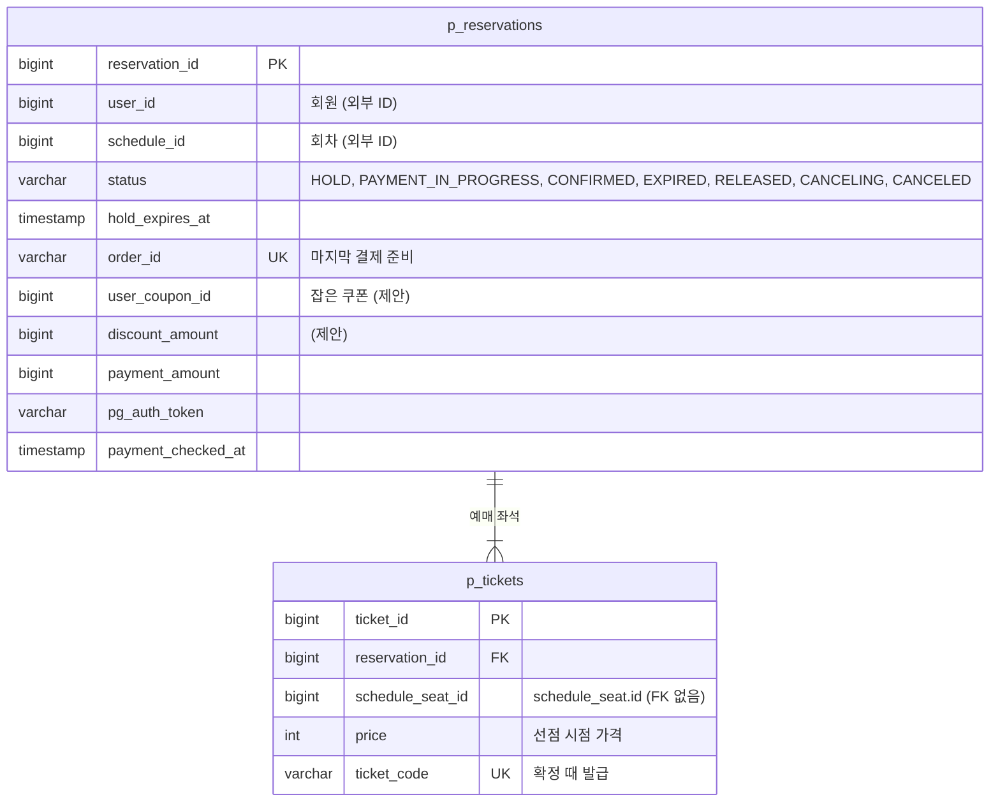

# 예매 테이블 명세

- 상태: 작성 중
- 담당: 지한얼
- DDL: `backend/sql/reservation-service/booking.sql` (`schema.sql` 다음에 적용한다, booking-decisions.md B27)
- 출처: Notion 테이블 명세서 "예매" 토글 (2026-10-26 기준)을 구현에 맞춰 고쳤다.

## 1. ERD

- `user_id`, `schedule_id`는 다른 서비스의 ID라 FK 없이 값만 둔다.
- `p_tickets.schedule_seat_id`가 가리키는 [schedule_seat](../seat/tables.md)은 좌석 담당 테이블이다. 모듈 경계를 지키려고 FK를 걸지 않는다.
- `user_coupon_id`가 가리키는 [p_user_coupons](../coupon/tables.md)는 같은 서비스의 쿠폰 담당 테이블이다. booking은 `CouponUsage`로만 쿠폰을 다룬다 (제안, #27).
- 감사 컬럼 6개는 ERD에서 뺐다.

## 2. 공통 사항

**소유 서비스: 예매 서비스(reservation-service), booking 담당.**

p_reservations, p_tickets는 booking이 소유한다.
예매 상태는 조건부 UPDATE로만 바꾸고, 좌석 상태와 같은 로컬 트랜잭션에서 함께 바꾼다.
payment 호출은 트랜잭션 밖에서 한다.
회원·공연·결제 데이터는 외부 ID로 참조하며 서비스 간 물리 FK를 만들지 않는다.

- PostgreSQL 16 기준이다. 식별자는 모두 BIGINT IDENTITY이고, 회원 ID도 회원 서비스에 맞춰 BIGINT다. 시각은 KST TIMESTAMP다.
- 물리 테이블 이름은 저장소 규칙대로 p_ 접두사를 붙인다.
- 테이블 이름에 스키마를 붙이지 않는다. 서비스 계정(reservation_app)의 기본 search_path인 reservation_schema에 만들어진다.
- 금액은 원 단위다.
- 삭제 API는 두지 않는다. 예매의 끝은 상태(EXPIRED, RELEASED, CANCELED)로 남긴다.
- 요청 밖 작업(선점 만료·결제 결과 확인 스케줄러)이 바꾼 행의 작성자는 SYSTEM이다.

**감사 컬럼**

p_reservations와 p_tickets는 BaseEntity 감사 컬럼 6개(created_at, created_by, updated_at, updated_by, deleted_at, deleted_by)를 가진다. 아래 표에는 반복하지 않는다.
조건부 UPDATE는 JPA 감사를 거치지 않으므로 updated_at·updated_by를 쿼리가 직접 채운다.

**합의할 항목**

| 항목 | 지금 구현 | 다른 문서·서비스 | 관련 |
| --- | --- | --- | --- |
| 상태 이름 | `CANCELING`·`CANCELED`로 확정했다. `CANCELLED`, `CANCEL_PENDING`, `CANCEL_REQUESTED`는 쓰지 않는다. `CANCELING`은 취소를 구현할 때 CHECK와 enum에 더한다 | ERD 명세서·결제 계약과 같다 | 해결 (T3) |
| hold_expires_at | 예매에 둔다. 결제 중에도 바꾸지 않는다 | schedule_seat에도 있다. 결제 중 좌석 쪽만 늘릴지, 이름을 locked_until·payment_deadline으로 나눌지 정한다 | S4 |
| 금액 타입 | payment_amount·discount_amount BIGINT | 공연·결제·티켓 가격은 INT | 팀 전체 |
| 화면 표시 정보 | 예매 번호, 공연 제목, 회차 시각, 좌석 위치 컬럼 없음 | ERD 명세서의 reservation_no, 내 예매 목록 표시 정보 | 공연 담당 |
| 쿠폰 컬럼 | user_coupon_id, discount_amount는 아직 DDL에 없다 | 쿠폰 호출을 구현할 때 더한다 | #27 |

## 3. p_reservations — 예매

좌석을 선점하면 같은 트랜잭션에서 HOLD로 만들어진다.
결제 시도 값(order_id, payment_amount, pg_auth_token)은 마지막 시도 하나만 둔다. 지난 시도의 기록은 payments에 남는다.
상태 전이는 [orchestration.md](orchestration.md) 4장을 따른다. `HOLD → PAYMENT_IN_PROGRESS → CONFIRMED`, `PAYMENT_IN_PROGRESS → HOLD / EXPIRED`, `HOLD → EXPIRED / RELEASED`, `CONFIRMED → CANCELING → CANCELED`다.

| 컬럼(영문) | 컬럼(한글) | 타입 | 제약·기본값 | 설명 |
| --- | --- | --- | --- | --- |
| reservation_id | 예매 식별자 | BIGINT | PK, NOT NULL, IDENTITY | DB가 만든다. |
| user_id | 예매자 식별자 | BIGINT | NOT NULL, 외부 참조 ID | 회원 서비스의 회원 ID. 요청 헤더에서 받는다. |
| schedule_id | 회차 식별자 | BIGINT | NOT NULL, 외부 참조 ID | 공연 서비스의 회차 ID. |
| status | 예매 상태 | VARCHAR(30) | NOT NULL, CHECK | HOLD / PAYMENT_IN_PROGRESS / CONFIRMED / EXPIRED / RELEASED / CANCELING / CANCELED. |
| hold_expires_at | 선점 만료 시각 | TIMESTAMP | NOT NULL | 이 시각 전에 결제 승인을 요청해야 한다. 결제 준비 때 payments.expires_at으로 보낸다. 결제 중에도 바꾸지 않는다. |
| order_id | 주문 번호 | VARCHAR(64) | NULL, UNIQUE | 마지막 결제 준비의 주문 번호. 준비 시도마다 새로 만든다. payments.order_id와 같은 값. 결제가 실패해 HOLD로 돌아가면 지운다(B21). |
| user_coupon_id | 사용 쿠폰 식별자 | BIGINT | NULL | 이 예매에 잡은 회원 쿠폰(p_user_coupons). 결제 준비에서 쿠폰을 고르면 기록하고, 쿠폰을 빼거나 예매가 끝나 쿠폰을 돌려주면 지운다. 확정 뒤에는 남긴다. (제안, DDL 미반영) |
| discount_amount | 할인 금액(원) | BIGINT | NULL | 쿠폰 할인액. 최소 결제 금액 아래로 내려가지 않게 자른 값. 결제 준비 요청의 discountAmount로 보낸다. (제안, DDL 미반영) |
| payment_amount | 결제 금액(원) | BIGINT | NULL | 결제 금액(티켓 가격 합계 - discount_amount). 준비 응답의 amount와 같아야 하고, 승인 요청에 이 값을 쓴다. |
| pg_auth_token | PG 인증값 | VARCHAR(255) | NULL | 결제창 인증 뒤 받은 값(토스 paymentKey, 카카오 pg_token). 결제 중에만 두고 결제 중을 벗어나면 지운다. 승인 요청을 다시 보낼 때 쓴다. |
| payment_checked_at | 결과 확인 시각 | TIMESTAMP | NULL | 결제 결과 확인 스케줄러가 마지막으로 확인한 시각. 확인한 예매를 다음 차례에서 뒤로 보낸다. |

**키·인덱스**

UK(order_id): 같은 주문 번호가 두 예매에 기록되지 않게 한다.
CHECK(status IN (HOLD, PAYMENT_IN_PROGRESS, CONFIRMED, EXPIRED, RELEASED, CANCELED)). `CANCELING`은 취소를 구현할 때 더한다.
INDEX(hold_expires_at) WHERE status = HOLD: 선점 만료 대상.
INDEX(updated_at) WHERE status = PAYMENT_IN_PROGRESS: 결제 결과 확인 대상.

**상태와 의미**

| 상태 | order_id | pg_auth_token | 의미 |
| --- | --- | --- | --- |
| HOLD | 준비 전이면 NULL, 준비 뒤 값 있음 | NULL | 좌석을 선점했고 결제 승인 전. 결제 실패로 돌아오면 order_id를 지우고 쿠폰은 유지한다. |
| PAYMENT_IN_PROGRESS | 필수 | 필수 | 승인을 요청하고 결과를 기다린다. 만료되지 않는다. |
| CONFIRMED | 필수 | NULL | 결제 성공, 좌석 판매 완료, 티켓 코드 발급, 쿠폰 사용. |
| EXPIRED | 준비했으면 값 있음 | NULL | 선점 시간 안에 결제를 마치지 못했다. 좌석 반환, 쿠폰 해제. |
| RELEASED | 준비했으면 값 있음 | NULL | 사용자가 선점을 직접 해제했다(B30). 좌석 반환, 쿠폰 해제. |
| CANCELING | 필수 | NULL | 외부 환불 호출 전에 커밋하는 취소 의도. 티켓은 쓸 수 없고 좌석은 그대로다 (취소 구현 때 추가). |
| CANCELED | 필수 | NULL | payment가 환불 요청을 접수했다. 좌석 반환, 쿠폰 복원. |

## 4. p_tickets — 예매 좌석(티켓)

예매가 담은 좌석 한 장이다.
선점할 때 예매와 함께 만들고, 좌석과 가격은 바꾸지 않는다. 만료·취소돼도 지우지 않는다.
좌석의 지금 상태와 지금 잡고 있는 예매는 schedule_seat이 가진다.
티켓이 유효한지는 예매 상태로 판단한다. 부분 취소가 생기면 티켓 상태를 더한다.
확정·만료 때 이 목록의 좌석을 id 오름차순으로 잠그고 판매·반환한다.

| 컬럼(영문) | 컬럼(한글) | 타입 | 제약·기본값 | 설명 |
| --- | --- | --- | --- | --- |
| ticket_id | 티켓 식별자 | BIGINT | PK, NOT NULL, IDENTITY | DB가 만든다. |
| reservation_id | 예매 식별자 | BIGINT | FK → p_reservations.reservation_id, NOT NULL | 티켓이 묶인 예매. |
| schedule_seat_id | 회차 좌석 식별자 | BIGINT | NOT NULL | schedule_seat.id. 모듈 경계를 지키려고 FK를 걸지 않는다. |
| price | 좌석 가격(원) | INT | NOT NULL, CHECK(price >= 0) | 선점 시점의 좌석 가격. 결제의 할인 전 금액(totalPrice)은 이 값의 합계다. |
| ticket_code | 티켓 코드 | VARCHAR(36) | NULL, UNIQUE | 예매가 확정될 때 발급한다. QR에 담는 값이다. |

**키·인덱스**

UK(reservation_id, schedule_seat_id): 한 예매에 같은 좌석이 두 번 들어가지 않는다.
UK(ticket_code): 티켓 코드가 겹치지 않는다.
FK(reservation_id) → p_reservations.reservation_id.
