# 좌석 테이블 명세

- 상태: 작성 중
- 담당:
- DDL: `backend/sql/reservation-service/schema.sql`
- 출처: Notion 테이블 명세서 3.9 (2026-10-26 기준). 담당자가 검토하며 고친다.

## 1. ERD

```mermaid
erDiagram
    schedule_seat {
        bigint id PK
        bigint schedule_id "공연 서비스 schedule.id, UK(schedule_id, venue_seat_id)"
        bigint venue_seat_id "공연 서비스 venue_seat.id"
        bigint venue_seat_grade_id "공연 서비스 venue_seat_grade.id 스냅샷"
        varchar grade_name "등급명 스냅샷"
        int base_price "가격 스냅샷, 판매 제외 좌석은 NULL 허용"
        boolean is_sellable
        varchar status "AVAILABLE, HOLD, SOLD"
        bigint reservation_id "예매 서비스 내부 참조"
        datetime hold_expires_at
        bigint config_version "schedule.seat_config_version과 대응"
        datetime created_at
        datetime updated_at
    }
```

- `schedule_id`, `venue_seat_id`, `venue_seat_grade_id`는 공연 서비스의 ID라 FK 없이 값만 둔다.
- `reservation_id`는 같은 예매 서비스의 예매를 가리킨다. 실제 ID 타입과 FK는 예매 담당자와 일치시킨다.

## 2. 공통 사항

**소유 서비스: 예매 서비스(reservation-service).**

schedule_seat은 예매 서비스가 소유한다.
공연 서비스 데이터(회차, 공연장 좌석, 고정 등급)는 외부 ID로 참조하며 서비스 간 물리 FK를 만들지 않는다.

## 3. schedule_seat — 회차 좌석

공연 서비스의 DB 테이블이 아니다.
공연장 좌석·고정 등급·공연 가격을 바탕으로 생성하는 회차별 판매 데이터다.
같은 물리 좌석이라도 회차마다 다른 행을 가지며, 선점·판매 상태를 독립적으로 관리한다.

| 컬럼(영문) | 컬럼(한글) | 타입 | 제약·기본값 | 설명 |
| --- | --- | --- | --- | --- |
| id | 회차 좌석 식별자 | BIGINT | PK, NOT NULL, AUTO_INCREMENT 제안 | 예매 서비스에서 생성하는 ID. 물리 좌석 ID와 다르다. |
| schedule_id | 공연 회차 식별자 | BIGINT | NOT NULL, 외부 참조 ID | 공연 서비스 `schedule.id`를 참조한다. 서비스 간 물리 FK는 두지 않는다. |
| venue_seat_id | 공연장 물리 좌석 식별자 | BIGINT | NOT NULL, 외부 참조 ID | 공연 서비스 `venue_seat.id`. 회차 내 같은 물리 좌석은 한 번만 생성한다. |
| venue_seat_grade_id | 공연장 고정 등급 식별자 | BIGINT | NOT NULL, 외부 ID 스냅샷 | 물리 좌석의 고정 등급을 복사한다. 회차에서 임의로 바꾸지 않는다. |
| grade_name | 좌석 등급명 스냅샷 | VARCHAR(20) | NOT NULL | VIP, R 등. 좌석 준비에 사용한 등급명. |
| base_price | 공연 기본 가격 스냅샷(원) | INT | 판매 대상은 NOT NULL, 0 이상. 판매 제외 좌석은 NULL 허용 | 해당 공연의 등급 가격을 복사한다. 쿠폰·할인·수수료 반영 전 금액. 제외된 등급에 공연 가격이 없으면 NULL로 저장한다. 가격 미입력을 0원으로 간주하지 않는다. |
| is_sellable | 판매 대상 여부 | BOOLEAN | NOT NULL | 공연 공통 제외 정책을 반영해 서버가 생성한다. false 좌석은 AVAILABLE이어도 선점 불가. 클라이언트가 변경할 수 없다. |
| status | 좌석 판매 상태 | VARCHAR(20) | NOT NULL DEFAULT AVAILABLE | AVAILABLE / HOLD / SOLD. 좌석 준비 시 AVAILABLE로 생성한다. |
| reservation_id | 현재 점유·구매 예매 식별자 | BIGINT | NULL 허용, 예매 서비스 내부 참조 | HOLD/SOLD에서는 현재 소유 예매 ID. AVAILABLE에서는 NULL. `reservation.id`와 같은 서비스의 관계이며 실제 ID 타입과 FK는 예매 담당자와 일치시킨다. |
| hold_expires_at | 선점 만료 시각 | DATETIME(3) | NULL 허용 | HOLD에서는 필수. 기본 선점 10분 유지안. AVAILABLE/SOLD에서는 NULL. 결제 진행 중 만료 연장 여부는 예매·결제 담당자 협의. |
| config_version | 좌석 생성 구성 버전 | BIGINT | NOT NULL, 1 이상 | 공연 서비스 `schedule.seat_config_version`과 대응. 오래된 생성 요청이 최신 데이터를 덮어쓰지 못하게 한다. |
| created_at | 생성 시각 | DATETIME(3) | NOT NULL, DEFAULT CURRENT_TIMESTAMP(3) | 예매 서비스 서버가 기록한다. |
| updated_at | 최종 변경 시각 | DATETIME(3) | NOT NULL, DEFAULT CURRENT_TIMESTAMP(3) | 예매 서비스가 선점·해제·판매 확정 시 갱신한다. |

**키·인덱스**

UK(schedule_id, venue_seat_id): 동일 회차 좌석 중복 생성 방지.
INDEX(schedule_id, is_sellable, status): 회차별 선택 가능 좌석 조회.
INDEX(status, hold_expires_at): 선점 만료 정리.
INDEX(reservation_id): 예매별 소유 좌석 확인.
최종 인덱스는 조회 계획과 부하 테스트로 확정한다.
논리적으로 참조하는 schedule·venue_seat·venue_seat_grade는 공연 서비스 소유다.

**상태와 정합성**

| 상태 | reservation_id | hold_expires_at | 의미 |
| --- | --- | --- | --- |
| AVAILABLE | NULL | NULL | 현재 점유·판매되지 않음. is_sellable=true인 좌석만 선점 가능. |
| HOLD | 현재 예매 ID 필수 | 필수 | 만료 전까지 해당 예매가 점유. 만료 시각이 지났다면 재선점 판정 가능. |
| SOLD | 구매 확정 예매 ID 필수 | NULL | 예매 확정 좌석. 다른 사용자가 선점할 수 없음. |

**선점·만료 처리**

선점은 좌석 상태·판매 대상 여부·만료 시각을 검사하는 원자적 조건부 UPDATE로 처리한다.
재선점은 hold_expires_at이 현재 시각 이하인 HOLD를 대상으로 한다.
예매 생성과 좌석 선점은 예매 서비스의 같은 로컬 트랜잭션으로 묶는다.
만료·해제 시 reservation_id가 해당 예매와 일치할 때만 좌석을 해제한다.
이전 예매 정리 작업이 새로운 사용자의 선점을 지우면 안 된다.
결제 확정도 현재 소유 예매 ID를 확인한 뒤 SOLD로 전환하고 `hold_expires_at`을 비운다.
결제 진행 중 연장·타임아웃·회차 취소와의 경합은 기존 협의 항목을 따른다.

**재생성·삭제**

DRAFT 변경으로 재생성할 때도 config_version을 확인한다.
선점·판매 이력이 있는 좌석을 초기 상태로 덮어쓰지 않는다.
취소는 회차 운영 상태와 별개로 전파하며, 좌석을 AVAILABLE로 바꿨다고 취소 회차를 다시 판매할 수 없다.
공개 이후 임의 삭제·좌석 수정 API는 제공하지 않는다.
등급·가격 스냅샷과 실제 티켓 가격 확정 시점은 예매 담당자가 최종 합의한다.
