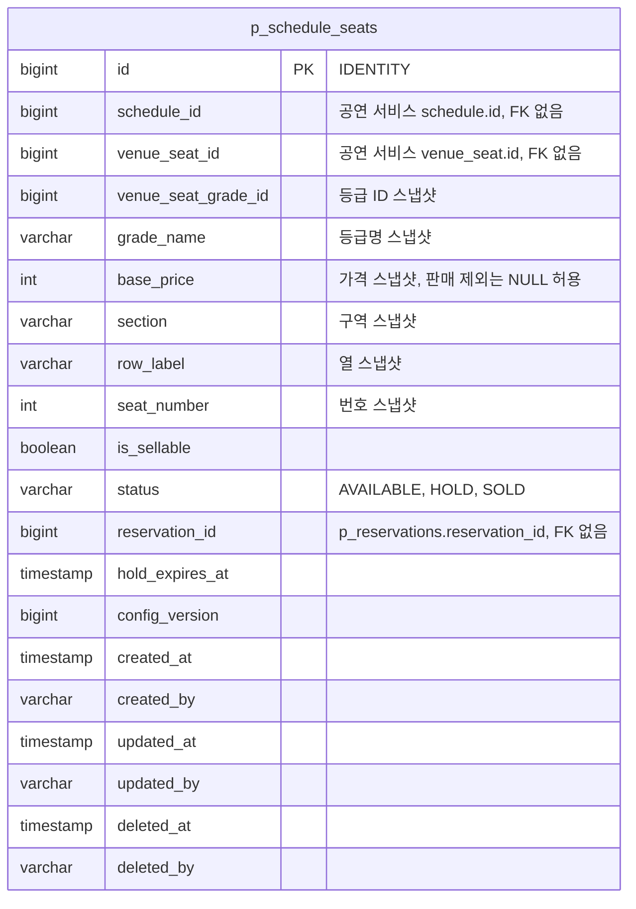

# 좌석 테이블 명세

- 상태: 작성 중
- 담당: 변정민
- DDL: `backend/sql/reservation-service/schema.sql` (아직 반영하지 않았다. 엔티티 구현 PR에서 함께 넣는다)
- 출처: Notion 테이블 명세서 "schedule_seat — 회차 좌석"과 "보고서 확정 계약 — 예매·좌석" (2026-10-27 기준)

## 1. ERD



- `schedule_id`, `venue_seat_id`, `venue_seat_grade_id`는 공연 서비스의 ID라 FK 없이 값만 둔다.
- `reservation_id`는 같은 서비스의 booking 모듈 예약을 가리키지만, 모듈 경계를 지키려고 FK를 두지 않는다.
- booking의 `p_tickets.schedule_seat_id`가 이 테이블의 `id`를 가리킨다. 그쪽도 FK가 없다.

## 2. 공통 사항

**소유: reservation-service seat 모듈(좌석 담당).** 공연 서비스의 테이블이 아니다. 공연장 좌석·고정 등급·공연 가격을 바탕으로 만드는 회차별 판매 데이터다. 같은 물리 좌석이라도 회차마다 다른 행을 가지며 선점·판매 상태를 따로 관리한다.

- DB: PostgreSQL 16. 물리 테이블 이름은 저장소 규칙대로 `p_` 접두사와 복수형을 쓴다.
- 식별자: BIGINT, `GENERATED ... AS IDENTITY`.
- 시각: KST `TIMESTAMP`. API에서는 `+09:00` ISO 8601로 표현한다. DB·서버·드라이버 시간대를 맞춘다.
- 금액: 원 단위 INT. 통화는 KRW 고정이라 통화 컬럼이 없다.
- 감사 컬럼: 팀 `BaseEntity`를 상속해 `created_at`, `created_by`, `updated_at`, `updated_by`, `deleted_at`, `deleted_by` 6개를 가진다. 조건부 UPDATE·잠금 후 벌크 변경은 JPA Auditing을 거치지 않으므로 쿼리가 `updated_at`·`updated_by`를 직접 채운다. 작성자 값을 채우는 방식은 [plan.md 열린 질문](plan.md#7-열린-질문) 2를 본다.
- 논리 삭제: Entity에 `@SQLRestriction("deleted_at IS NULL")`을 붙인다. 공개 이후 좌석 삭제 API는 제공하지 않는다.

## 3. p_schedule_seats — 회차 좌석

| 컬럼(영문) | 컬럼(한글) | 타입 | 제약·기본값 | 설명 |
| --- | --- | --- | --- | --- |
| id | 회차 좌석 식별자 | BIGINT | PK, NOT NULL, IDENTITY | 예매 서비스가 만드는 ID. 물리 좌석 ID와 다르다. |
| schedule_id | 공연 회차 식별자 | BIGINT | NOT NULL, 외부 참조 ID | 공연 서비스 `schedule.id`. FK 없음. |
| venue_seat_id | 공연장 물리 좌석 식별자 | BIGINT | NOT NULL, 외부 참조 ID | 공연 서비스 `venue_seat.id`. 회차 안에서 같은 물리 좌석은 한 번만 만든다. |
| venue_seat_grade_id | 공연장 고정 등급 식별자 | BIGINT | NOT NULL, 외부 ID 스냅샷 | 물리 좌석의 고정 등급을 복사한다. 회차에서 바꾸지 않는다. |
| grade_name | 좌석 등급명 스냅샷 | VARCHAR(20) | NOT NULL | VIP, R 등. 좌석 준비에 쓴 등급명. |
| base_price | 공연 기본 가격 스냅샷(원) | INT | 판매 대상은 NOT NULL, 0 초과. 판매 제외 좌석은 NULL 허용 | 해당 공연의 등급 가격을 복사한다. 쿠폰·할인·수수료 반영 전 금액. 가격 미입력을 0원으로 보지 않는다. |
| section | 좌석 구역 스냅샷 | VARCHAR(20) | NOT NULL | 좌석 조회용 위치 복제. 공개 후 바꾸지 않는다. |
| row_label | 좌석 열 스냅샷 | VARCHAR(10) | NOT NULL | 좌석 조회용 위치 복제. 공개 후 바꾸지 않는다. |
| seat_number | 좌석 번호 스냅샷 | INT | NOT NULL, 0 초과 | 좌석 조회용 위치 복제. 공개 후 바꾸지 않는다. |
| is_sellable | 판매 대상 여부 | BOOLEAN | NOT NULL | 공연 공통 제외 정책을 반영해 서버가 만든다. false 좌석은 AVAILABLE이어도 선점할 수 없다. 클라이언트가 바꿀 수 없다. |
| status | 좌석 판매 상태 | VARCHAR(20) | NOT NULL, DEFAULT 'AVAILABLE' | AVAILABLE / HOLD / SOLD. 좌석 준비 때 AVAILABLE로 만든다. |
| reservation_id | 현재 점유·구매 예약 식별자 | BIGINT | NULL 허용, FK 없음 | HOLD·SOLD에서는 현재 소유 예약 ID, AVAILABLE에서는 NULL. |
| hold_expires_at | 선점 만료 시각 | TIMESTAMP | NULL 허용 | HOLD에서는 필수(선점 시각 + 10분, 공용 `Clock` 기준). AVAILABLE·SOLD에서는 NULL. 예약의 `p_reservations.hold_expires_at`과 같은 값이며 결제 중에도 바꾸지 않는다. |
| config_version | 좌석 생성 구성 버전 | BIGINT | NOT NULL, 1 이상 | 공연 서비스 `schedule.seat_config_version`과 대응한다. 오래된 생성 요청이 최신 데이터를 덮어쓰지 못하게 한다. |
| created_at ~ deleted_by | 감사 컬럼 6개 | | | 2장 공통 사항. |

**키·인덱스**

UK(schedule_id, venue_seat_id): 같은 회차 좌석 중복 생성 방지.
INDEX(schedule_id, is_sellable, status): 회차별 선택 가능 좌석 조회.
INDEX(status, hold_expires_at): 만료 HOLD 조회.
INDEX(reservation_id): 예약별 소유 좌석 확인.
최종 인덱스는 조회 계획과 부하 테스트로 확정한다.

**상태와 정합성**

| 상태 | reservation_id | hold_expires_at | 의미 |
| --- | --- | --- | --- |
| AVAILABLE | NULL | NULL | 점유·판매되지 않음. `is_sellable = true`인 좌석만 선점할 수 있다. |
| HOLD | 현재 예약 ID 필수 | 필수 | 만료 전까지 해당 예약이 점유한다. 만료 시각이 지났고 그 예약이 결제 중(PAYMENT_IN_PROGRESS)이 아니면 다시 선점할 수 있다. |
| SOLD | 구매 확정 예약 ID 필수 | NULL | 예매 확정 좌석. 다른 사용자가 선점할 수 없다. |

**선점·만료 처리**

- MVP는 좌석 행을 비관적 락(`SELECT ... FOR UPDATE`)으로 잠근 뒤 상태·판매 대상 여부·만료 시각을 확인해 선점한다. 트러블슈팅 기간에 조건부 UPDATE·NOWAIT·Redis 방식과 비교한다.
- 잠금 순서는 좌석 ID 오름차순 → 예약이다. booking의 확정·만료도 같은 순서를 쓴다.
- 재선점은 `hold_expires_at <= now`이고 그 좌석의 예약이 PAYMENT_IN_PROGRESS가 아닌 HOLD를 대상으로 한다. 예전 예약은 같은 트랜잭션에서 EXPIRED로 정리한다.
- 결제 시작과 재선점의 경합은 조건부 UPDATE로 한쪽만 성공시킨다. booking의 결제 시작은 `status = HOLD AND hold_expires_at > :now`, seat의 예전 예약 정리는 `status = HOLD AND hold_expires_at <= :now`일 때만 바꾼다.
- `now`는 DB `now()`가 아니라 seat·booking이 함께 쓰는 `Clock` 빈(`ClockConfig`)에서 읽어 쿼리 인자로 넘긴다. 두 모듈이 같은 시계를 써야 경계가 겹치지 않고, 테스트에서 `MutableClock`으로 만료 경계를 만들 수 있다. 서버 여러 대의 시계는 NTP로 맞춘다([#34](https://github.com/Good-Ticket-Service/ticket/issues/34) 쟁점 1).
- 만료·해제는 `reservation_id`가 해당 예약과 일치할 때만 좌석을 푼다. 이전 예약의 정리 작업이 새 사용자의 선점을 지우면 안 된다.
- 결제 확정도 현재 소유 예약 ID를 확인한 뒤 SOLD로 바꾸고 `hold_expires_at`을 비운다.
- 만료 정리 스케줄러는 booking이 10초 주기로 돌린다.

**컬럼이 바뀌는 시점**

| 작업 | 주체 | 조건 | 바뀌는 값 |
| --- | --- | --- | --- |
| 좌석 준비(최초) | seat | 해당 회차 좌석 없음 | 행 생성(AVAILABLE), 완료 이벤트 발행 |
| 좌석 준비(같은 버전) | seat | 이미 처리한 요청 | 변경 없음, 완료 이벤트 재발행 |
| 좌석 준비(오래된 버전) | seat | 요청 버전 < 현재 | 무시, 발행 안 함 |
| 좌석 재준비 | seat | 요청 버전이 더 크고 모든 좌석 AVAILABLE | 행 교체, 완료 이벤트. 아니면 실패 이벤트 |
| 선점 | seat | `is_sellable = true`, AVAILABLE 또는 만료됐고 예약이 결제 중이 아닌 HOLD | HOLD, reservation_id, hold_expires_at |
| 결제 확정 | booking → `SeatFacade.sell` | HOLD이고 reservation_id 일치 | SOLD, hold_expires_at = NULL |
| 선점 해제 | seat (예약 상태는 `BookingFacade`) | 본인 HOLD 예약, reservation_id 일치 | AVAILABLE, reservation_id·hold_expires_at = NULL. 예약은 RELEASED(만료 후면 EXPIRED) |
| 만료·취소 | booking → `SeatFacade.release` | reservation_id 일치 | AVAILABLE, reservation_id·hold_expires_at = NULL |

좌석 준비 저장은 한 트랜잭션에서 전부 반영하거나 전부 반영하지 않는다. 같은 회차 이벤트는 scheduleId 파티션 키로 순서대로 처리한다.

**재생성·삭제**

- DRAFT 변경으로 재생성할 때도 `config_version`을 확인한다. 선점·판매 이력이 있는 좌석을 초기 상태로 덮어쓰지 않는다.
- 회차 취소는 회차 운영 상태와 별개로 전파한다. 좌석을 AVAILABLE로 바꿨다고 취소 회차를 다시 판매할 수 없다.
- 가격은 좌석 준비 `base_price` → 선점 판매 검증 → `p_tickets.price` 복사 순서로 확정된다.

## 4. 다른 모듈 테이블과의 관계 (참고)

이 절의 테이블은 booking 소유라 여기서는 언급만 한다. 정의는 [reservation/tables.md](../reservation/tables.md)를 따른다.

- 1인 1장 제한의 DB 최종 방어는 예약 테이블의 부분 UNIQUE다. 위반하면 seat는 제약 이름을 확인해 선점 트랜잭션 전체를 롤백하고 409 `PURCHASE_LIMIT_EXCEEDED`로 응답한다. JPA `ddl-auto`로는 부분 인덱스가 만들어지지 않으므로 `schema.sql`에 DDL이 필요하다.

```sql
CREATE UNIQUE INDEX uk_p_reservations_active_user_schedule
ON p_reservations(user_id, schedule_id)
WHERE status IN ('HOLD', 'PAYMENT_IN_PROGRESS', 'CONFIRMED', 'CANCELING');
```

- `p_tickets.schedule_seat_id` → `p_schedule_seats.id` (FK 없음). 티켓 가격은 선점 때 seat가 넘긴 `base_price` 스냅샷이다.

## 5. 나중에 추가할 것

| 대상 | 시기 | 내용 |
| --- | --- | --- |
| `version` 컬럼 | 트러블슈팅 | 낙관적 락과 비교할 때 ALTER로 추가한다. MVP 컬럼에는 넣지 않는다. |
| `outbox_event` | 트러블슈팅 | 좌석 준비 결과 이벤트 유실 방지. 좌석 저장과 같은 트랜잭션에 기록하고 별도 발행기가 보낸다. |
| `processed_event` | 트러블슈팅 | 멱등 소비. 같은 요청이 다시 오면 처리하지 않고 이전 결과를 재발행한다. |

MVP는 `config_version` 비교와 UK(schedule_id, venue_seat_id)로 중복 생성을 막는다. `outbox_event`·`processed_event`를 reservation-service 공용으로 둘지는 예매 담당과 협의한다.
