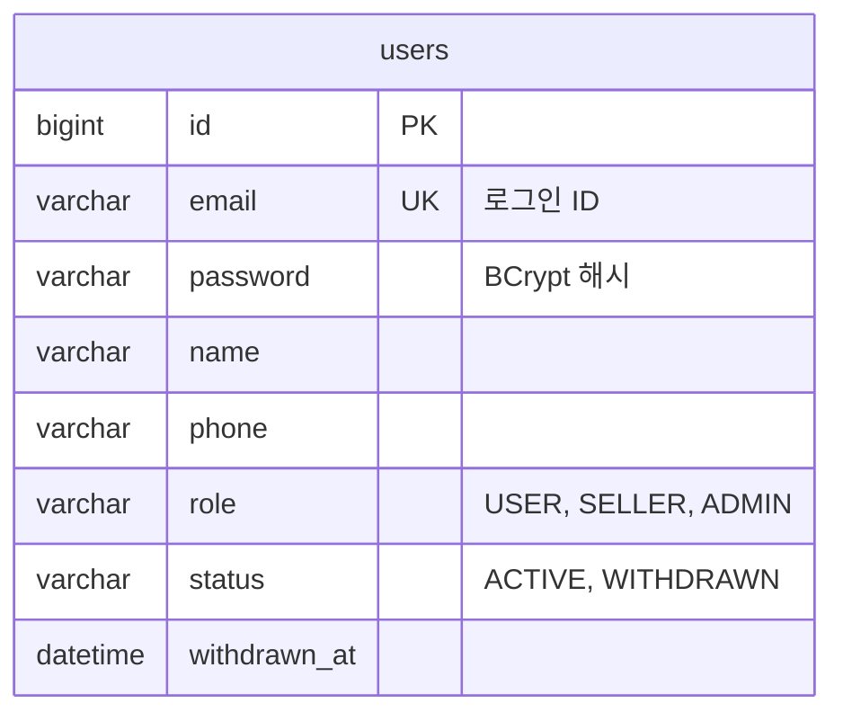

# 회원 테이블 명세

- 상태: 작성 중
- 담당:
- DDL: `backend/sql/user-service/schema.sql`
- 출처: Notion 테이블 명세서 users (2026-10-26 기준). 담당자가 검토하며 고친다.

## 1. ERD

- 다른 서비스는 회원 ID를 FK 없이 값만 둔다.

## 2. 공통 사항

users는 회원 서비스(user-service)가 소유한다.

## 3. users — 회원

| 컬럼 | 타입 | 제약 | 설명 |
| --- | --- | --- | --- |
| id | BIGINT | PK | 회원 ID |
| email | VARCHAR(100) | NOT NULL, UK | 로그인 ID (제안) |
| password | VARCHAR(255) | NOT NULL | BCrypt 해시 |
| name | VARCHAR(50) | NOT NULL | 이름 |
| phone | VARCHAR(20) | NOT NULL | 전화번호 |
| role | VARCHAR(20) | NOT NULL | USER / SELLER / ADMIN |
| status | VARCHAR(20) | NOT NULL | ACTIVE / WITHDRAWN. WITHDRAWN이면 로그인 차단 |
| withdrawn_at | DATETIME | NULL | 탈퇴 시각. 1년 뒤 개인정보 파기 기준 |

**상태값**

| 컬럼 | 값 | 의미 | 바뀌는 때 |
| --- | --- | --- | --- |
| role | USER | 일반 회원. 예매·결제·취소 가능 | 가입 시 기본값 |
| role | SELLER | 판매자. 본인 공연·회차·가격 등록 가능 | 관리자가 권한 부여 (ADMIN-02) |
| role | ADMIN | 관리자. 공연장 등록, 회차 취소, 쿠폰 생성, 회원 관리 | 초기 데이터로 지정 (제안) |
| status | ACTIVE | 정상 회원 | 가입 시 |
| status | WITHDRAWN | 탈퇴한 회원. 로그인만 막고 정보는 1년 보유 | 회원 탈퇴 (AUTH-06) |
